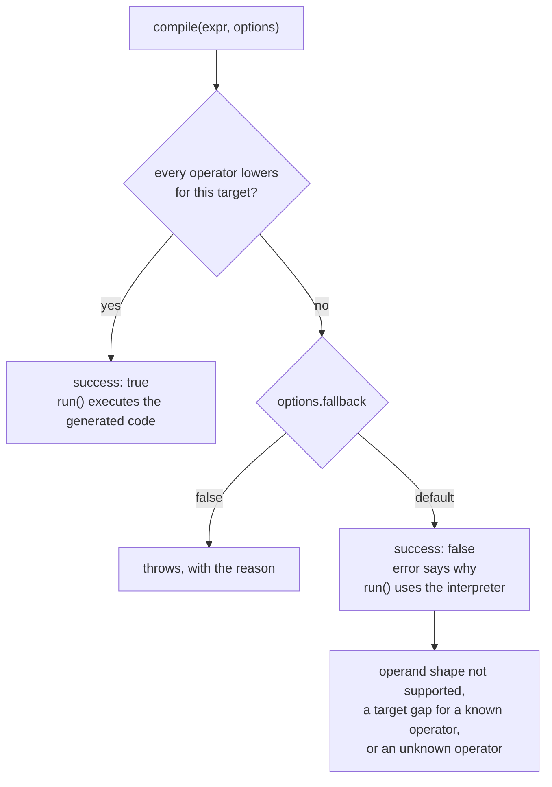

<Intro>
The Compute Engine can compile **LaTeX expressions** to **JavaScript functions**!
</Intro>

## Introduction

Some expressions can take a long time to evaluate numerically, for example if
they contain a large number of terms or involve a loop \\((\sum\\) or
\\(\prod\\)).

In this case, it is useful to compile the expression into a JavaScript function
that can be evaluated much faster.

For example this approximation: $ \pi \approx \textstyle\sqrt{6\sum^{10^6}_{n=1}\frac{1}{n^2}} $

```live
// import { parse, compile } from '@cortex-js/compute-engine';
const expr = parse("\\sqrt{6\\sum^{10^5}_{n=1}\\frac{1}{n^2}}");

// Numerical evaluation using the Compute Engine
console.time('evaluate');
const evaluated = expr.evaluate();
console.timeEnd('evaluate');
console.log(evaluated.toString());

// Compilation to a JavaScript function and execution
console.time('compile');
const result = compile(expr);
console.timeEnd('compile');
console.log(result.run?.());
```

## Compiling

**To get a compiled version of an expression** use the `compile()` function:

```javascript
import { compile } from '@cortex-js/compute-engine';

const f = compile("2\\prod_{n=1}^{\\infty} \\frac{4n^2}{4n^2-1}");
```

**To evaluate the compiled expression** call the `run` method on the
`CompilationResult` returned by `compile()`:

```javascript
console.log(f.run());
// ➔ 3.141592653589793
```

If the expression cannot be compiled, the `result.success` property will be
`false`.

### Which Targets Are Registered

The `to` option of `compile()` names a target registered on the expression's
engine. Which targets an engine has depends on the package entries the program
loads:

| Entries loaded in the program | Targets of every engine |
|---|---|
| `@cortex-js/compute-engine` (the full entry), `…/epsil`, or the `epsil` CLI, with or without `…/core` | `javascript`, `interval-js`, `glsl`, `python` |
| `@cortex-js/compute-engine/core` only | `javascript`, `interval-js` |

The `javascript` and `interval-js` targets are part of every engine: the engine
uses them itself (the `Map` auto-compile, the numeric integration and
differentiation kernels, the solver's domain enumeration). The GPU and Python
targets are bundled in the full entry, not in `core`; once the full entry is
loaded anywhere in the program, every engine resolves them, including an engine
made earlier from `core`. In a program that loads only `core`, import the class
of the target you need from `@cortex-js/compute-engine/compile` and register
it:

```javascript
import { ComputeEngine } from '@cortex-js/compute-engine/core';
import { compile, GLSLTarget, PythonTarget } from '@cortex-js/compute-engine/compile';

const ce = new ComputeEngine();
ce.registerCompilationTarget('glsl', new GLSLTarget());
ce.registerCompilationTarget('python', new PythonTarget({ includeImports: true }));

const shader = compile(ce.box(['Sin', 'x']), { to: 'glsl' });
```

A target name that is not registered fails with an error that lists the
registered names. `ce.unregisterCompilationTarget(name)` removes a target.

### Validation and Fallback Behavior

Compilation APIs enforce runtime contracts to catch malformed extension payloads
early:

- `ce.registerCompilationTarget(name, target)` validates target names and
  required `LanguageTarget` methods (`getOperators()`, `getFunctions()`,
  `createTarget()`, `compile()`).
- `compile(expr, options)` validates option payload shape for `to`, `target`,
  `operators`, `functions`, `vars`, `imports`, `preamble`, `fallback`, and
  `constantFold`.

By default, `compile()` falls back to interpretation (`success: false` with a
`run` function). To disable fallback and fail fast, set `fallback: false`.



The three reasons are described under
[Why a compilation declined](#why-a-compilation-declined).

### The `run()` Contract: Shaped Inputs, Read-Only Results

On the `javascript` target, `run()` requires inputs of the shape the compiled
code reads, and treats its results as read-only. The runner does a constant
amount of work per binding on each call, one `typeof`:

- a `{re, im}` value bound to a real binding throws a `TypeError` that names
  the binding (the unsigned pole `~oo` is projected to `Infinity` instead);
- a plain number bound to a complex binding is lifted to `{re, im: 0}`;
- a string or a typed array (`Float64Array`, …) bound to a binding the code
  reads as an array is refused: the compiled code reads plain arrays only, so
  convert a typed array once on your side with `Array.from(typed)`.

The string refusal applies to a binding declared with a bare collection type
(`indexed_collection`, `collection`, `list`), with a collection of non-text
elements (`list<number>`), with `list<string>` or `list<character>`, or whose
collection type the engine inferred from its uses. Compiled code would read
the string as UTF-16 code units, not as characters, so the `TypeError` names
the binding and says so. A binding whose type admits a string (`string`,
`indexed_collection<character>`) is not refused. These entry checks are on by
default; `compile(expr, { entryChecks: false })` turns them off, for a caller
that validates its own inputs.

```javascript
ce.declare('S', 'indexed_collection');
const f = compile(ce.box(['Length', ['Drop', 'S', 1]]));
f.run({ S: 'abc' });
// ➔ throws TypeError: "S" (type `indexed_collection`) is compiled as a
//   JavaScript array, and compiled code does not accept a string for it: it
//   would read the string as UTF-16 code units, not as characters. Pass an
//   array, or declare the binding `string` to compile text.
```

A number bound to a binding declared as a list is not refused at entry, since
some lowerings accept a scalar. When the compiled body then fails because it
needed an array, the error names the binding and keeps the body's message as
its `cause`:

```javascript
ce.declare('S', 'list<number>');
compile(ce.box(['Sum', 'S'])).run({ S: 5 });
// ➔ throws TypeError: "S" (type `list<number>`) received a number: compiled
//   code reads such a binding as a JavaScript array, and the compiled body
//   failed (_.S.reduce is not a function). Pass an array.
```

Nothing else is checked, converted, or copied:

- a value of another type is not refused, and the result is undefined: it
  can differ from the value of the interpreter, and between targets. With
  `x` declared `real`, `x + 1` gives `2` for `x = true` and `"ab1"` for
  `x = "ab"`. See [Supplying Inputs](#supplying-inputs);
- the entries of a list input are never read. A `{re, im}` object, a string
  or a typed array at an entry of a list the code reads on the real lane
  computes with that value, as it would in plain JavaScript;
- a returned collection or `{re, im}` object is the value the code built. It
  may be a value the runner keeps for every later call (a hoisted constant
  list, a bound symbol value), so do not write to a result: copy it first if
  you need to change it.

The result convention is kept: a value whose imaginary part is exactly zero
comes back as a plain number, inside a collection too, and a collection is
copied only when such a cell has to be rewritten. That check is one `typeof`
per cell of a returned collection, with no allocation.

The interpreter is the route that validates: evaluate the expression with
`.evaluate()` or `.N()` to diagnose a wrong input shape.

```typescript
const fn = compile(expr, { to: 'javascript' }).run!;
const T = Array.from(float64Board); // convert a typed array once
const v = fn({ x, y, T });          // no per-call walk, copy or check of T
```

### Running Compiled Code Without the Engine

The entry point `@cortex-js/compute-engine/runtime` exports
`createJavaScriptRuntime(options)`: the helper bundle that `run()` uses, with
no engine behind it. Store a `javascript` `CompilationResult` and run it on a
page, in a worker or on a server with `runtime.load(result)`:

```typescript
import { compile } from '@cortex-js/compute-engine';
import { createJavaScriptRuntime } from '@cortex-js/compute-engine/runtime';

const result = compile(ce.parse('x^2 + 1'), { to: 'javascript' });

const runtime = createJavaScriptRuntime({});
const f = runtime.load(result);
f({ x: 3 });
// ➔ 10
```

`load()` reads the `code`, `entryPlan`, `reconstructionDigits` and
`runtimeVersion` fields of the result, and the `preambleOnce`,
`preamblePerCall` and `callCode` fields when the code has a preamble. It
evaluates the definitions that read nothing per call (a constant list, a
memo) once, and it applies the same input steps as `run()`: a number given
for a complex binding is lifted, `~oo` given for a real binding is projected
to `Infinity`, another `{re, im}` value given for a real binding is refused,
and a string or a typed array given for a binding read as an array is
refused. `load()` throws when `result.runtimeVersion` is not
`runtime.runtimeVersion`, or when the stored code has none.

To run the stored code on a worker pool, the runtime entry also exports
`createKernelPool`, and `runtime.loadBroadcastAsync(result, { workers })`
returns the `broadcastAsync()` of the result: the same options (`out`,
`deadline`, `signal`, `chunk`, `inline`) and the same result (`done`, `route`,
`reason`), with `willUsePool(cells)` and `shippable`. The pool workers run the
entry `@cortex-js/compute-engine/kernel-worker`, so a worker that loads
stored code does not import the engine bundle.

```typescript
import {
  createJavaScriptRuntime,
  createKernelPool,
} from '@cortex-js/compute-engine/runtime';

const workers = createKernelPool({
  create: () =>
    new Worker(
      new URL('@cortex-js/compute-engine/kernel-worker', import.meta.url),
      { type: 'module' }
    ),
});
const run = createJavaScriptRuntime().loadBroadcastAsync(stored, { workers });
const { out, done, route } = await run({ x: xs }, { deadline: 100 });
```

Store the whole result, for example as `JSON.stringify(result)`, not only
the fields that `load()` reads. `loadBroadcastAsync()` sends a batch to a
worker only when the stored result has `shippable: true`. A host that copies
some fields and leaves out `shippable` gets every batch on the calling
thread, with `reason: 'not-shippable'` and no error. `workers` must be a pool
from `createKernelPool()`: another value throws a `TypeError`. The stored
fields are copied when the code is loaded, so load it again after a change.

The runtime exposes `load`, `frame`, `setFrame`, `iterationLimit`, `deadline`
and `runtimeVersion`. The other helpers are internal and can change in any
release. The options give the runtime the state it cannot read from an engine:

- `random`: the source of random draws outside a `WithRandomSeed` frame, and
  of the Monte-Carlo samples of the integrals. `null` denies draws; a draw
  then throws an error whose `name` is `CapabilityDeniedError` (test `e.name`,
  not `instanceof`: the class differs in each bundle).
- `frame`, or `runtime.setFrame()`: the frame of an interpreted
  `WithRandomSeed` that the code is called from (`{ seedLo, seedHi, next }` or
  `{ seed, next }`). After the call, `runtime.frame.next` is the advanced
  counter.
- `iterationLimit`: the cap on the lazy-stream walks (default 1024; `0` or
  less means no limit, as for `ce.iterationLimit`).
- `deadline`: an optional time after which the shuffle and choice loops throw.

A seeded program gives the same values interpreted, with `run()` and from the
stored code. Functions passed in the `functions` or `imports` compile options
are copied into the code as source, so a closure loses its enclosing scope,
and a function given by name must exist where the code runs.

### Evaluating Many Points at Once: `broadcast()`

A plotter samples a function once per pixel column, or once per cell of an
implicit plot, and `run()` converts its argument object and wraps its result
on every call. `broadcast(inputs, options)` takes the inputs of every cell at
once and writes every result into one `Float64Array`: the conversions run once
per batch, the compiled body once per cell. Measured 2026-10-20: 20 % faster
than `run()` per cell on the main thread, and the batch is what a worker
thread receives (below). It is present on a `javascript` result compiled from
an expression (`calling: 'expression'`) and on an `interval-js` result
compiled from an expression.

```javascript
const f = compile(ce.parse('\\sin(x)\\cos(y) + a'));

const xs = new Float64Array([0, 0.5, 1]);
const ys = new Float64Array([0, 1]);

// Six cells: the two arrays are the axes of a grid, `x` varying fastest.
f.broadcast({ x: xs, y: ys, a: 0.5 }, { layout: 'grid' });
// ➔ Float64Array [0.5, 0.979…, 1.341…, 0.5, 0.759…, 0.954…]

// Three cells: every array holds one value per cell.
f.broadcast({ x: xs, y: new Float64Array([1, 1, 1]), a: 0.5 });
```

**Inputs.** `inputs` maps each free variable to a `Float64Array` or to a
number. A number is the same value for every cell (a document variable). With
the default layout, `'cells'`, every array holds one value per cell (for
`interval-js`, a `lo, hi` pair per cell) and all have the same cell count.
With `layout: 'grid'` the arrays are the axes of a regular grid, in key order
of `inputs`, the first varying fastest; the cell count is the product of their
lengths and nothing is expanded on the caller's side. `options.out` is a
caller-owned output array, filled and returned instead of a new one; it must
hold at least `outputs` values per cell (below).

**Index axes** (`grid` layout only). A variable that `options.indexes` names
is an axis whose value at each cell is the cell's position along that axis.
Its input is the axis length `n`, a non-negative integer, and the variable
takes the values `0, 1, …, n − 1`. The axis has its place in key order of
`inputs`, as a column `0 … n − 1` would, but no column is built, sent to a
worker or read. A kernel that reads a shared list by cell position declares
the index with a type such as `integer<0..>`; the values that the engine gives
are then in range by construction:

```javascript
ce.declare('F', 'list<number>');
ce.declare('m', 'integer<0..>');
ce.declare('n', 'integer<0..>');
const g = compile(ce.parse('F_{m + 4n + 1}'));

// 3 × 2 cells, `m` varying fastest: the same values as the columns
// m: [0, 1, 2] and n: [0, 1].
const F = [10, 11, 12, 13, 14, 15, 16, 17];
g.broadcast({ m: 3, n: 2, F }, { layout: 'grid', indexes: ['m', 'n'] });
// ➔ Float64Array [10, 11, 12, 14, 15, 16]
```

For `interval-js`, an index axis gives the point interval of each index. A
name in `indexes` must be a key of `inputs` and must not be a shared input;
with the `cells` layout the option throws.

**Shared inputs** (`javascript` only). An input can also be bound once for the
whole batch and read by index in the expression, for example the field values
of a grid that each cell reads around its own index:

```javascript
ce.declare('F', 'list<number>');
ce.declare('i', 'integer');
const f = compile(ce.parse('F_{i+1}'));

f.broadcast({ i: new Float64Array([0, 1, 2]), F: [1, 2, 3, 4] });
// ➔ Float64Array [1, 2, 3]
```

A variable is shared when the compiled code reads it as a list (its declared
type is a list type), or when `options.shared` names it: `{ shared: ['G'] }`
is the way to share a variable that has no declared type. Each name in
`shared` must be a key of `inputs`. A shared input is a plain array of numbers
or a `Float64Array`. A shared input is not a column of the `cells` layout and
not an axis of the `grid` layout: it does not count toward the cells. A plain
array for any other variable throws.

**Batch body and declared types.** When the compiled code reads a shared list
declared as a list of numbers at a scalar index (`F_{i+1}` with
`F: list<number>`) and the caller compiled with `broadcast: true`, the result
carries a second body for batches. The batch body is a second compilation of
the same size as the first (it adds about 45 % to the compile time of such a
kernel, measured 2026-10-25), so it is built only on request: a caller that
only calls `run()` keeps the default, `false`, and a caller that broadcasts a
kernel over many cells asks for it. Without it, `broadcast()`,
`broadcastAsync()` and a kernel worker run the ordinary body for every cell,
with the same values. The batch
checks each such list once (a `Float64Array`, or a plain array whose elements
are all numbers; a plain array that passed is not checked again while its
length is the same), reads a `Float64Array` in place, and reads the list
directly in each cell. A declared type of an input is a promise of the host,
and the batch body trusts it: when the index type proves an integer of at least
1 (for example `i + 1` with `i` declared `integer<0..>`), the read has no
run-time test, and a read past the end gives `NaN`, as `At` does. When an input
breaks its declared type (a fractional `i` for `integer<0..>`, a string in a
list declared `list<number>` after it was checked), the result is not defined.
When a list fails the check, the whole batch runs the ordinary body. Declare
the index with its range: a kernel that reads `F_{i+1}` with `i: integer<0..>`
runs about 1.7 times as fast as with `i: integer` (measured 2026-10-24, 250 000 cells, two reads per cell).

**Output of a `javascript` result.** One value per cell by default. A boolean
is `1` or `0`; a complex value with a zero imaginary part is its real part; a
cell whose evaluation throws, or gives any other non-number (a complex value
with a non-zero imaginary part, a list), is `NaN`. Cell for cell, the value is
the one `run()` gives: the same compiled body runs with the same conversions.
A length mismatch throws before the loop. A variable left out, or a value
outside its declared type (a boolean for a variable declared `real`), is not
refused: the result is undefined. With `a` left out, the example above gives
`NaN` in every cell.

**Several outputs per cell.** An expression whose type is a tuple of two or
more elements that can be numbers writes that many values per cell into the
same output array. An element typed `unknown` counts: `(x, y)` with undeclared
`x` and `y` writes two values per cell. An element that cannot be a number,
such as a string, gives one value per cell. With
`m` values per cell, cell `c` is at `[m·c, m·c + m)`. The result reports the
inferred `m` as `broadcastOutputs` (absent when it is 1), and
`options.outputs` (a positive integer) overrides it.

```javascript
const g = compile(ce.parse('(i, 2i)'));
g.broadcastOutputs;                                 // ➔ 2
g.broadcast({ i: new Float64Array([1, 2, 3]) });
// ➔ Float64Array [1, 2,  2, 4,  3, 6]
```

With more than one value per cell, the elements of an array answer go through
the conversions above one by one; an element past the end of the array is
`NaN`, and an answer that is not an array, or a cell that throws, is `NaN` in
every slot. With one value per cell (`outputs: 1`), an array answer is `NaN`,
as before. `shared` and `outputs` are `javascript` options: an `interval-js`
result throws a `TypeError` for either.

**Output of an `interval-js` result.** A `lo, hi, kind` triple per cell, at
offsets `3·i`, `3·i + 1` and `3·i + 2`. The kinds are the `INTERVAL_KIND`
codes, exported from the main entry and from
`@cortex-js/compute-engine/interval`:

| Code | Meaning | `lo`, `hi` |
|------|---------|------------|
| `interval` | an ordinary enclosure; a half-infinite bound is ordinary | the enclosure |
| `empty` | no value on the input (`sqrt([-2, -1])`) | NaN |
| `entire` | every real; nothing can be said | NaN |
| `singularPole` | the input crosses a pole (`1/x` on `[-1, 1]`) | NaN |
| `singularJump` | the input crosses a jump (`floor`) | the values on both sides |
| `partial` | part of the input is outside the domain (`sqrt([-1, 4])`) | the values inside |
| `boolTrue`, `boolFalse`, `boolMaybe` | a compiled comparison or logical expression | NaN |
| `error` | this cell threw, or gave bounds that are not numbers or are reversed | NaN |

A cell never rejects the batch. The `domainClipped` side of a `partial`
result and the `at` and `continuity` of a `singular` result are not reported.

```javascript
const g = compile(ce.parse('\\sqrt{x}'), { to: 'interval-js' });
g.broadcast({ x: new Float64Array([1, 4, -2, -1, -1, 4]) });
// ➔ [1, 2, INTERVAL_KIND.interval,  NaN, NaN, INTERVAL_KIND.empty,  0, 2, INTERVAL_KIND.partial]
```

### Worker Threads: `broadcastAsync()` and the Kernel Pool

`broadcastAsync(inputs, options)` takes the same inputs and `out` as
`broadcast()`, plus a `signal` (an `AbortSignal`), a `deadline` (milliseconds
of wall clock for the whole batch), a `chunk` (cells per task) and `inline`
(see below). It resolves to `{ out, done, route, reason }`, where `done` is
the number of leading cells that are valid: every cell, or fewer when the
deadline or the signal stopped the batch; the cells after `done` are
untouched. `route` is `'pool'` when workers ran the batch and
`'calling-thread'` when it ran (or, with `inline: false`, would have run) on
the calling thread; `reason` says why the pool did not take it:
`'no-pool'` (`ce.workers` is not set), `'pool-unusable'` (the workers hold
another runtime version), `'not-shippable'`, `'below-threshold'` or
`'pool-declined'` (a worker failed during the batch).

`broadcastAsync()` takes `shared` and `outputs` as `broadcast()` does; `done`
is still a count of cells, not of values. On a pool, the shared inputs go to
each worker once per call, with the first slice of the call that the worker
receives, and the worker keeps them until the call ends; each later slice
carries only its own cells. A `Float64Array` shared input is copied for each
worker and transferred, a plain array is cloned. The default stride travels
with the stored result (`broadcastOutputs`), so a worker and
`createJavaScriptRuntime().loadBroadcast(result)` lay out the cells the same
way, and the runtime reads the shared inputs from the stored entry plan.

Without a worker pool it runs the batch inline, in slices between yields to
the event loop, so a deadline still applies and a long batch does not block a
frame. The first slice also runs after a yield: no cell is computed before
`broadcastAsync()` returns. With a pool it splits the cells into one slice per worker (or `chunk`
cells per slice), ships them, and writes each returned slice into `out` as it
arrives. A batch under a threshold runs inline in any case: the pool measures
the cells per millisecond of each compiled function from its inline batches,
and ships a batch only when its serial time would exceed about 10 ms (before
the first measurement, 20 000 cells). Measured 2026-10-20 on an 18-core
machine: an implicit plot of 512×512 interval cells takes 175 ms inline and 34
ms on 8 workers; a 2000-column 1D plot takes under 2 ms and never ships.

A host that must never compute on the calling thread (a live plot that
repaints on every frame) has three tools:

- `inline: false` refuses the calling thread: when the pool would not take the
  batch, `broadcastAsync()` resolves at once with `done: 0`, computes nothing,
  and leaves the threshold measurement unchanged. When a worker fails during
  the batch, the cells the workers finished are kept and the rest is not
  computed.
- `result.willUsePool(cells)` says in advance whether a batch of that many
  cells would go to the pool, with the current `ce.workers` and threshold (for
  an `interval-js` result, `cells` counts intervals).
- `result.shippable` says whether the compiled result can run on a worker at
  all. It is `false` for code that draws random numbers, for a `vars` or
  `functions` entry that names a host global, and for a caller preamble; such
  a result always runs on the calling thread.

The engine creates no worker on its own. The host builds the pool and gives it
to one or more engines:

```javascript
import { ComputeEngine, createKernelPool } from '@cortex-js/compute-engine';

const pool = createKernelPool({
  // The worker file ships as one self-contained ES module,
  // `dist/esm-min/kernel-worker.js` (`@cortex-js/compute-engine/kernel-worker`).
  // Copy it next to your own files when your bundler does not resolve the
  // package at run time, and start it from its URL.
  create: () => new Worker(new URL('./kernel-worker.js', import.meta.url), { type: 'module' }),
  size: 4,        // default: one less than the hardware concurrency, at most 8
  prewarm: true,  // create the workers on idle time now, not on the first batch
});

const ce = new ComputeEngine();
ce.workers = pool;

const f = compile(ce.parse('\\sin(x)\\cos(y) + x^2 - y^2 - 0.3'), { to: 'interval-js' });
const { out, done } = await f.broadcastAsync(
  { x: xAxis, y: yAxis },
  { layout: 'grid', deadline: 30 }
);
```

In Node the factory returns a `worker_threads` `Worker` on the same file.

**An engine inside a worker.** When the engine itself runs in a dedicated
worker (to keep the page responsive), the code in that worker makes the pool,
with a factory that starts workers of its own (nested workers), and sets
`ce.workers` as above. Nothing comes from the page: the pool reads
`navigator.hardwareConcurrency`, which a worker has, and uses
`requestIdleCallback` for `prewarm` only when it exists. The worker URL must
be one that the worker can start, for example
`new URL('./kernel-worker.js', import.meta.url)` in a module worker. This was
checked on 2026-10-24 with a module worker that runs a batch and a `FindFit`
scan on its own pool of two nested module workers: same values as on one
thread, in Chromium 156, Firefox 157 and WebKit 27.2 (Playwright builds), and
with Node `worker_threads`. A pool made on the page cannot serve an engine in
a worker: the two threads would need a protocol between them, which does not
exist.

A worker reports the versions of the runtimes it holds; a stored result compiled
by another release is refused by the worker, and its slices then run inline.
`pool.dispose()` terminates the workers; a later batch creates them again. A
Content Security Policy must allow the worker script (`worker-src`) and
`new Function` in it (`'unsafe-eval'`): the worker rebuilds each function from
its text, as `createJavaScriptRuntime().load()` does. `SharedArrayBuffer` is
not needed; the arrays are transferred.

The two standalone runtimes have the same batch forms:
`createJavaScriptRuntime().loadBroadcast(result)` and
`createIntervalRuntime().loadBroadcast(result)` (from
`@cortex-js/compute-engine/interval`) rebuild a stored result as a
`broadcast()` function, with no engine behind it. An `interval-js` result
carries `runtimeVersion`, `preambleOnce` and `preamblePerCall` for them, as a
`javascript` result does.

### Parallel Loops on Worker Threads: `runAsync()`

A `parallel for` loop (`ParallelLoop` in MathJSON) says that its passes are
independent. `run()` still runs them in order, on the calling thread.
`runAsync(inputs, options)` runs the same program and sends each
`parallel for` that can run on the pool to the workers of `ce.workers`: each
worker gets one range of consecutive passes and adds the terms of its passes
to zero, then the calling thread adds these sums to the accumulators, in the
order of the ranges. The statements outside these loops run on the calling
thread. `runAsync()` is on a `javascript` result called with an object of
variables (the default `calling: 'expression'`).

```javascript
import { ComputeEngine, compile, createKernelPool } from '@cortex-js/compute-engine';

const ce = new ComputeEngine();
ce.workers = createKernelPool({
  create: () => new Worker(new URL('./kernel-worker.js', import.meta.url), { type: 'module' }),
  size: 3,
});
ce.declare('H', 'list<integer>');
ce.declare('n', 'integer');

// let L = H
// parallel for k in 1..n { L[k % 3 + 1] += 1 }
// L
const count = compile(
  ce.box([
    'Block',
    ['Assign', 'L', 'H'],
    [
      'ParallelLoop',
      ['AddTo', ['At', 'L', ['Add', ['Mod', 'k', 3], 1]], 1],
      ['Element', 'k', ['Range', 1, 'n']],
    ],
    'L',
  ])
);

count.willParallelize(900_000);
// ➔ true

const L = await count.runAsync(
  { H: [0, 0, 0], n: 900_000 },
  { onLoop: (report) => console.log(report) }
);
// onLoop: { passes: 900000, route: 'pool' }
// L ➔ [300000, 300000, 300000], the value of count.run(…)
```

The promise resolves to the value of `run(inputs)`, except for the order of
the additions (below). The inputs are checked and the value converted as
`run()` does. An error of the program rejects the promise; `runAsync()` never
throws. The input list `H` is not changed. The calling thread is free only
while the program waits for the workers, and the host must not change the
values of `inputs` until the promise settles.

**The options.**

- `signal`: an `AbortSignal`. A signal that is already aborted rejects the
  promise with `signal.reason` before any statement runs. An abort while the
  program waits for the workers rejects it with `signal.reason`; the workers
  that still run a range are terminated and replaced after the grace period of
  the pool. An abort while the calling thread runs statements is seen at the
  next loop that can run on the pool.
- `minPasses`: the smallest count of passes that goes to the pool, a positive
  integer. Default: 20 000. With `n: 1000`, the loop above runs on the calling
  thread and `onLoop` receives
  `{ passes: 1000, route: 'calling-thread', reason: 'below-threshold' }`;
  with `minPasses: 100`, it runs on the pool.
- `onLoop(report)`: called once for each run of a loop that can run on the
  pool, with `{ passes, route, reason }`. `route` is `'pool'` or
  `'calling-thread'`; `reason` says why the pool did not take the loop:
  `'no-pool'` (`ce.workers` is not set), `'pool-unusable'` (the workers hold
  another runtime version), `'below-threshold'`, `'too-large'` (the private
  lists of all the workers would hold more than 16 million numbers together)
  or `'pool-declined'` (a worker did not complete its range, and the calling
  thread ran it again).

`result.willParallelize(passes?)` is `true` when the program has a loop that
can run on the pool (also inside a function that it calls), `ce.workers` is a
usable pool, and `passes`, when it is given, is at least 20 000. It does not
know the range of a loop and does not read `minPasses`:
`count.willParallelize(1000)` is `false`, and without a pool
`count.willParallelize()` is `false`.

**When a loop runs in order.** A loop runs on the calling thread, with the
code of `run()`, and does not call `onLoop`, unless:

- its domain is a range (`1..n`), not a list;
- each accumulator is a local variable of the function or block that holds
  the loop, a number (`s += e`) or a list of numbers with one index
  (`L[i] += e`), and the loop reads it nowhere else;
- the body writes no other outer variable and does not leave the loop
  (`break`, `return`);
- the body reads only numbers, booleans, strings and lists or tuples of these
  from outside, calls no function value, makes no random draw, and calls no
  function of the `functions` or `operators` option;
- the program is compiled in the default mode, with no `iterationBudget`;
- the loop is a statement of the program or of a user function (also inside
  an `if`, a `for` or a `while`), and the program calls that function as a
  statement, as the value of a declaration or an assignment, or as its last
  value. A call in an operand (`total(H, 4) + 1`), an argument
  (`max(total(H, 4), 1)`), a callback (`map`) or `WithRandomSeed` runs the
  loop in order. Write `let t = total(H, 4)`, then `t + 1`. When the program
  uses a function in such a position, the loops of that function run in
  order at all its calls.

The rules, with an example for each, are in `docs/COMPILATION-MODEL.md` of the
repository ("The worker pool and `parallel for`: `runAsync()`").

**The values.** The pool adds the terms of each range to zero, then adds the
sums in the order of the ranges, where `run()` adds each term in the order of
the passes. An accumulator of integers whose value and partial sums stay
within ±2^53 has the value of `run()`. An accumulator of real numbers can
differ in the last bits, and the difference depends on the size of the pool:
the sum of `1/k` for `k` in `1..1000000` gave `14.392726722864989` with
`run()` and `14.392726722865703` with `runAsync()` on 3 workers. An element of
a list accumulator that holds `-0` keeps `-0` when the sum of each range is
exactly 0, where `run()` gives `+0` if a pass adds `+0` to it.

**Errors.** When a worker does not complete its range (an error of a pass, a
worker that fails), the calling thread runs that range again, and `onLoop`
receives `reason: 'pool-declined'`. A range that fails there too rejects the
promise with the error that `run()` throws. Each worker uses the engine's
`iterationLimit`.

### Limiting Loops: `iterationBudget`

A compiled `Loop` has no time check, so a loop that does not end stops the page
that runs it, also under `ce.withTimeLimit()`. When you run a document that you
did not write, set a limit when you compile it:

```js
const expr = ce.box(['Block', ['Assign', 'k', 0],
  ['Loop', ['Assign', 'k', ['Add', 'k', 1]]], 'k']);
const { run } = compile(expr, { iterationBudget: 1e6 });
run({}); // throws a CancellationError, cause 'iteration-limit-exceeded'
```

Each iteration of a `Loop` adds one to one total for a call of the compiled
code, including nested loops and loops in the bodies of user functions. The next
call starts at 0. The limit is a count and not a time, so it stops at the same
pass on every machine. To get a time limit, measure the cost of a pass.

- `javascript` and `interval-js` throw. Stored code that you run with
  `createJavaScriptRuntime()` or `createIntervalRuntime()` keeps the limit.
- `broadcast()` gives `NaN` for a cell over the limit, as for any error of a
  cell. Each cell has its own count, so a batch costs up to cells × budget.
- `python` declines a program with a `Loop` when the option is set.
- `glsl` cannot throw: over the limit, the loops of the shader stop and the
  value is `NaN`. On this target the limit also applies to `Sum` and
  `Product`, and it is 10,000 passes when the option is not set (see "What
  the GLSL Target Compiles: `canCompile()`").
- A `Sum` or `Product` over the budget gives `NaN` and does not throw. On
  `interval-js` it gives the `entire` interval.

Without the option, the compiled code has no check.

### The `numeric-kernel` Profile (Experimental)

The option `profile: 'numeric-kernel'` compiles a numeric program with the
structured compiler of the `javascript` target. It admits scalar
arithmetic of reals, integers and complex numbers, `If` and the comparisons
(`Less`, `LessEqual`, `Equal`, `NotEqual`),
powers and roots of real numbers, powers of a complex base with a number
literal exponent, `Sqrt`, `Ln`, `Log`, `Exp`, the
trigonometric and hyperbolic functions and their inverses (`Sin`, `Cos`,
`Tan`, `Cot`, `Sec`, `Csc`, `Sinh`, `Cosh`, `Tanh`, `Arcsin`, `Arccos`,
`Arctan`, `Arctan2`, `Arsinh`, `Arcosh`, `Artanh`), `Abs`, `Sign`, `Gamma`,
`Erf`, `Erfc`, `Digamma`, `Haversine`, `Conjugate`, `Min`, `Max`, `Floor`, `Ceil`,
`Round`, `Mod`, captured numbers, function literals with typed parameters
and local variables, `Loop` over an integer range with `Break` in a branch
of an `If`, `Sum` and `Product` of a real or integer body over integer
ranges (`Limits`), `Which` and an `If` with no else branch whose values are
real or integer numbers, calls of user functions
with or without a declared signature, and lists of numbers read with `At` and `Length`,
made with a comprehension over a range and updated with `ReplaceAt`,
list literals of numbers and tuples of reals.
A block of statements can be the compiled expression itself: its free
symbols are then the inputs. A power or a root of two number literals is
written as the value that the ordinary compiler folds it to.

A block can hold another block, and a block whose statements declare names
with a value can be an operand. A local declared `unknown` with a value has
the type of its value, and a first write to a new name of a block declares
a local, as in the ordinary compiler. In the `strict` mode, a local function
of the block (a `Declare` of a function literal, or `DefineFunction`) and a
user function declared `function` are compiled once; a local function reads
the names of the block at each call, as a closure does. A local function in
a branch or a loop, a recursive one, a local function in the `complex` mode,
and a local of a nested block with the name of an outer one decline:

```js
const o = compile(
  ce.box(['Add',
    ['Block', ['Declare', 'a', "'real'", ['Multiply', 3.7, 'x']],
      ['Subtract', 'a', ['Floor', 'a']]],
    1]),
  { profile: 'numeric-kernel' }
);
o.code;          // ➔ "(() => { const _tv1 = 3.7 * _.x; return _tv1 + -Math.floor(_tv1) + 1; })()"
o.run({ x: 1 }); // ➔ 1.7000000000000002

const l = compile(
  ce.box(['Block',
    ['Assign', 'a', ['Multiply', 2, 'x']],
    ['Declare', 'g', "'function'", ['Function', ['Add', 't', 'a'], 't']],
    ['Assign', 'a', 10],
    ['g', 3]]),
  { profile: 'numeric-kernel' }
);
l.run({ x: 5 }); // ➔ 13
```

```js
import { compile, canCompile } from '@cortex-js/compute-engine/compile';

ce.declare('x', 'real');
ce.declare('y', 'real');
const r = compile(ce.box(['Add', ['Sin', 'x'], ['Multiply', 'x', 'y']]), {
  profile: 'numeric-kernel',
});
r.code;      // ➔ "_.x * _.y + Math.sin(_.x)"
r.profile;   // ➔ "numeric-kernel"
r.pure;      // ➔ true
r.shippable; // ➔ true
r.run({ x: 0, y: 2 }); // ➔ 0

const f = compile(
  ce.box(['Function', ['Block', ['Multiply', 'a', ['Sqrt', 'a']]],
    ['Typed', 'a', "'real'"]]),
  { profile: 'numeric-kernel' }
);
f.code;      // ➔ "(a) => { return a * Math.sqrt(a); }"
f.run(4);    // ➔ 8
f.shippable; // ➔ true

const b = compile(
  ce.box(['Block', ['Declare', 'a', "'real'", ['Add', 'x', 1]],
    ['Multiply', 'a', 'a']]),
  { profile: 'numeric-kernel' }
);
b.code;          // ➔ "(() => { const _tv1 = _.x + 1; return _tv1 * _tv1; })()"
b.run({ x: 2 }); // ➔ 9

const g = compile(ce.box(['Exp', ['Multiply', 'ImaginaryUnit', 'x']]), {
  profile: 'numeric-kernel',
});
g.code;          // ➔ "_SYS.cexp(({ re: 0, im: _.x }))"
g.run({ x: 1 }); // ➔ { re: 0.5403023058681398, im: 0.8414709848078965 }
```

A product, a quotient or a power with a complex operand, and most functions
of a complex operand, are written as the ordinary compiler writes them. A
real operand of a product is not converted to a complex number, so
`x·(a + bi)` is `x·a + x·b·i`, as in the ordinary compiler. Some forms
decline: a power whose exponent is not a number literal (`z^x`), `Abs` of a
complex operand that is not a name, and `Sinh`, `Cosh`, `Tanh` and `Exp` of
a complex operand that reads `Pi`.

A bound of a `Sum` or a `Product` is floored, as in the ordinary compiler;
with an `iterationBudget`, a range of more terms than the budget gives
`NaN`. A `Which` with no `True` clause gives `NaN` when no condition holds.
A complex body of a `Sum` or a `Product`, and a complex value of a `Which`,
decline:

```js
const s = compile(
  ce.box(['Function', ['Block', ['Sum', ['Divide', 1, 'k'], ['Limits', 'k', 1, 'n']]],
    ['Typed', 'n', "'integer'"]]),
  { profile: 'numeric-kernel' }
);
s.run(4); // ➔ 2.083333333333333

const w = compile(ce.box(['Which', ['Less', 'x', 0], 0, ['Less', 'x', 1], 'x']), {
  profile: 'numeric-kernel',
});
w.code;          // ➔ "_.x < 0 ? 0 : _.x < 1 ? _.x : NaN"
w.run({ x: 2 }); // ➔ NaN
```

A list of reals or of integers (an input, a parameter, a literal such as
`[x, y, 1]`, or the result of a comprehension or of a user function) and a
tuple of reals (`(x, y)`, an input or a parameter declared
`tuple<real, real>`) are values of the program and can be its result, a
JavaScript array. `Sum`, `Product`, `Max` and `Min` of one list or tuple
fold its elements; `Max` and `Min` of an empty list are `NaN`. Arithmetic of
a list and numbers applies to each element (`2·L + 1`). Two lists are
combined only when their lengths are equal by construction, such as `L` and
`2·L`: `L + M` of two inputs declines, because the ordinary compiler gives
`NaN` for lists of different lengths. A comprehension can have a guard that
does not draw, with bounds that are integer literals or a `Length`:

```js
ce.declare('L', 'list<real>');
const e = compile(ce.box(['Add', ['Multiply', 2, 'L'], 1]), {
  profile: 'numeric-kernel',
});
e.run({ L: [1, 2.5] }); // ➔ [3, 6]

const m = compile(ce.box(['Max', 'L']), { profile: 'numeric-kernel' });
m.run({ L: [1, 7, 3] }); // ➔ 7
m.run({ L: [] });        // ➔ NaN

const t = compile(
  ce.box(['Function', ['Block', ['Tuple', ['Sum', 'P'], ['Product', 'P']]],
    ['Typed', 'P', "'tuple<real, real>'"]]),
  { profile: 'numeric-kernel' }
);
t.run([3, 4]); // ➔ [7, 12]

const stones = compile(
  ce.box(['Function',
    ['Block', ['Comprehension', 'k',
      ['Element', 'k', ['Range', 1, ['Length', 'B']], ['Equal', ['At', 'B', 'k'], 'p']]]],
    ['Typed', 'B', "'list<integer>'"], ['Typed', 'p', "'integer'"]]),
  { profile: 'numeric-kernel' }
);
stones.run([1, 0, 1, -1], 1); // ➔ [1, 3]
```

A list of lists, a list or a tuple of booleans or of complex numbers,
`Power` or a function of a list (`L^2`, `sin(L)`), arithmetic on a tuple,
`First`, `Last`, `Count` and a captured list decline. A fold that the
ordinary compiler writes as a complex value declines too: the fold of an
expression whose type is not real (`Sum(I/2.5)`), and in the `complex`
mode the `Sum` or `Product` of a local list. So does a product or a
quotient with the call of a user function that has a list argument, whose
type admits a list and a number (`10·(2/f(L))`).

The result reports two facts about the compiled program:

- `pure`: two calls, with any arguments, give the same results whether they
  run one after the other or at the same time in two workers, and a call
  changes nothing that the host can observe. A list argument is only read.
- `shippable`: the code can run on a worker of the kernel pool. Under the
  profile, a function literal has this field too.

Neither fact starts a parallel execution.

The profile admits random draws: `Random()`, `Random` of an `Interval` or a
`Range` whose bounds are number literals, `WithRandomSeed`, and calls of
user functions whose body draws. The code draws the same numbers as the
ordinary compiler, in the same order and the same number of times, and a
compiled function called inside an interpreted `WithRandomSeed` draws from
its frame. A draw makes the program not `pure`, unless it is inside a
`WithRandomSeed`; a program that draws or seeds the random stream is not
`shippable`. A draw in a comprehension declines, because the interpreter
draws the elements of a comprehension when they are read. A program that
draws more than once declines when one of its draws is in a complex value
(`Random() + Sqrt(Random(Range(-2, 8, 2)))` in the `complex` mode), because
the ordinary compiler evaluates a complex operand first. `RandomChoice`,
`RandomSample`, `RandomShuffle` and `Random` of a domain with a variable
decline too:

```js
const u = compile(ce.box(['Add', 'x', ['Random', ['Interval', -1, 1]]]), {
  profile: 'numeric-kernel',
});
u.pure;      // ➔ false
u.shippable; // ➔ false

const s = compile(ce.box(['WithRandomSeed', 42, ['Add', 'x', ['Random']]]), {
  profile: 'numeric-kernel',
});
s.pure;          // ➔ true
s.shippable;     // ➔ false
s.run({ x: 1 }); // ➔ 1.7367300395263547, at each call
```

A parameter or a free symbol with no declared type is a real number in the
`strict` mode and a complex number in the `complex` mode. The result lists
these names in `defaultedSymbols`, so that you can find a name you did not
mean to leave undeclared. Declare a name that is a list, a boolean or an
integer (a loop bound, an index), or call `ce.infer()` before `compile()`.

`ce.infer()` declares each free symbol of the expressions you give it with
the type that they require of it, and the profile reads that type as a
declared type. So does a type that `ce.assume()` writes (`x > 0` gives `x`
the type `real<0<..>`), and the type of a value assigned with `ce.assign()`.
Boxing, evaluating or compiling an expression writes no type, so the type
of a name does not depend on what you boxed before:

```js
ce.infer([ce.box(['Mod', 'v', 2])]); // `v` is real
const k = compile(ce.box(['Sin', 'v']), {
  profile: 'numeric-kernel',
  mode: 'complex',
});
k.code;             // ➔ "Math.sin(_.v)"
k.defaultedSymbols; // ➔ undefined
```

The same rule applies to a user function with no declared signature that
the code calls: a parameter with no type is a real number in the `strict`
mode and a complex number in the `complex` mode, and the result has the type
of the body. A call with an argument of another type (a list, a boolean, a
complex value in the `strict` mode) declines. `defaultedSymbols` lists the
name of the function:

```js
ce.parse('f(t) := t^2 + 1').evaluate();
const g = compile(ce.box(['Function', ['Block', ['f', 'x']], 'x']), {
  profile: 'numeric-kernel',
});
g.defaultedSymbols; // ➔ ["x", "f"]
g.run(3);           // ➔ 10
```

A name declared `number` (an input, a parameter, a parameter of a user
function) has the type it has in the ordinary compiler: a real number in the
`strict` mode, a complex number in the `complex` mode, where the code
accepts a number or a complex value for an input or a parameter. A name
declared a union of a real type with `nan` or `signed_infinity` is a real
number in both modes. A user function declared with the result `number`
returns the type of its body, and a name declared `number` whose value is a
number is captured as that number. `defaultedSymbols` does not list these
names, since their type is declared:

```js
ce.declare('w', 'number');
const n = compile(ce.box(['Sin', 'w']), {
  profile: 'numeric-kernel',
  mode: 'complex',
});
n.code;                        // ➔ "_SYS.csin(_SYS.cplx(_.w))"
n.run({ w: { re: 0, im: 1 } }); // ➔ { re: 0, im: 1.1752011936438014 }
n.run({ w: 2 });               // ➔ 0.9092974268256817
n.defaultedSymbols;            // ➔ undefined
```

A program outside the profile declines with the diagnostic code
`outside-profile`. The diagnostic names the first node outside the profile:
its head in `operator`, or a name in `binding`. The `fallback` option applies
as for any other decline, and the ordinary compiler is never used for a part
of the program.

```js
ce.declare('L', 'list<real>');
const d = compile(ce.box(['RandomChoice', 'L', 2]), {
  profile: 'numeric-kernel',
});
d.success;    // ➔ false
d.diagnostic; // ➔ { code: "outside-profile", kind: "capability",
              //     message: "Could not compile with the profile 'numeric-kernel': unsupported head RandomChoice",
              //     operator: "RandomChoice", value: "RandomChoice(L, 2)" }
```

`canCompile()` answers for the profile with the same options: `ok: true`
exactly when `compile()` gives code, with `pure` and `shippable`, and
otherwise the diagnostic that `compile()` gives. It runs the whole
compilation, so it costs as much as `compile()`.

```js
canCompile(ce.box(['Add', 'x', ['Sin', 'x']]), { profile: 'numeric-kernel' });
// ➔ { ok: true, pure: true, shippable: true }
```

Under the profile:

- `cse` and `constantFold` are ignored: the structured compiler does neither.
- The modes are `strict` and `complex`.
- The options `vars`, `functions`, `operators`, `imports` and `preamble`
  give the code of the ordinary compiler. The functions of the host run the
  same number of times, in the same order, on both compilers:
  - A `vars` entry that reads the vars object under another name
    (`u: '_.w'`) makes the name an input.
  - Another source that is one operand (a name, a call, a member access, an
    expression in parentheses: `t: 'next()'`) is read once at each
    occurrence of the name. The result is then neither `pure` nor
    `shippable`.
  - A call of a `functions` entry, or of an `operators` entry whose operator
    is a name, is a call of the host. It is `pure` only when the entry is
    declared pure (`{ source, pure: true }`). The result is never
    `shippable`, because a worker does not have the function.
  - `imports` and `preamble` work as on the ordinary compiler. A preamble
    that is not blank runs on every call, so the result is not `pure`.
- `broadcast` is ignored: the result has no `batch`, and the values are those
  of `broadcast: false`.
- These decline with `outside-profile`, each with a message that names the
  cause:
  - the function form of `operators`, and an infix `operators` entry;
  - an entry for an operator or a constant of the library
    (`functions: { Sin: … }`);
  - a `vars` source that is not one operand (`'Math.PI / 4'`);
  - a read or a call of the host in the `complex` mode;
  - a `functions` source that is not a name, a dotted path of names or a
    function expression with a pure arithmetic body (`'_.getTransform()'`):
    the ordinary compiler evaluates it before the arguments;
  - a source with a line terminator or a comment;
  - a `Sum` or a `Product` that calls a function declared pure (the
    ordinary compiler skips such calls after a sum of `NaN`);
  - `mode: 'bigint'`.
- An empty object of `functions`, `operators` or `vars` is the same as an
  absent option.

```javascript
ce.declare('x', 'real');
ce.declare('f', '(real, real) -> real');
const r = compile(ce.box(['Add', ['f', 'x', 1], 1]), {
  profile: 'numeric-kernel',
  functions: { f: { source: 'Math.hypot', pure: true } },
});
r.code;      // ➔ "(() => { const _tv1 = Math.hypot(_.x, 1); return _tv1 + 1; })()"
r.pure;      // ➔ true
r.shippable; // ➔ false
r.run({ x: 3 }); // ➔ 4.16227766016838
```
- A program of more than 100,000 operations declines with
  `outside-profile`, also one with no repeated subexpression (a sum of
  30,000 terms `sin(x + c)`); the diagnostic names no node.
- With another target than `javascript`, or in the `compile()` method of a
  target object (`new JavaScriptTarget().compile(expr, { profile })`), the
  option is an error, thrown whatever `fallback` says.

The profile is experimental: the list of what it admits will grow, and its
options can change.

### Constant Folding

A **pure** subexpression with no free variables is evaluated at compile time
and emitted as a literal instead of being lowered structurally — on every
target:

```javascript
compile(ce.parse("\\mathrm{Sum}(\\mathrm{Take}(\\mathrm{Map}(\\_ \\mapsto \\_^2, 1..20), 10))")).code
// ➔ "385"

compile(ce.parse("x + \\mathrm{Sum}(\\mathrm{Map}(\\_ \\mapsto \\_^2, 1..5))")).code
// ➔ "_.x + 55"
```

Numbers, booleans, and **constant collections** fold. A constant collection
becomes a literal list, which matters most when the collection is constant but
its consumer is not:

```javascript
const r = compile(ce.box(['At', ['Map', ['Function', ['Square', 'y'], 'y'],
                                 ['Range', 1, 6]], 'k']));
r.code         // ➔ "_SYS.at(_lit_1, _.k)"
r.preambleOnce // ➔ "const _lit_1 = [1, 4, 9, 16, 25, 36];\n"
```

The index `k` is a run-time input, so the expression as a whole cannot fold —
but its base is baked once at compile time instead of being rebuilt and
mapped over on every call. The baked list is a preamble local that `run()`
evaluates once per compiled function (it is in `preamble`, and in
`preambleOnce` for a runtime that splits the two), so a caller that runs
`code` itself must include the preamble, as for a bound symbol value
(`_val_*`) or a user function (`_fn_*`). A written list literal of three or
more numbers (`[1, 2, 3]`, a matrix of them) is hoisted the same way. Collection folding is bounded: it applies to a
**finite, indexed** collection (a `Set` has no defined element order, so it
never folds) of at most 50 **numeric** elements. A longer collection, or one
holding strings, tuples or nested collections, compiles structurally.

Folding declines — and the subtree compiles exactly as before — whenever any
of the following holds:

- the subtree is **impure** (`Random(…)` and friends keep drawing at run
  time);
- it mentions an **unknown**, a **`vars`-mapped input** (even one with an
  engine value — `vars` pins it live), or a name bound by an enclosing lambda
  or loop;
- it mentions an operator whose emission you overrode with the `functions` or
  `operators` options (folding would evaluate the engine's definition, not
  yours);
- it contains a `Sum` or `Product` over a **non-finite bound** (`Σ i,
  i=1..∞`): for a divergent series the interpreter's numeric evaluation
  silently returns an iteration-limit-truncated partial sum, and folding
  would bake that wrong number as a constant — such expressions keep their
  fail-closed structural behavior (a *bounded* infinite pipeline like
  `Sum(Take(Map(_ ↦ _^2, 1..∞), 10))` still folds);
- it is estimated to cost too much to evaluate at compile time, or exceeds
  the engine's collection-size cap. The estimate is **deterministic** — it
  reads the expression and nothing else, so the same input always compiles
  to the same output, and folded code is safe to pin in a test. Constructs
  that multiply work are priced by their counts: a `Sum` or `Product` by its
  number of iterations, a `Map` or `Filter` by the size of its source. An
  expression whose count cannot be determined statically is not folded —
  though a bound supplied by a *consumer* still counts, which is why
  `Sum(Take(Map(f, 1..∞), 10))` folds while `Sum(Map(f, 1..∞))` does not;
- the compilation records a capture set (the `symbolDeps` option, used by the
  engine's implicit-compilation cache): folding evaluates through engine
  state transitively and would under-report the dependencies the cache is
  keyed on, so such a compilation never folds.

The folded value is the **interpreter's** (`.N()`), so a folded constant can
differ in the last ulp from what the structural code would have computed in a
different operation order — compiled output tracks `evaluate()` by design
(`sin(π/6)` compiles to `0.5`, not `Math.sin(Math.PI / 6)`, which is
`0.49999999999999994`).

**To disable folding** — for example to inspect the structural lowering of a
constant expression — pass `constantFold: false`:

```javascript
compile(expr, { constantFold: false });
```

The interval-arithmetic target (`interval-js`) never constant-folds: a folded
point value would discard the outward-rounded enclosure that target exists to
compute.

### Why a compilation declined

When `success` is `false`, `CompilationResult.error` carries the reason (the
same text the `fallback: false` path throws). The message identifies which of
three things happened:

| Message shape                                                | Meaning                                                                                   |
| :----------------------------------------------------------- | :---------------------------------------------------------------------------------------- |
| `X: cannot compile — …` naming an operand or a component      | The head lowers, but not for these operand shapes (e.g. a collection-valued point component) |
| `X: cannot compile — the operator is known … no lowering`     | A target gap: the engine knows `X`, this target has no codegen for it                      |
| ``Unknown operator `X` ``                                     | No operator definition for `X` at all — a typo, or a symbol never declared as a function   |

`CompilationResult.unsupported` lists the same heads declaratively, so a caller
can branch on the condition without parsing the message. The list is empty when
`success` is `true`. A name that the expression binds (a local function, a
parameter of a function literal, an index) is never in the list: when a call of
such a name declines, only the message names it.

### Inputs With No Type and Values With No Settled Shape

Compiled code settles the shape of every value (a number, a complex number, a
string, a list, a point or a matrix) at compile time, and does not test it at
run time. Two declines follow from this rule. Both occur on every target, and
with the default fallback the interpreter computes the value.

**An input with no type declines**, with `diagnostic.code` `'untyped-input'`.
An input is a free symbol of the compiled code. When its type is `unknown` or
`any`, `unsupported` holds its name:

```javascript
const r = compile(ce.box(['If', ['Less', 'M', 3], 'M', 0]));
r.success          // ➔ false
r.unsupported      // ➔ ['M']
r.run({ M: [1, 5] }) // ➔ [1, 0], from the interpreter
```

Declare the input (`ce.declare('M', 'real')`). When the host can pass both
shapes, declare a union such as `real | list<real>`: a union compiles. A
parameter of a function is not an input, so `t ↦ 2t` compiles.

An input with no declared type has the type that the compiled expression
requires of it: in `x + 1`, `x` is a `number`, and `freeSymbolTypes` reports
it. A type that only another expression requires is not used, because
parsing an expression declares nothing. Declare the inputs, or call
`ce.infer()` with the expressions that use them, before you compile:

```javascript
const a = ce.parse('x + 1');
const b = ce.parse('x > 1');
compile(b).success;   // ➔ false: `x > 1` requires no type of `x`
ce.infer([a, b]);     // declares x: number
compile(b).success;   // ➔ true
```

The result of an operation such as `subs()` does not carry the types that the
operation required of a symbol that you made before it. Declare such a
symbol before you compile the result:

```javascript
const q = ce.symbol('q0');
const r = ce.parse('a \\cos(x)').subs({ a: q });
compile(r).success;   // ➔ false: `q0` has no type
ce.declare('q0', 'real');
compile(r).success;   // ➔ true
```

A name of the library that an expression reads as a variable (`N` in
`N + 1`) has no type until it is declared: `compile(ce.parse('N + 1'))`
declines, and compiles after `ce.declare('N', 'real')`.

**A value with no settled shape declines**, with `diagnostic.code`
`'unsettled-shape'`, and `unsupported` holds the sub-expression:

- A conditional whose branches have different shapes. With `x: real`,
  `If(x > 0, [1, 2], 3)` declines.
- A name that gets values of different shapes in one scope. A local has the
  type of its first value, and an assignment of a value of another type is the
  static error `assignment-type-mismatch`: `Block(p ≔ 0; p ≔ [1, 2]; p)` is
  invalid, so it declines with `'compile-error'`. The shapes can differ only
  when the declared type admits both, and a declared `any` does:
  `Block(Declare(p, "any", 0), Assign(p, [1, 2]), p)` declines. The order of
  the assignments is not examined, and the length of a list is not part of its
  shape: `Block(p ≔ [1, 2]; p ≔ [1, 2, 3]; p)` compiles. A declared type that
  is a union of shapes (`real | list<real>`) compiles with one body per
  member.
- Arithmetic over a symbol declared `any` or `value`, on the `javascript`,
  `python` and `interval-js` targets. Such a symbol can hold a number or a list.
  `(t: any) ↦ 2t` declines, and `unsupported` holds `t`. With the fallback, the
  interpreter gives `[2, 4]` for `[1, 2]`. Declare the shape, such as `real` or
  `list<real>`, to compile it.
- A function literal that assigns a name of an enclosing scope (a callback, a
  stored function, a user function that the code calls).
  `Block(p ≔ 0; Filter(L, u ↦ Block(p ≔ 5, u > 1)); p)` declines. The root of
  the compilation, and a function that `Apply` applies where it is written to
  scalar arguments, still compile.
- A list whose element type is a union of shapes. With
  `CS: list<real | tuple<real, real>>` and `f := t ↦ 2t`, `Map(f, CS)`
  declines, and `unsupported` holds `CS`. With the fallback, the interpreter
  gives `[2, [6, 8]]` for `CS = [1, [3, 4]]`.
- An integer power of a list whose type admits both a matrix and a list of
  points (a bare `list`, `list<unknown>`, `list<any>`), and the product of
  such a list with another list. Compiled code holds a point as an array, so
  `[[1, 2], [3, -4]]` can be a matrix, whose square is the matrix power, or
  two points, whose square is the square of each coordinate. With
  `p: list`, `p^2` declines, and `unsupported` holds `p`. With the fallback,
  the interpreter gives `[[7, -6], [-9, 22]]` for `p = [[1, 2], [3, -4]]`.
  Declare `p` as `list<list<real>>` (a matrix) or `list<tuple<real, real>>`
  (points) to compile it. `p^{0.5}` and `3p` compile.
- A node whose code a `compile` handler of its definition writes, when the
  static type of the node admits values of different shapes and code that no
  handler wrote reads its value. With `x: real` and `HostPair` declared with
  the signature `(real) -> real | list<real>` and a `compile` handler that
  returns a list, `HostPair(x)` compiles and gives `[3, 3]` for `x = 3`, but
  `HostPair(x) + 1` declines. The node compiles as the value of the whole
  expression, as an operand of another node whose code a handler writes, or
  when its type has one shape (a `missing` member is not a shape). To compile
  the consumer, give the node a type of one shape, or write the code of the
  consumer with a handler too.

**A call selects the variant of the function from the static type of its
argument.** With `f := t ↦ 2t`, `f(L)` with `L: list<real>` compiles to a map
of the scalar variant over the list, and `f(p)` with `p: tuple<real, real>`
calls a variant compiled for a point. No test of the shape runs. An input
declared with a union of shapes gets one test, where it is bound, and one
body per member. With `y: real | tuple<real, real>`, `f(y)` compiles to
`Array.isArray(y) ? f_point(y) : f(y)`, and gives `6` for `y = 3` and
`[2, 4]` for `y = [1, 2]`. To avoid the test, declare one shape, or compile
one function for each shape.

### Supplying Inputs

The compiled code assumes that each input holds a value of its declared type,
and does not test it. So:

- **Declare the type and the shape of each input that you will pass**:
  `ce.declare("x", "real")`, `ce.declare("L", "list<real>")`,
  `ce.declare("P", "tuple<real, real>")`. An input with no type declines.
  An undeclared input has only the type that the compiled expression
  requires of it; `ce.infer()` declares the types that several expressions
  require.
- **When an input can have two shapes**, compile one function for each
  shape, or declare the union (`real | tuple<real, real>`). One function for
  each shape has no run-time test. The union costs one test on each call,
  where the input is bound.
- **Supply every input** that `CompilationResult.freeSymbols` lists, with a
  value of its declared type. `freeSymbolTypes` gives the type of each one.
  The compiled code does not test for an input that is left out, so when a
  value can be missing, test it before the call.
- **A value outside its type gives an undefined result.** The result can
  differ from the value of the interpreter, and it can differ between
  targets. A declared `real` holds only finite values: to get a defined
  result for `NaN` or `±Infinity`, declare the input
  `real | signed_infinity | nan`.

```javascript
ce.declare("x", "real");
ce.declare("L", "list<real>");

const f = compile(ce.parse("x > 0"));
f.code;      // ➔ "0 < _.x"
f.run({});   // ➔ false: undefined result, x is left out
             //   (the interpreter has no value for x > 0)

compile(ce.box(["Sum", "L"])).run({});
// ➔ throws TypeError: undefined result, L is left out
```

An absent value is not an input. A declared type cannot name `missing`, so an
input cannot be declared `real | missing`.
[Values That Are Absent](#values-that-are-absent) describes the absent values
that a program produces.

### Values That May Be Lists

An operand typed
[`broadcastable<T>`](/compute-engine/guides/types/) — a value that may be a
scalar or a list, such as the result of a call whose return type is
`unknown` — compiles differently per target:

- **JavaScript**: arithmetic and element-wise math functions compile through a
  runtime broadcast helper. The same compiled artifact returns a scalar for a
  scalar binding and the element-wise list for a list binding, matching the
  interpreter.
- Shapes that cannot be lowered soundly **fail closed** (a compilation error;
  with the default fallback, the interpreter is used): a product of two or
  more possibly-list operands (a run-time matrix would require the matrix
  product, not an element-wise one), `Equal`/`NotEqual` over a possibly-list
  operand, and complex-element broadcasts.
- **Python**: arithmetic over a possibly-list operand always fails closed —
  Python's `*` and `+` repeat or concatenate a plain `list` rather than
  broadcasting, so scalar code would silently compute the wrong value.
  Function heads that lower to NumPy calls (`np.sin`, …) are unaffected —
  NumPy broadcasts natively.
- **GLSL**: such operands compile as scalar slots, unchanged — the shader
  target has no dynamic lists.

### Out-of-Domain Operands to String Operators

Several string operators take an operand whose domain the interpreter enforces
by returning an **error value**: `RangeOf`'s `from` (an integer of 1 or more)
and its needle (a non-empty sequence), `StringReplace`'s `target` (a non-empty
string) and `count` (a positive integer), `StringRepeat`'s `n` (a non-negative
integer), and `PadStart`/`PadEnd`'s `n` (a non-negative integer) and `pad` (a
non-empty string). Compiled code has no representation for an error value, so
each of those operands takes one of three routes.

**A valid literal compiles bare.** The check happens once, at compile time, and
nothing is emitted for it:

```javascript
compile(ce.box(['PadStart', 's', 5, { str: '0' }])).code
// ➔ '_SYS.spad(_.s, 5, "0", true)'
```

**An invalid literal declines to compile**, and so does a computed operand the
engine can already *prove* out of domain (`Negate(k)` for a `k` known positive,
a symbol assigned `""`). The result is `success: false` with a message naming
the operator and the rule; with the default fallback the interpreter runs the
expression instead, and returns its error value:

```javascript
const r = compile(ce.box(['PadStart', 's', -1, { str: '0' }]));
r.success;
// ➔ false
r.error;
// ➔ "PadStart: cannot compile — `n` must be a non-negative integer of at most
//    1000000, and this operand is the literal `-1`, which the interpreter
//    answers with an error value. Fail closed (D6)."
```

This is the first row of the [decline table](#why-a-compilation-declined) — the
head lowers, just not for this operand — so it is reported in `error` only;
`CompilationResult.unsupported` stays empty, because `PadStart` itself is not a
target gap.

**A computed operand compiles and is guarded at run time.** The emitted code
carries a domain check that **throws a `RangeError`** naming the operator and
the rule when the value turns out to be out of domain:

```javascript
ce.declare('s', 'string');
ce.declare('w', 'integer');

const p = compile(ce.box(['PadStart', 's', 'w', { str: '0' }]));
p.code;
// ➔ '_SYS.spad(_.s, _SYS.domi(_.w, 0, 1000000, "PadStart: `n` must be a
//    non-negative integer of at most 1000000"), "0", true)'

p.run({ s: '7', w: 5 });
// ➔ "00007"

p.run({ s: '7', w: -1 });
// ➔ throws RangeError: PadStart: `n` must be a non-negative integer of at
//   most 1000000
```

Throwing is the deliberate divergence. The interpreter answers an out-of-domain
operand with an error value; a compiled artifact returns a plain JavaScript
value and cannot carry one, so it fails loudly rather than returning a wrong
answer. `Slice` in the same target already sets that precedent — a non-literal
span argument compiles and the emitted code throws
`RangeError: Slice: the span argument is not an ascending index range at run
time`.

The integer operations `Mod`, `Remainder`, `GCD` and `LCM` use the same
convention for magnitude. Compiled code works in doubles, so an operand beyond
the safe integer range (±2^53) or an infinity throws a `RangeError` that names
the operation and the value, instead of returning a different number. The
Python target raises a `ValueError` with the same message. The `Mod(x, 1)`
fractional-part forms are not checked. A plot kernel that samples
`Mod(1/x, 2)` at `x = 0` throws at that sample. A constant operand is folded
from the exact value, so `DigitSum(2^1000)` compiles to `1366`.

```javascript
ce.declare('x', 'integer');
const m = compile(ce.box(['Mod', 'x', 10]));
m.run({ x: 2 ** 60 + 1 });
// ➔ throws RangeError: Mod: 1152921504606847000 is beyond the safe integer
//   range of compiled code (±9007199254740991); evaluate with the interpreter
//   for the exact result
```

The upper bound in those messages is not arbitrary. The interpreter reads these
counts with `asSmallInteger`, which answers `null` — hence an error value —
above **1 000 000**, so the compiled guard uses the same ceiling; without it
`StringRepeat(s, 2000001)` would build a multi-megabyte string where the
interpreter errors. `RangeOf`'s `from` is the exception: it is read with
`toInteger`, which has no ceiling, so a large `from` is not an error at all —
just a search that starts past the end and answers `Nothing`.


## Implicit Compilation and the `jit` Setting

Beyond explicit `compile()` calls, the engine **compiles automatically** in a
number of implicit spots — for example when draining a large numeric `Map`,
or when an exact integer computation over a large collection is provably safe
to run in floating point. This is transparent: results are identical to the
interpreter's, and any compilation failure silently falls back to
interpretation.

The `jit` property of a `ComputeEngine` instance controls this behavior:

- **`"auto"`** (the default): implicit compilation is attempted where
  beneficial. If the environment forbids code generation altogether (a
  strict Content-Security-Policy page without `'unsafe-eval'`, an MV3
  browser extension), the engine detects this on the first attempt and
  latches to `"off"` engine-wide, so at most one CSP violation is reported.
- **`"off"`**: no implicit code generation is ever attempted; every implicit
  path uses the interpreter. Set it up front on hardened runtimes, or use it
  as a diagnostic kill switch to compare interpreter and compiled behavior.

Explicit `compile()` calls are not affected by this setting — a direct
request keeps failing loudly with the environment's own error.

Toggling `jit` is an engine-configuration change: caches whose entries were
produced on the other route are invalidated, so `jit = "off"` genuinely
re-runs the interpreter rather than serving previously compiled results.

## What Can Be Compiled

Three kinds of expressions can be compiled, and each produces a `run` function
with a different calling convention.

### Plain Expressions

A plain expression like `x^2 + 1` has free variables (unknowns). The compiled
`run` function takes a **vars object** mapping variable names to values:

```live
// import { compile } from '@cortex-js/compute-engine';
const f = compile("n^2");

for (let i = 1; i < 10; i++) console.log(f.run({ n: i }));
```

An expression with no unknowns can be called with no arguments:

```live
// import { compile } from '@cortex-js/compute-engine';
console.log(compile("\\sqrt{6\\sum^{100}_{n=1}\\frac{1}{n^2}}").run());
// ➔ 3.1320...
```

### Lambda Expressions

A lambda expression uses $\mapsto$ (`\mapsto`) to explicitly declare
parameters. The compiled `run` function takes **positional arguments**:

```live
// import { compile } from '@cortex-js/compute-engine';

// Single parameter
const f = compile("x \\mapsto x^2 + 1");
console.log(f.run(3));
// ➔ 10

// Multiple parameters
const g = compile("(x, y) \\mapsto x^2 + y^2");
console.log(g.run(3, 4));
// ➔ 25
```

Pass one argument for each parameter. The compiled function does not check the
number of arguments, so that a call costs nothing more than a plain JavaScript
call. With fewer arguments, the result is not defined: for example
`compile("x \\mapsto x > 0").run()` returns `false`, where the interpreter has
no value. Inside compiled code, a call with too few arguments is refused when
the expression is compiled, and the interpreter evaluates it instead.

A parameter with a default value (see
[Default Values](/compute-engine/guides/types/#default-values)) can be left
out of a compiled call, as in the interpreter. The default fills only an
argument that the call leaves out. An absent value given at that position
(`NaN` in JavaScript, for example) is passed to the body, and the result is
not defined, as for any other operator that gets an absent operand (see
[Values That Are Absent](#values-that-are-absent)):

```js
const f = compile(ce.box(["Function", "k",
  ["Optional", ["Typed", "k", "'real'"], 2]]));
f.code;        // ➔ "(k) => { if (k === undefined) k = 2; return k; }"
f.run();       // ➔ 2
f.run(5);      // ➔ 5
f.run(NaN);    // ➔ NaN
```

Inside compiled code, every target (JavaScript, Python, GLSL and
interval-js) adds the default value to each call that leaves the argument out
when the expression is compiled. With
`g = (k: real = 2) ↦ k + 1`, `g()` compiles to `3`. With `L: list<real>`,
`g(At(L, 100))` passes the `NaN` of a read past the end of the list to `g`,
and the result is not defined (the JavaScript code gives `NaN`); the
interpreter passes `Missing` and gives `Missing`. To replace an absent
argument, write `Coalesce` in the call: `g(Coalesce(At(L, 100), 2))` gives `3`.

Lambdas are useful when the variable name is user-specified rather than assumed
by convention. A lambda like `\theta \mapsto 1 + \cos(\theta)` makes the
parameter explicit, avoiding ambiguity.

**Declared parameter types are not checked.** A compiled call of a user
function does not test its arguments against the declared types of the
parameters. An argument whose static type does not prove a parameter type
that holds only some real numbers (`integer`, `real<0..>`) is assumed to hold
it. Where the interpreter gives an `incompatible-type` error, the compiled
value is not defined:

```js
ce.declare("h", { signature: "(x: integer) -> integer" });
ce.assign("h", ce.parse("x \\mapsto 2x"));
ce.declare("y", "real");

const f = compile(ce.parse("h(y)"));
f.code;             // ➔ "_fn_h(_.y)"
f.run({ y: 3 });    // ➔ 6
f.run({ y: 2.5 });  // ➔ 5  (the interpreter gives an incompatible-type error)

compile(ce.box(["Map", "h", ["List", 1, 2.5]])).run();
// ➔ [2, 5]
```

An argument whose static type has no value of the parameter type declines.
A body whose value cannot be of the declared result type is refused when the
function is assigned, so no call of it is compiled: with `h` declared
`(number) -> number`, `ce.assign("h", ce.parse("t \\mapsto [t, t]"))` throws
an `incompatible-type` error (see
[Typed Function Literals](/compute-engine/guides/types/#typed-function-literals)).

### Function Values

Compiled code calls a function only when it can see the function where the
call is written. A call compiles when the function is:

- a function defined with `ce.assign()` or `ce.declare()` with a value;
- a local of a block declared with a function literal as its value;
- a function literal written at the call site.

The callbacks of `Map`, `Filter`, `Sort`, `Fold` and `Reduce` compile when they
are one of these. A derivative of a defined function also compiles: with
`p = x ↦ x^3`, `p'(u)` (`Apply(Derivative(p, 1), u)`) compiles to a call of
the literal `x ↦ 3x^2`.

```js
ce.declare("L", "list<real>");
ce.declare("u", "real");
ce.assign("sq", ce.parse("t \\mapsto t^2"));
ce.assign("p", ce.parse("x \\mapsto x^3"));

compile(ce.box(["Map", "sq", "L"])).run({ L: [1, 2, 3] });  // ➔ [1, 4, 9]
compile(ce.box(["Filter", "L", ["Function", ["Greater", "x", 1], "x"]]))
  .run({ L: [1, 2, 3] });                                    // ➔ [2, 3]
compile(ce.parse("p'(u)")).run({ u: 2 });                    // ➔ 12
```

These forms do not compile, and with the default fallback the interpreter
evaluates them:

- a partial application or a curried call: `Apply(f, 1)` with `f` a function
  of two parameters, or `Apply(Apply(f, 1), u)`;
- a function passed as an argument to a user function, for example
  `h(x ↦ x + u)`, and a function with a parameter declared with a function
  type, for example `h = (g: function) ↦ g(1)`;
- a call whose value is a function: with `mk = a ↦ (x ↦ x + a)`,
  `Apply(mk(1), u)`;
- a call of a function stored in a local of a block that is assigned more than
  once, assigned inside a nested statement, or assigned the result of a call.

```js
ce.assign("f", ce.box(["Function", ["Add", "x", "y"], "x", "y"]));
const r = compile(ce.box(["Apply", ["Apply", "f", 1], "u"]));
r.success;         // ➔ false
r.run({ u: 2 });   // ➔ 3, from the interpreter
```

The interpreter keeps first-class functions: function literals, closures,
currying, partial application and function values.

### Tuple Expressions

A tuple expression like `(\cos(t), \sin(t))` compiles to a function that returns
a JavaScript array:

```live
// import { compile } from '@cortex-js/compute-engine';
const f = compile("(\\cos(t), \\sin(t))");

const [x, y] = f.run({ t: Math.PI / 5 });
console.log(x, y);
```

This is particularly useful for parametric curves. Both `Tuple` and `List`
expressions compile to arrays.

### Dictionary Expressions

A dictionary compiles to a JavaScript object literal, or a Python `dict`, with
each value compiled. Each evaluation returns a new object:

```js
const f = compile(ce.box([
  "Dictionary",
  ["Tuple", "'x'", ["Cos", "t"]],
  ["Tuple", "'y'", ["Sin", "t"]],
]));
console.log(f.code);
// ➔ ({"x": Math.cos(_.t), "y": Math.sin(_.t)})
console.log(f.run({ t: 0 }));
// ➔ { x: 1, y: 0 }
```

The result has the same form as a `dictionary` input: a plain object whose
own keys are the keys of the dictionary, including a key `__proto__`. A value
whose type is `unknown` is not compiled. The GLSL and interval targets
have no dictionary value, so a dictionary does not compile on them.

### Control Structures

Control structures such as conditionals, loops, and blocks can be compiled to
JavaScript.

#### `If` and `Which` (Conditionals)

`If` expressions compile to ternary operators and `Which` expressions (used by
`\begin{cases}`) compile to chained ternaries:

```live
// import { compile } from '@cortex-js/compute-engine';

// If expression
const f = compile("\\keyword{if} x > 0 \\keyword{then} x \\keyword{else} -x");
console.log(f.run({ x: -5 }));
// ➔ 5

// Which / cases expression
const g = compile("\\begin{cases} x^2 & x > 0 \\\\ -x & x < 0 \\\\ 0 \\end{cases}");
console.log(g.run({ x: 3 }));
// ➔ 9
```

When no condition matches, compiled `Which` returns `NaN`. The interpreter
answers `Missing` for the same input — the absence marker has no value in the
target's floating-point model, so it projects to `NaN`. See
[Non-Finite Results](#non-finite-results). A selection whose arms are all
provably not numbers — strings, lists — answers the target's missing-object
literal instead, `undefined` in JavaScript and `None` in Python, so that
`IsMissing` and `Coalesce` work on a compiled string selection; an arm whose
type is unknown counts as a number. Under a list of conditions, a position
that no clause selects is `NaN` for a number and `[NaN, NaN]` for a point,
never `undefined`, and a string arm is refused (the compilation falls back
to the interpreter). An `If` with no else-branch is
the one-clause `Which`: `If(c, t)` compiles on every target and returns
`NaN` when `c` is false (`[NaN, NaN]` for a point). An `If` whose branch is a statement — an
assignment, a loop — is a guard statement, not a value, and keeps its own
rules (see the statement sections below).

### Values That Are Absent

An absent value — the `NaN` or `undefined` of an unmatched `Which`, or of a read
past the end of a list (`At`, `First`, `Last`) — is guaranteed at three kinds
of places in compiled code:

- **where it is produced**: the producer gives `NaN` for a numeric result, a
  point of `NaN` coordinates (`[NaN, NaN]`) for a point, and the target's absent
  object (`undefined` in JavaScript, `None` in Python) otherwise;
- **where it is moved without computation**: `At`, `First`, `Last`, `Rest`,
  `Length`, `Reverse`, and the binding of a `Map` callback parameter keep the
  hole in its position (`Length([1, Missing])` is 2 everywhere);
- **where it is discharged**: `IsMissing`, `Coalesce` (`??`) and
  `AssertPresent` (`?!`) give the interpreter's value for an absent operand,
  whatever its spelling. A point whose coordinates are all `NaN` is absent for
  them, also when its type is `tuple<real, real>`. A default parameter is not
  a discharge: it fills only an argument that the call leaves out.

Every other operator applied to an absent operand gives the target's own
value, and nothing is promised about it or about anything computed from it:
`undefined + 1` is `NaN`, `undefined > 0` is `false`, `undefined[0]` throws,
and Python's `None + 1` is a `TypeError`. The interpreter keeps its own
propagation (`Missing + 1` is `Missing`, `Missing > 0` is `False`), so a program
that computes on an absent value before discharging it can give one value in
the interpreter and another when compiled. Discharge first:

```javascript
ce.declare("S", "list<string>");
ce.declare("n", "integer");

// Guaranteed on every route: the absent value is discharged first.
compile(ce.parse("\\mathrm{IsMissing}(S[n])")).run({ S: ["a"], n: 5 });
// ➔ true
compile(ce.parse("\\mathrm{Coalesce}(S[n], \"d\")")).run({ S: ["a"], n: 5 });
// ➔ "d"
```

```live
// import { compile } from '@cortex-js/compute-engine';

// No clause covers x = 0, and there is no fallback clause
const h = compile("\\begin{cases} x^2 & x > 0 \\\\ -x & x < 0 \\end{cases}");
console.log(h.run({ x: 0 }));
// ➔ NaN
```

#### `Sum` and `Product`

`Sum` and `Product` with numeric bounds compile to `for` loops with accumulator
variables:

```live
// import { compile } from '@cortex-js/compute-engine';

// Fourier approximation
const f = compile("\\sum_{k=0}^{5} \\frac{\\sin((2k+1)x)}{2k+1}");
console.log(f.run({ x: 1.0 }));
```

#### `Loop`, `Break`, `Continue`, `Return`

`Loop` is imperative control flow, compiled for effect: bare `Loop(body)`
compiles to a JavaScript `while (true) { ... }` loop, and `Loop(body,
Element(...), ...)` compiles to plain `for`/`for-of` loops with no result
collection. `Break`, `Continue`, and `Return` compile to their JavaScript
equivalents.

The value of a loop is `Nothing` (or the value of a `Break(v)`), and the
compiled code has no form for it. So a loop whose value is used — the whole
expression, the last statement of a block, the body of a function — does not
compile, and `run()` uses the interpreter. This includes a search loop that
ends with a `Return`, because it gives `Nothing` when no `Return` runs. A loop
with no indexing set and no `Break`, which ends only through a `Return`, still
compiles. Use the loop as a statement, and end the block with the value it
should have:

```live
// import { compile } from '@cortex-js/compute-engine';

const loop = compile("\\keyword{for} i \\keyword{from} 1 \\keyword{to} 10 \\keyword{do} i^2");
console.log(loop.success);
// ➔ false (the value of the loop is used)

const sum = compile("s \\coloneq 0; \\keyword{for} i \\keyword{from} 1 \\keyword{to} 10 \\keyword{do} s \\coloneq s + i^2; s");
console.log(sum.success, sum.run());
// ➔ true 385
```

On JavaScript, a loop that updates a block local with `xs = ReplaceAt(xs, i, v)`
copies the list once, at the first update, and then writes it in place. A result
type on the function that holds the loop (`-> list<real>`) does not change
this. This is not possible when the list has another name or is used in a way that could see
a write, for example `ys = xs` in the loop or a function literal that reads
`xs`. Each pass of the loop then copies the whole list, and the result reports
it in `warnings`, with the code `'copying-list-update'` and the name of the
local in `binding`. The code does not change. An update that is not in a loop,
which copies once, is not reported; nor is the Python target, which always
copies a block local.

```live
// import { compile } from '@cortex-js/compute-engine';

ce.declare('L', 'list<real>');
const double = ['Assign', 'xs',
  ['ReplaceAt', 'xs', 'i', ['Multiply', 2, ['At', 'xs', 'i']]]];
const loop = ['Loop', double, ['Element', 'i', ['Range', 1, ['Length', 'L']]]];

const inPlace = compile(ce.box(['Block',
  ['Declare', 'xs', "'list<real>'", 'L'], loop, 'xs']));
console.log(inPlace.run({ L: [1, 2, 3] }), inPlace.warnings);
// ➔ [2, 4, 6] undefined

const copying = compile(ce.box(['Block',
  ['Declare', 'xs', "'list<real>'", 'L'],
  ['Declare', 'f', "'function'", ['Function', ['Sum', 'xs']]],
  loop, ['f']]));
console.log(copying.run({ L: [1, 2, 3] }));
// ➔ 12
console.log(copying.warnings.map((w) => [w.code, w.binding]));
// ➔ [["copying-list-update", "xs"]]
```

On GLSL, `Break` compiles as a statement of the body of a counted `Loop`,
alone or as the branch of an `If` with no else. So
`If(a > 3, Break())` in the body gives `if (3.0 < a) { break; }`, and a formula
can stop as soon as its value is known. Any other position declines: an `If`
with an else branch, a `Break` with a value, a jump in a value, and a jump with
no enclosing `Loop`. `Continue` and `Return` decline on GLSL in every position.

On `interval-js`, the condition of an `If` in a `Loop` body is compared with
interval arithmetic, and a pass of the loop runs one branch only. When the
input intervals decide the condition, the loop gives the value that the
interpreter gives: with `x` declared `real`,
`n ≔ 0; Loop(Block(n ≔ i; If(i > x, Break())), i ∈ 1..5); n + 1` gives
`[4, 4]` for `x = 2` and for `x = [2.2, 2.8]`. When the condition is true at
some points of an input interval and false at others, the pass where the loop
stops is not known, and the result is `{ kind: 'entire' }` (`x = [1.5, 2.5]`).

#### `Comprehension`

`Comprehension` compiles to nested `for (const x of ...)` loops that push
each computed value into a result array, which is returned:

```live
// import { compile } from '@cortex-js/compute-engine';

const f = compile("x^2 \\keyword{for} x = [1...5]");
console.log(f.run());
// ➔ [1, 4, 9, 16, 25]
```

On `glsl`, a comprehension over constant ranges is written out when the
expression is compiled: `x^2 \keyword{for} x = [1...5]` compiles to
`float[5](1.0, 4.0, 9.0, 16.0, 25.0)`. A comprehension whose range reads an
input declines, because a shader has no array of a length known only at run
time. A `Loop` over an integer range compiles to `glsl` in a block.

#### Multi-statement constructs on the shader targets

A shader has no expression-level loop or IIFE, so on GLSL a `Sum` or
`Product` with a symbolic bound is emitted as **statements** (with constant
bounds it unrolls into an ordinary expression instead). Such a loop is hoisted
ahead of the value that consumes it, so it can appear anywhere in an
expression: with `n` declared `integer`, `0.03\sum_{k=0}^{n}kx` compiles, and
a nested sum is hoisted into its enclosing loop body rather than out of it.
A bound with no declared or inferred type declines (see "What the GLSL
Target Compiles: `canCompile()`").

A `Block`, with the `Loop` statements in it, is valid as the whole
expression and as the body of a user function, and declines when used as a
sub-expression.

A shader has no dynamic array, so a literal `List`, `Tuple` or `PointList` is
written into the shader as a constant array constructor. The `glsl` target
accepts at most **256** elements this way. A larger constant collection is
outside the GLSL fragment: the compilation declines with the diagnostic code
`outside-fragment`, and the message names the type of the list and the
limit. Ship such a collection as a texture (a `storage: sampler2D` input read
with `At`) instead. The `javascript` and `interval-js` targets have no such
limit: a list of any length is one array constant there.

```javascript
const big = ce.box(['List', ...Array.from({ length: 300 }, (_, i) => i)]);
const r = compile(ce.box(['At', big, 'k']), { to: 'glsl' });
r.diagnostic.code;
// ➔ "outside-fragment"
r.diagnostic.operator;
// ➔ "List"
r.error;
// ➔ "The value of `[0,1,2,…,299]` has the type `list<real, 300>`, which the
//    GLSL target cannot hold (a list needs a static count of at most the
//    array limit)."
```

#### `Block` and `where`

`Block` expressions create scoped variable bindings. The `where` syntax provides
a convenient way to define local variables:

```live
// import { compile } from '@cortex-js/compute-engine';

const f = compile("r^2 \\text{ where } r \\coloneq x^2 + y^2");
console.log(f.run({ x: 3, y: 4 }));
// ➔ 625
```

An item of a `where` clause is a binding (`r \coloneq v`, or `r = v` with a
symbol on the left) or a condition (any other relation). Each binding is a
`Declare(r, "unknown", v)` statement of one `Block`, and the conditions wrap
the body in a single-branch `If`, which gives `NaN` for a number when a
condition is false, as a restriction `e\{c\}` does:

```live
// import { compile } from '@cortex-js/compute-engine';

const g = compile("x^2 \\text{ where } a \\coloneq 2, x > a");
console.log(g.run({ x: 3 }), g.run({ x: 1 }));
// ➔ 9 NaN
```

The serializer writes such a `Block`, and every single-branch `If`, with
`where`: `ce.parse("x^2\\{x>0\\}+1").latex` is
`x^2+1\text{ where }0\lt x`.

A local has a value from its declaration: `Declare(x, type, v)`, or the first
assignment of the name at the level of the block. A `Declare` with no value,
a first assignment in a branch or in a loop body, and a read of a local before
its declaration are static errors (`declaration-without-value`,
`first-assignment-in-branch`, `read-before-declaration`), so the compilation
declines. An assignment is a statement, never an operand: `f(a \coloneq 2)` is
the error `assignment-in-operand`. A later assignment must keep the type of the
local, or it is the error `assignment-type-mismatch`.

A compiled block writes only the locals that it declares, and the locals of an
enclosing compiled block. A write to a symbol of the engine, to an input or to
a `vars` name declines, because compiled code has no binding of the engine to
change. Return the value and let the host assign it, or declare a local with a
value and read the local:

```live
// import { compile } from '@cortex-js/compute-engine';

const h = compile("m \\coloneq n + 1; 2m");
console.log(h.run({ n: 1 }));
// ➔ 4
```

A block with an assignment or a declaration compiles as a statement, as the
body of a function, or as the compiled expression. As an operand it declines:
`1 + Block(b ≔ x; 2b)` declines. A block whose last statement is an assignment
has the value `Nothing`, so it declines where its value is used. End the block
with the name.

A `vars` entry is a value, the same at each read. A string entry is source
text that the JavaScript code puts in at each read of the name: `x + 2x` with
`vars: { x: 'q' }` is `q + 2 * q`. Use a plain read of a value (`'_.s'`, a
name). An entry with an effect (`'nextValue()'`) runs once for each read, or
not at all, and the result is then unspecified.

## Variable Names

The compiled function expects variable names as they appear in the parsed
MathJSON expression. Greek letters become their English names:

| LaTeX       | Variable Name |
|-------------|---------------|
| `x`, `y`    | `"x"`, `"y"`  |
| `t`         | `"t"`         |
| `\theta`    | `"theta"`     |
| `\alpha`    | `"alpha"`     |
| `u`, `v`    | `"u"`, `"v"`  |

Use the wrong name and you'll get `NaN` silently:

```javascript
const f = compile("1 + \\cos(\\theta)");

f.run({ theta: 0.5 }); // ✓ correct → 1.8776
f.run({ x: 0.5 });     // ✗ wrong key — returns NaN
```

**To discover the variable names** in an expression, use `expr.unknowns` (or
its alias `expr.freeVariables`). These properties return only the free
variables — symbols that are not constants, operators, or bound by scoping
constructs like `Sum` or `Product`:

```live
console.log(parse("n^2").unknowns);

console.log(parse("a^2+b^3").unknowns);

console.log(parse("\\sin(\\theta)").unknowns);
```

## Complex Numbers

The JavaScript target has full complex arithmetic support. When the compiler
detects that a subexpression involves complex values, it automatically emits
complex-aware code for all operations touching that subexpression.

### When Complex Arithmetic Is Used

The compiler decides at compile time whether each subexpression is
complex-valued. This happens when:

- The expression contains `i` (`ImaginaryUnit`)
- A symbol has been declared with a complex type
- An operation is applied to a complex-valued operand

The detection is **static** — based on the expression's structure, not on
runtime values. What happens to a radical of a real operand whose sign is not
known depends on the compile [mode](#modes-strict-complex). Under the
default `strict` mode the radical compiles to the real `Math.sqrt`, because
`x` has no declared complex type, so `compile("\\sqrt{x}").run({ x: -4 })` is
`NaN`, and `2` at `x = 4`. Under `mode: "complex"`, `\sqrt{x}` is
**promoted**: it is lowered through the complex kernel, and the same call
returns `{ re: 0, im: 2 }`, as `evaluate()` gives.

### Result Format

When an expression _is_ complex-valued, the compiled `run` function returns a
`{ re: number, im: number }` object instead of a plain number:

```live
// import { compile } from '@cortex-js/compute-engine';

// Explicit complex expression — compiler knows it's complex
const f = compile("(1 + 2i)^2");
console.log(f.run());
// ➔ { re: -3, im: 4 }
```

Complex-aware operations include all the standard arithmetic (`+`, `-`, `*`,
`/`), trigonometric functions (`sin`, `cos`, `tan`, and their inverses and
hyperbolic variants), `exp`, `ln`, `sqrt`, `pow`, `abs`, `arg`, `conjugate`,
`Re`, and `Im`.

### Extracting Real and Imaginary Parts

Use `Re` and `Im` to extract components from a complex expression:

```live
// import { compile } from '@cortex-js/compute-engine';

const f = compile("\\Re((1 + 2i)^2)");
console.log(f.run());
// ➔ -3  (a plain number, not an object)
```

### Mixing Real and Complex Operands

When a complex operand is combined with a real operand, the result is complex:

```live
// import { compile } from '@cortex-js/compute-engine';
const f = compile("x + 2i");
console.log(f.run({ x: 3 }));
// ➔ { re: 3, im: 2 }
```

### GLSL Target

The GLSL target is registered on an engine made from the full package entry.
An engine made from `@cortex-js/compute-engine/core` needs
`ce.registerCompilationTarget('glsl', new GLSLTarget())` first, with
`GLSLTarget` imported from `@cortex-js/compute-engine/compile` (see "Which
Targets Are Registered" above).

The GLSL target also supports complex arithmetic, but represents complex numbers
as `vec2` values — the `.x` component is the real part, `.y` is the imaginary
part:

```glsl
// Complex literal: 3 + 4i
vec2(3.0, 4.0)

// Imaginary unit
vec2(0.0, 1.0)
```

Simple operations like addition, subtraction, negation, and scalar multiplication
use native `vec2` operations. More involved operations — complex multiplication,
division, exponentiation, and transcendentals — use helper functions emitted in
a **preamble** block:

| Operation | GLSL Helper |
|-----------|-------------|
| `z * w`   | `_gpu_cmul(z, w)` |
| `z / w`   | `_gpu_cdiv(z, w)` |
| `z ^ w`   | `_gpu_cpow(z, w)` |
| `sqrt(z)` | `_gpu_csqrt(z)` |
| `exp(z)`  | `_gpu_cexp(z)` |
| `ln(z)`   | `_gpu_cln(z)` |

The preamble is **dependency-aware**: each helper declares its prerequisites
(e.g., `_gpu_cpow` depends on `_gpu_cexp`, `_gpu_cmul`, and `_gpu_cln`), and
only the needed functions are emitted in topological order. If the expression is
purely real, no preamble is generated.

Component extraction maps to native swizzle operations:

```glsl
Re(z)        →  (z).x
Im(z)        →  (z).y
Abs(z)       →  length(z)      // built-in
Arg(z)       →  atan(z.y, z.x)
Conjugate(z) →  vec2(z.x, -z.y)
```

The same complex value analysis used by the JavaScript target determines
whether each subexpression needs complex or real code paths in GLSL.

### Result Convention

A compiled JavaScript unit returns a real value as a plain `number` and a
non-real value as `{ re, im }` — and both directions are guaranteed at the
`run()` boundary: a value whose imaginary part is **exactly** zero comes back
as a `number`, and a returned `{ re, im }` always has `im !== 0`. So a
consumer's per-sample test is the single `typeof v === 'number'`, and a
`{ re, im }` with a non-zero imaginary part tells "outside the real domain"
from a genuine `NaN`. Booleans are never coerced.

```live
// import { compile } from '@cortex-js/compute-engine';

console.log(compile("(1 + 0i) * 5").run());   // 5 (a plain number)
console.log(compile("\\sqrt{x}").run({ x: 4 }));    // 2
console.log(compile("\\sqrt{x}").run({ x: -1 }));   // { re: 0, im: 1 }
```

The transcendental complex kernels chop their own roundoff dust at the
machine scale (as the interpreter does), which is what lets the boundary test
be exact: `arcsin(0.5)` compiled through the complex kernel is the number
`0.5235…`, while `1 + 10^{-12} i` stays `{ re: 1, im: 1e-12 }` — nothing is
chopped in ring arithmetic.

### Non-Finite Results

The engine distinguishes three kinds of non-finite number — the signed
infinities $+\infty$ and $-\infty$, complex infinity $\tilde\infty$, and `NaN`.
A floating-point target has only two: IEEE `Infinity`/`-Infinity` and `NaN`.
Compiled code therefore reports a **projection** of the interpreted answer, and
the two agree everywhere except at the direction-less infinity.

The signed infinities and `NaN` round-trip. `\ln(0)` is $-\infty$ interpreted
and `-Infinity` compiled; a `NaN` argument stays `NaN` through a compiled
numeric head, exactly as it does through `evaluate()`:

```live
// import { compile } from '@cortex-js/compute-engine';

console.log(compile("\\ln(x)").run({ x: 0 }));
// ➔ -Infinity

console.log(compile("\\mathrm{Heaviside}(x)").run({ x: NaN }));
// ➔ NaN
```

Complex infinity has no distinct floating-point value, so a pole projects onto
the positive infinity. Interpreting $1/0$ gives $\tilde\infty$, which carries no
direction; the compiled unit answers `Infinity`, and `-Infinity` for the
negative-zero approach that IEEE arithmetic does distinguish:

```live
// import { compile } from '@cortex-js/compute-engine';

const f = compile("\\frac{1}{x}");
console.log(f.run({ x: 0 }));    // ➔ Infinity
console.log(f.run({ x: -0 }));   // ➔ -Infinity
```

This projection reaches a comparison in a branch. In the interpreter a pole
has no order, so `1/x > 0` at `x = 0` is `False` and `\{1/x > 0: 1, 0\}` is
`0` (user decision of 2026-10-21); the compiled unit compares `Infinity > 0`,
which is `true`, and gives `1`. The two answers differ at the pole only. A
closed form with no variable (`\{1/0 > 0: 1, 0\}`) is folded at compile time to
the interpreter's answer, `0`.

On the `glsl` target, an infinity or a `NaN` computed at run time
is not guaranteed. GPU drivers (Metal, for example) can assume that no
infinity or `NaN` occurs at run time. A division by zero in a shader can therefore give a
finite value, and so can a function of its result. For example,
`\sin(2\pi T/P)` at `P = 0` is `NaN` on the `javascript` target, but on an
Apple GPU the shader returned a finite number. The compiled
shader does not test each divisor for zero, because that test would add work
to every division. When the value at a zero divisor matters, write the test
in the expression, for example `\{P = 0: \operatorname{NaN}, \sin(2\pi T/P)\}`:
a comparison is reliable on a GPU.

On `glsl` only, a product with a factor that the driver can prove is zero is
`0`, even when the other factor is `NaN` or an infinity:
`\operatorname{NaN} \cdot 0 \cdot \cos(x)` gives `0` on an Apple GPU (WebGL2
over ANGLE Metal), and WebGPU gives `NaN`.

`\max`, `\min`, `\operatorname{Clamp}`, `\operatorname{ElementMax}`,
`\operatorname{ElementMin}`, `\sin`, `\cos`, `\sec`, `\csc`, `\cot`,
`\operatorname{sgn}`, `\operatorname{Smoothstep}` and
`\operatorname{Heaviside}` give `NaN` when an operand is `NaN` on both
shader targets, as in the interpreter. On Apple GPUs the built-ins `max`,
`min` and `clamp` return the other operand, and `sin`, `cos`, `sign` and
`smoothstep` return 0, so the shader calls helpers that test the bit pattern
of each operand.

A helper costs more than the built-in. The shader calls the built-in
`sin`, `cos`, `max`, `min` or `clamp` when the compiler can prove that the
argument is finite in 32-bit floating point. The proof reads the declared
types and ranges of the inputs, the declared result types and parameter
ranges of the functions, the values that the calls of a function pass, the
number literals and the operators of the expression. It does not read the
body of a function to prove a call of it. To get the built-in, declare a
range:

- With `t` declared `real<-5.5..5.5>`, `\sin(10000(51.1\lfloor t\rfloor-3.9))`
  calls the built-in `sin`: the range of `t` bounds the argument.
- With `f(u) := \cos(u)/2` and no declared type, `\sin(f(x))` calls the
  helper `_gpu_sin`. Declare `f` as `(real) -> real<-1..1>` to get the
  built-in. A function whose value leaves its declared range gives an
  undefined result.
- With `x` declared `real<-1e15..1e15>` and `F(a) := \sin(a)`, the shader of
  `F(x)` defines `_fn_F` with the built-in `sin(a)`: every call passes a
  finite value. A call `F(e^y)` with `y` declared `real` makes it
  `_gpu_sin(a)`, since `e^y` can overflow in 32-bit floating point.
- With `G` declared `(real<-1..1>) -> real` and `G(a) := \sin(1000a)`,
  `_fn_G` calls the built-in `sin(1000.0 * a)` for any argument. An argument
  outside the declared range gives an undefined result.

A `NaN` keeps its value through the other operations that were measured:
addition, multiplication by a value that is not zero, `\tan`, `\sinh`,
`\cosh`, `\tanh`, `\exp`, `\ln`, `\sqrt{}`, `\arcsin`, `\arccos`,
`\arctan`, `\lfloor x \rfloor` and the other rounding functions, `\bmod`,
`|x|`, `0/0` and `\infty - \infty`.

Absence markers project the same way. `Missing` — what an unmatched `Which`
returns, and what an else-less `If` and a false restriction `e\{c\}` return
for a value that is neither a number nor a point — is not a number, so the chained ternary ends in a literal `NaN` (see
[`If` and `Which`](#if-and-which-conditionals)). The same value reaches `run()`
when the expression was never compiled at all and fell back to
interpretation: its `Missing` crosses the boundary as `NaN` too. What a
further operator makes of that value is not specified; see
[Values That Are Absent](#values-that-are-absent).

**Type guards follow the finite-by-default lattice.** Every bare numeric type
name denotes a **finite** value, so the guard a compiled parameter test emits
rejects `Infinity` and `NaN` exactly as the interpreter's signature check does:
`real` lowers to `Number.isFinite`, `integer` to `Number.isInteger`, and
`complex` to a test that a plain number is finite or that both parts of a
`{ re, im }` pair are. `+oo | -oo` — the signed pair — is the guard for
the infinities.

The `infinity` and `nan` tiers have no faithful test in the target's value
model, because the projection above is lossy in exactly the place those tiers
distinguish. A definition whose parameters use either one therefore **declines
as a whole** and runs interpreted, rather than dispatching on a test that would
disagree with `evaluate()`. This is the usual fail-closed posture for a
construct the target cannot represent.

### Modes: `strict`, `complex`

JavaScript has no complex number: a compiled value is a `number` or a
`{ re, im }` object, and the compiler decides which **statically, per node**.
What a compile **mode** fixes is what a numeric binding whose static type is
**wide** (`unknown`, `number`, an unannotated parameter, a `Block` local not
declared real) is shaped as — and what happens when a complex-shaped value
reaches one:

- **`strict`** (the default on every target) — the shader targets' model, on
  every target: the lane of a value follows its static type. A
  `complex`-typed value, a `Complex(…)` literal, `i`, an operation whose
  result type is complex, and a radical of a **provably** negative operand
  are complex-shaped; everything else is real. Nothing promotes: an
  operation whose exact value is complex on the real lane gives `NaN`
  (`√x` at `x = −1` is `NaN`, as `Math.sqrt` gives). A complex-shaped value
  meeting a wide binding — `b(z)` for `b(x) := 2x` and `z: complex` —
  **fails closed** with a `LaneMismatch` decline naming the binding to
  declare complex. A binding typed `number` is real under `strict`: the
  value you give for it must be real. A complex value there gives an
  unspecified result. With `L: list<tuple<number, real>>` at
  `[(1 + i, 2)]` and `hr = (p: tuple<real, real>) ↦ p[1] + p[2]`,
  `hr(L[1])` compiled under `strict` gives the string `"[object Object]2"`;
  under `mode: 'complex'` it gives `{ re: 3, im: 1 }`, the value of
  `evaluate()`. To pass complex values, compile with `mode: 'complex'` or
  declare the binding `complex`.
- **`complex`** — a wide binding is complex, lifted at its use; an
  unknown-sign `Sqrt`/`Ln`/`Log`, and `x^{0.3}`-style powers (a non-integer
  exponent of an unknown-sign base), **promote**: they lower through the
  complex kernels, so the compiled value matches `evaluate()`. User
  functions are emitted once. Always sound, only slower (~2.3× on affected
  chains). A kernel whose value is real still returns a plain `number`: a
  `{ re, im }` object comes back only when the imaginary part is not zero
  (`(√x)²` at `x = −4` is the number `-4`).

The `auto` mode of version 0.177.0 and earlier (the former default: `strict`
plus promotion, and a redo in `complex` mode after a lane mismatch) is
removed. `compile(expr, { mode: 'auto' })` declines with the diagnostic code
`'unsupported-mode'`; use `mode: 'complex'`, which gives the values `auto`
gave.

| Input                                       | Default (`strict`)            | `mode: 'complex'`  |
| ------------------------------------------- | ----------------------------- | ------------------ |
| `Sqrt(x)`, `x: real`, at `x = -4`           | `NaN`                         | `{ re: 0, im: 2 }` |
| `Sqrt(x)^2`, `x: real`, at `x = -4`         | `NaN`                         | `-4`               |
| `x + 2i`, `x: real`, at `x = 1`             | `{ re: 1, im: 2 }`            | `{ re: 1, im: 2 }` |
| `compile(e, { mode: 'auto' })`              | `unsupported-mode` decline    |                    |

The special functions whose value is complex for some real operands —
`HurwitzZeta`, `LerchPhi`, `PolyLog`, `EllipticK`, the complete `EllipticE`,
`Hypergeometric2F1`, `LambertW` and `Gamma` — promote under `complex` the
same way. The complex kernel is used where the operand facts do not prove
the value real (`x ≥ −1/e` for `LambertW`, `z ≤ 1` for `PolyLog`, `m ≤ 1` for
the elliptic integrals), so under `mode: 'complex'` compiled `LambertW(x)` at
`x = −1` is `{ re: -0.318…, im: 1.337… }`, as `.N()` gives, and compiled
`LerchPhi(3, 2, 1)` is `0.7734 − 1.1505i`; under `strict` both are `NaN`. The
GLSL target has no complex lane for these heads and decline a
provably complex value. `Arcsec` and `Arccsc` of a real operand of unknown
magnitude are typed `complex | infinity | nan`, so with `x` declared `real`
the compiled `Arcsec(x)` at `x = 0.5` is `{ re: 0, im: 1.317… }` in every
mode.

```live
// import { ComputeEngine, compile } from '@cortex-js/compute-engine';

const ce = new ComputeEngine();
ce.declare("t", "real");
ce.parse("z(t) \\coloneq \\sqrt{t-1}").evaluate();

// Interpreted — promotes to complex, then |·| brings it back to a real
console.log(ce.parse("|z(t)/2 - 1|").subs({ t: 0.3 }).N().toString());  // 1.08397416943394

// Compiled with `mode: 'complex'` — the same value
const r = compile(ce.parse("|z(t)/2 - 1|"), { mode: "complex" });
console.log(r.run({ t: 0.3 }), r.mode);                          // 1.08397416943394 "complex"

// Compiled by default (`strict`) — the real kernel, NaN
console.log(compile(ce.parse("|z(t)/2 - 1|")).run({ t: 0.3 }));  // NaN
```

Every result reports what was used:

- `result.mode` — `'strict'`, `'complex'` or `'bigint'`, the mode the code
  was compiled under (the requested mode, `'strict'` when none was
  requested). It is not a test of the shape of a value: `x + 2i` compiled
  under `strict` returns `{ re, im }`. Test a returned value with
  `typeof v === 'number'`;
- `result.diagnostic` — on any decline, the structured form of `error`
  (`code`, `kind: 'capability' | 'correctness'`, `message`, and for a lane
  mismatch its `boundary` and a user-legible `binding` such as "the
  parameter `x` of `b`").

Ordering comparisons and the real-only heads (`Floor`, `Mod`, `Max`, `Erf`,
…) over a value that **may** be complex — a `complex`-typed symbol, a promoted
radical — compile under `complex` with a **runtime rule**: the operand is
bound once, and the comparison is `false` / the head `NaN` when the value's
imaginary part is not exactly zero (`z < 2` is `true` at `z = 1`, `false` at
`z = i`; `y > √x` is `false` where `x < 0`). A **statically** non-real
operand of a real-only head (`Floor(2i)`) has no compiled value and is a
compile-time decline in every mode; a statically non-real operand of an
ordering comparison (`i < 2`) folds to `false`, the interpreter's answer (a
value with no order decides false, user decision of 2026-10-21), while
`i < x` with `x` free declines; `strict` declines every complex operand of
such a head.

The single most effective lever is not a mode: **declare the narrowest type
you can.** A symbol declared `real` is never a wide binding — `2a + 1`,
`b(a)`, `a < 3` stay on the real kernel in every mode (its unknown-sign
radical still promotes under `complex`, because promotion is about sign, not
wideness); a symbol declared `complex` is complex-shaped in every mode and
never a mismatch.

A function's declared result is read the same way. A function declared
`(real) -> real` whose body holds an unknown-sign radical or logarithm compiles
its body on the real kernel in every mode, and gives `NaN` outside the real
domain. A body that is complex because of a complex-typed operand still
declines.

```javascript
ce.declare('p', { signature: '(real) -> real' });
ce.assign('p', ce.parse('k \\mapsto \\sin(2.4k)\\sqrt{(k-0.5)/16}'));
ce.declare('k', 'real');
const r = compile(ce.parse('p(k)'), { mode: 'complex' });
r.preamble;
// ➔ "const _fn_p = (k) => Math.sin(2.4 * k) * Math.sqrt(0.0625 * (k + -0.5));"
r.run({ k: 0.1 });
// ➔ NaN
```

Under `complex` on the JavaScript target, a user function called from a
`Sum`, `Product` or comprehension whose index has literal integer bounds is
compiled once more for the range of that index when the range proves the
sign of such a head. With `p := k ↦ 1.45 √((k − 0.5)/16) cos(2.4k)`, a bare
`p(t)` promotes the radical, but `\sum_{k=1}^{16} p(k) x` compiles the copy
`_fn_p_integer_1___ = (k) => 1.45 * Math.cos(2.4 * k) * Math.sqrt(0.0625 * (k + -0.5))`
on the real kernel. A copy is made only when it removes a promoted head, so
a function with no such head keeps one definition.

`mode` is per compilation, on `CompileTarget` (the target
default) or on `compile()`'s options; a mode a target does not offer
(`complex` on `glsl`) is a `capability` decline, never a silent coercion. The
shader targets and `interval-js` offer `strict` only.

> **Removed:** the `complexPromotion` option is gone, and a call that still
> passes it gets no warning. `complexPromotion: true` used to select
> `mode: 'complex'`; such a call now compiles in the default `strict` mode.
> Pass `mode: 'complex'` to keep the old behavior.

## Custom Operators

By default, operators like `+`, `-`, `*`, `/` compile to their JavaScript equivalents. However, you can override operators to use custom function calls instead. This is particularly useful for:

- **Vector and matrix operations** - where `[1,2,3] + [4,5,6]` should call a custom `add()` function
- **Custom domain-specific languages** - where operations have specialized semantics
- **Type-specific operations** - where the same operator behaves differently for different types

### Basic Usage

Override operators by passing an `operators` option to `compile()`:

```javascript
import { compile } from '@cortex-js/compute-engine';

const result = compile("v + w", {
  operators: {
    Add: ['add', 11],      // Convert + to add() function
    Multiply: ['mul', 12]  // Convert * to mul() function
  },
  functions: {
    add: (a, b) => a.map((v, i) => v + b[i]),
    mul: (a, b) => a.map((v, i) => v * b[i])
  }
});

const value = result.run({ v: [1, 2, 3], w: [4, 5, 6] });
console.log(value);
// ➔ [5, 7, 9]
```

The operator override format is `[functionName, precedence]`:
- **functionName**: The name of the function to call (alphanumeric identifier)
- **precedence**: Numeric precedence level (higher = tighter binding)

### Function-Based Overrides

You can also use a function to conditionally override operators:

```javascript
import { compile } from '@cortex-js/compute-engine';

const result = compile("v + w", {
  operators: (op) => {
    // Only override Add, let other operators use defaults
    if (op === 'Add') return ['vectorAdd', 11];
    return undefined;
  },
  functions: {
    vectorAdd: (a, b) => a.map((v, i) => v + b[i])
  }
});
```

### Complex Expressions

Operator overrides work with complex nested expressions:

```javascript
import { compile } from '@cortex-js/compute-engine';

const result = compile("(a + b) * c", {
  operators: {
    Add: ['add', 11],
    Multiply: ['mul', 12]
  },
  functions: {
    add: (a, b) => a.map((v, i) => v + b[i]),
    mul: (a, b) => a.map((v, i) => v * b[i])
  }
});

const value = result.run({
  a: [1, 2, 3],
  b: [4, 5, 6],
  c: [2, 2, 2]
});
console.log(value);
// ➔ [10, 14, 18]  // (a + b) * c = ([1,2,3] + [4,5,6]) * [2,2,2]
```

### Important Notes

**Canonical Form**: Expressions are canonicalized before compilation, which may affect operator usage:
- Subtraction `a - b` is canonicalized to `Add(a, Negate(b))`
- To handle subtraction with custom operations, override both `Add` and `Negate`

**Symbol vs Function Names**:
- **Function names** (alphanumeric like `add`, `mul`) compile to function calls: `add(a, b)`
- **Symbol operators** (like `+`, `-`, `⊕`) compile to infix operators: `a + b`

**Partial Overrides**: You can override only some operators; others will use their default JavaScript implementations.

### Example: Complete Vector Math

```live 
// import { compile } from '@cortex-js/compute-engine';

// Define vector operations
function add(a, b) { return a.map((v, i) => v + b[i]); }
function mul(a, b) { return a.map((v, i) => v * b[i]); }
function neg(a) { return a.map(v => -v); }

const f = compile("u * v + w - z", {
  operators: {
    Add: ['add', 11],
    Multiply: ['mul', 12],
    Negate: ['neg', 14]
  },
  functions: { add, mul, neg }
});

console.log(f.run({
  u: [2, 3, 4],
  v: [1, 1, 1],
  w: [5, 6, 7],
  z: [1, 2, 3]
}));
// ➔ [6, 7, 8]  // u*v + w - z = [2,3,4] + [5,6,7] - [1,2,3]
```

### Runtime Helpers for Generated JavaScript

The JavaScript that the `javascript` target writes calls helper functions on
an object named `_SYS`. Most of them are internal: their names and behavior
can change in any release. Two of them are a stable contract, for a host that
writes its own code for an indexing operation (with a `compile` handler on an
operator definition, or an `operators` override of `At`):

<div className="symbols-table">

| Helper | Description |
| :--- | :--- |
| `_SYS.atNoWrap(base, index)` | The element of `base` at the 1-based position `index`, or a list of elements when `index` is a list of positions. A position that is not an integer from 1 to the length of `base` reads `NaN` when `base` holds numbers (or is empty), and `undefined` otherwise: no wrap-around, and no negative index from the end. A `base` that is not an array reads `NaN`. |
| `_SYS.atMask(base, mask)` | When `mask` is a list of booleans (a member can also be a hole: `undefined`, or `NaN` for a condition that could not be decided), the elements of `base` at the positions where `mask` is `true`, in order. A hole keeps nothing, and the two lists need not have the same length: only the positions they share are read. Any other `mask` (a position, a list of positions, an empty list) is read as by `_SYS.atNoWrap`, so one call serves an index that can be either at run time. A numeric typed array is accepted as `base`. |

</div>

```js
// The code a compile handler for `At` could write for `L[k]`:
`_SYS.atNoWrap(${compile(base)}, ${compile(index)})`
```

These two helpers keep their names and behavior. Do not call any other `_SYS`
member from your own code.

## Advanced: Custom Compilation Targets

For advanced use cases, you can create completely custom compilation targets by using the exported `CompileTarget` interface and `BaseCompiler` class.

### Exported Interfaces

```javascript
import {
  ComputeEngine,
  BaseCompiler,
  JavaScriptTarget,
  type CompileTarget,
} from '@cortex-js/compute-engine';
```

### Creating a Custom Target

Define a custom target object that implements the `CompileTarget` interface:

```javascript
import { BaseCompiler } from '@cortex-js/compute-engine';

const myTarget = {
  language: 'my-dsl',
  operators: (op) => {
    const ops = {
      Add: ['ADD', 11],
      Multiply: ['MUL', 12],
      Divide: ['DIV', 13],
    };
    return ops[op];
  },
  functions: (id) => id.toUpperCase(),
  var: (id) => `VAR("${id}")`,
  string: (s) => `"${s}"`,
  number: (n) => n.toString(),
  ws: () => ' ',
  preamble: '',
  indent: 0,
};

const code = BaseCompiler.compile("x + y * 2", myTarget);
console.log(code);
// → ADD(VAR("x"), MUL(VAR("y"), 2))
```

### Example: SQL-like Target

```javascript
import { BaseCompiler } from '@cortex-js/compute-engine';

const sqlTarget = {
  language: 'sql',
  operators: (op) => {
    return {
      Equal: ['=', 8],
      NotEqual: ['<>', 8],
      And: ['AND', 4],
      Or: ['OR', 3],
    }[op];
  },
  functions: (id) => ({ Abs: 'ABS', Sqrt: 'SQRT' }[id]),
  var: (id) => `"${id}"`, // Quote column names
  string: (s) => `'${s.replace(/'/g, "''")}'`,
  number: (n) => n.toString(),
  ws: () => ' ',
  preamble: '',
  indent: 0,
};

const sql = BaseCompiler.compile("x > 10 \\land y \\leq 20", sqlTarget);
console.log(`SELECT * FROM table WHERE ${sql}`);
// → SELECT * FROM table WHERE AND("x" > 10, "y" <= 20)
```

For more examples of custom targets, see [`examples/compile-custom-target.js`](https://github.com/cortex-js/compute-engine/blob/main/examples/compile-custom-target.js).

## Plugin Architecture: Registering Custom Targets

The Compute Engine includes a plugin architecture that allows you to register custom compilation targets and switch between them easily.

### Built-in Targets

The Compute Engine comes with these compilation targets:

- **`javascript`** (default) - Compiles to executable JavaScript functions
- **`glsl`** - Compiles to GLSL (OpenGL Shading Language) for WebGL shaders
- **`python`** - Compiles to Python/NumPy code for scientific computing (requires registration)
- **`interval-js`** - Compiles to JavaScript using interval arithmetic for reliable function plotting
- **`interval-glsl`** - _(Deprecated)_ Compiles to GLSL using interval arithmetic for GPU-based plotting

### Compiling to Different Targets

Use the `to` option to specify the target language:

```javascript
import { parse, compile } from '@cortex-js/compute-engine';

const expr = parse("x^2 + y^2");

// Compile to JavaScript (default)
const jsResult = compile(expr);
console.log(jsResult.run({ x: 3, y: 4 })); // → 25

// Compile to GLSL
const glslResult = compile(expr, { to: 'glsl' });
console.log(glslResult.code); // → (x * x) + (y * y)
```

### What the GLSL Target Compiles: `canCompile()`

A shader draws pixels, in 32-bit floats, on each frame. The `glsl` target
therefore compiles a fixed list of forms, the **GLSL fragment**, and checks
an expression against it before it writes code:

- **Values**: real numbers, integers, booleans, complex numbers (a `vec2`),
  points and vectors of 2 to 4 real components, colors, constant lists of at
  most 256 numbers or points, and list inputs. A list input of at most 256
  elements is a uniform array; a longer one must be in a texture (the
  `storage` option below). Every free symbol has one of these types,
  declared or inferred from its use.
- **Operations**: arithmetic, the elementary and special functions of the
  shader library, the parts of a complex number, points and vectors (`Dot`,
  `Cross`, `Norm`, `Normalize`, `Distance`, `Length`, which is the number of
  components), colors, comparisons and logic on numbers and booleans, `If`
  and `Which` when every branch has the same type. An `If` with no else
  branch gives `NaN` where its condition is false (`false` for a boolean
  value): `If(x > 0, x)` compiles to `((0.0 < x) ? (x) : (_gpu_nan()))`.
- **Sums and indexing**: `Sum` and `Product` over one or more integer ranges
  (their bounds can read an input), `Sum` and `Product` of a point, of a
  list of 2 to 4 numbers or of a list literal of at most 256 numbers, and
  `At` with an integer index on a list or a point.
- **Functions and blocks**: calls of user functions with no recursion, whose
  body is an expression or a block of number, point or complex locals with
  `for` loops over integer ranges, `break`, `if` and `+=`. A block can also
  be the whole expression. A `parallel for` with number accumulators runs
  its passes in order.
- **Work done when compiling**: constant folding, derivatives with a closed
  form, and comprehensions or `Map` over constant ranges, which are written
  out (`x^2 \keyword{for} x = [1...5]` compiles to
  `float[5](1.0, 4.0, 9.0, 16.0, 25.0)`).

Random draws, matrices, `Match`, `Integrate`, symbolic operations, strings,
dictionaries, function values, recursion and collections whose length is
not known when compiling are outside the fragment.

`canCompile(expr, options)` tells whether `compile(expr, options)` gives
code, without writing any. It takes the options of `compile()` and answers
`{ ok: true }`, or `{ ok: false, diagnostic }` with the first node outside
the fragment. The diagnostic has the code `outside-fragment`, the operator
of that node in `operator`, or the name of a symbol in `binding`. It never
throws.

```javascript
import { ComputeEngine } from '@cortex-js/compute-engine';
import { compile, canCompile } from '@cortex-js/compute-engine/compile';

const ce = new ComputeEngine();

canCompile(ce.parse('\\sin(x) + x^2'), { to: 'glsl' });
// ➔ { ok: true }

canCompile(ce.parse('\\int_0^x \\sin(t)\\,dt'), { to: 'glsl' });
// ➔ { ok: false, diagnostic: {
//      code: 'outside-fragment', kind: 'capability',
//      message: 'The head `Integrate` is outside the GLSL fragment.',
//      value: 'int_(0)^(x)(sin(t) dt)', operator: 'Integrate' } }
```

When the cause is a symbol, `binding` names it, and a declaration repairs
it. The bound `n` of this sum has no type:

```javascript
canCompile(ce.parse('0.03\\sum_{k=0}^{n}kx'), { to: 'glsl' }).diagnostic.message;
// ➔ "The symbol `n` has the type `unknown`, which has no type in the GLSL
//    fragment: declare a numeric type for `n`."

ce.declare('n', 'integer');
canCompile(ce.parse('0.03\\sum_{k=0}^{n}kx'), { to: 'glsl' });
// ➔ { ok: true }
```

A long list input names the option that puts it in a texture:

```javascript
ce.declare('H', 'list<number^1600>');
canCompile(ce.box(['At', 'H', 'n']), { to: 'glsl' }).diagnostic.message;
// ➔ "The list `H` has 1600 elements, more than the limit of 256 elements of
//    a shader array: name it in the `storage` option
//    (`storage: { H: 'sampler2D' }`) to read it from a texture."

canCompile(ce.box(['At', 'H', 'n']), { to: 'glsl', storage: { H: 'sampler2D' } });
// ➔ { ok: true }
```

A parameter of a user function with no declared type takes the type of its
argument at the first call. A call with an argument of another type is
refused:

```javascript
ce.declare('x', 'real');
ce.declare('z', 'complex');
ce.assign('sq', ce.box(['Function', ['Power', 'u', 2], 'u']));

compile(ce.box(['sq', 'x']), { to: 'glsl' }).preamble;
// ➔ "float _fn_sq(float u) {\n  return (u * u);\n}\n"

canCompile(ce.box(['Add', ['sq', 'x'], ['Real', ['sq', 'z']]]), { to: 'glsl' })
  .diagnostic.message;
// ➔ "The parameter `u` of `sq` has no declared type in the GLSL fragment,
//    and it has the type `real` of its argument at the first call; the
//    argument `z` has the type `complex`. Declare the type of the
//    parameter, or call the function with arguments of one type."
```

A parameter whose type is a list with no length, as the engine infers it
from the `At` reads of the body, takes the type of its argument the same
way: a list of 2 to 4 numbers, or a point, gives a `vecN` parameter.

```javascript
ce.declare('y', 'real');
ce.declare('d', '(list<number>, list<number>) -> number');
ce.assign('d', ce.box(['Function',
  ['Add', ['Multiply', ['At', 'a', 1], ['At', 'b', 1]],
          ['Multiply', ['At', 'a', 2], ['At', 'b', 2]]],
  'a', 'b']));

compile(ce.parse('d([x, y], [1, 2])'), { to: 'glsl' }).code;
// ➔ "_fn_d(vec2(x, y), vec2(1.0, 2.0))"
```

A call of a user function with a list of 2 to 4 reals has the value that
the interpreter gives. When every parameter of the function is scalar, the
interpreter applies the function to each element of the list, and the
shader code calls the function on each component with a wrapper. Otherwise
the list binds its parameter whole: a parameter with no declared type, or a
point parameter that the body reads by index, is a `vec2` to `vec4`.

```javascript
ce.assign('f', ce.box(['Function', ['Mod', 'u', 1], 'u']));
compile(ce.box(['f', ['List', ['Negate', 'x'], ['Negate', 'y']]]), { to: 'glsl' })
  .code;
// ➔ "_fn_f_each2_1(vec2(-x, -y))"
// The preamble has `float _fn_f(float u)` and the wrapper
// `vec2 _fn_f_each2_1(vec2 a0) { return vec2(_fn_f(a0.x), _fn_f(a0.y)); }`

ce.assign('R', ce.box(['Function',
  ['List',
    ['Sum', ['Multiply', 'V', ['List', ['Cos', 't'], ['Negate', ['Sin', 't']]]]],
    ['Sum', ['Multiply', 'V', ['List', ['Sin', 't'], ['Cos', 't']]]]],
  'V', 't']));
compile(ce.box(['R', ['List', 'x', 'y'], 0.5]), { to: 'glsl' }).code;
// ➔ "_fn_R_vector_real_2_number(vec2(x, y), 0.5)"
```

A longer list is refused, and so are lists of two lengths in one call of a
scalar function, and a list at a point parameter that is declared or that a
call in the body requires (the interpreter refuses the list there).

`compile()` to `glsl` runs the same check first. For a node outside the
fragment it declines with the same diagnostic: `success` is `false` and `run()` uses the
interpreter, or, with `fallback: false`, it throws an error with the
message. `compileFunction()`, `compileShader()` and `compileToSource()` of
the GLSL target run the check too, and throw.

```javascript
const r = compile(ce.parse('\\int_0^x \\sin(t)\\,dt'), { to: 'glsl' });
r.success;           // ➔ false
r.diagnostic.code;   // ➔ "outside-fragment"
r.diagnostic.operator; // ➔ "Integrate"
```

The answer depends only on the expression, the options and the declarations
that the expression reaches (the types of its symbols, the definitions of the
functions it calls). A program can keep it until one of those declarations
changes. Only the `glsl` target has a fragment: for another target,
`canCompile()` answers `ok: false`, and the program calls `compile()`. The
exception is `javascript` with the option `profile: 'numeric-kernel'` (see
"The `numeric-kernel` Profile (Experimental)").

**A limit on the loops of a shader.** A shader cannot throw, and a loop with
a large bound can stop the GPU long enough for the browser to lose the WebGL
context. The code of `compile()` to `glsl` counts the passes of every loop
(`Sum`, `Product`, `Loop`, `parallel for`, also in user functions), with one
count for each evaluation. Over the limit, the loops stop and the value is
`NaN` (`false` for a boolean). The limit is the `iterationBudget` option,
10,000 by default; `Infinity` removes the counter. With
`iterationBudget: 100`, `\sum_{k=1}^{n} kx` compiles to:

```glsl
_gpu_passes = 0;
float _tv1 = 0.0;
for (int k = 1; k <= int(floor(n)); k++) {
  if (++_gpu_passes > 100) break;
  _tv1 += float(k) * x;
}
float _tv2 = _tv1;
return _gpu_passes > 100 ? _gpu_nan() : _tv2;
```

### Lists in Shader Storage: the `storage` Option

On the `glsl` target, a free symbol that holds a list of numbers is by
default a shader array of a fixed length (`uniform float S[1600];`), which you
declare and fill. The `storage` option says where the values of a list live
instead, per symbol name. The option is checked on every target, but only the
shader target uses it: an unknown
kind, or a name that is not a free symbol of the expression, throws an error.

A free symbol whose type gives no length (`list<number>`, `list`,
`set<number>`, `matrix`) has no shader declaration, so a compilation that
reads it declines and falls back to the interpreter. Declare the length in
the type (`list<number^8>`).

| Kind | Targets | The list | Reads |
| :--- | :--- | :--- | :--- |
| `'sampler2D'` | `glsl` | A fixed length (`list<number^1600>`), in a single-channel float texture that you declare and upload | `At(S, i)` |

A shader function has no parameter for a list. When a user-defined function
receives a list input of the expression as an argument, the call uses a
definition of the function with no parameter for the list, whose body reads
the input itself, from the uniform array or the texture:

```javascript
ce.declare('H', 'list<number^1600>');
ce.declare('g', '(list<real>, real) -> real');
ce.assign('g', ce.box(['Function', ['Multiply', ['At', 'L', 1600], 'x'], 'L', 'x']));
const r = compile(ce.box(['g', 'H', 'x']), {
  to: 'glsl',
  storage: { H: 'sampler2D' },
});
// r.code: "_fn_g_bind0_H(x)"
// r.preamble holds:
// float _fn_g_bind0_H(float x) {
//   return x * _gpu_texat1600(H, 1600.0);
// }
```

The argument must be an input. For a list argument that is a local
variable, a list literal or a computed list, the function still has no
shader definition: the compilation declines, unless it can fold or inline
the call.

### Python/NumPy Target

The Compute Engine includes a complete Python/NumPy compilation target for
scientific computing. The full package entry registers it as `python` with its
default options; register your own instance to change the options, or to add
it to an engine made from `@cortex-js/compute-engine/core`, where it is not
bundled:

```javascript
import { ComputeEngine, PythonTarget, compile } from '@cortex-js/compute-engine';

const ce = new ComputeEngine();

// Register the Python target with NumPy support
ce.registerCompilationTarget(
    'python', new PythonTarget({ includeImports: true })
);

// Compile expressions to Python/NumPy code
const f = compile("\\sin(x) + \\cos(y)", { to: 'python' });
console.log(f.code);
// → import numpy as np
//
//   np.sin(x) + np.cos(y)
```

#### Generating Python Functions

The `PythonTarget` can generate complete Python functions:

```javascript
import { PythonTarget } from '@cortex-js/compute-engine';

const python = new PythonTarget({ includeImports: true });

const func = python.compileFunction(
  "\\sqrt{x^2 + y^2}",
  'euclidean_distance',
  ['x', 'y'],
  'Calculate Euclidean distance between two points'
);

console.log(func);
```

Generates:

```python
import numpy as np

def euclidean_distance(x, y):
    """Calculate Euclidean distance between two points"""
    return np.sqrt(x ** 2 + y ** 2)
```

#### Use Cases

The Python target is ideal for:

- **Scientific Computing**: Generate NumPy code for numerical analysis
- **Machine Learning**: Create feature engineering functions
- **Data Analysis**: Convert formulas to Pandas/NumPy operations
- **Education**: Show Python equivalents of mathematical notation
- **Code Generation**: Automated function creation from LaTeX

#### Lambda Functions

Generate Python lambda expressions:

```javascript
const lambda = python.compileLambda("x^2 + 2x + 1", ['x']);
console.log(lambda);
// → lambda x: x ** 2 + 2 * x + 1
```

#### Supported Functions

The Python target maps to NumPy functions:

- **Trigonometric**: `sin` → `np.sin`, `cos` → `np.cos`, etc.
- **Exponential**: `exp` → `np.exp`, `ln` → `np.log`
- **Power**: `x^n` → `x ** n`, `sqrt` → `np.sqrt`
- **Statistics**: `sum` → `np.sum`, `mean` → `np.mean`
- **Linear Algebra**: `dot` → `np.dot`, `cross` → `np.cross`

For complete documentation, see the [Python Target Guide](https://cortexjs.io/compute-engine/guides/python-target/).

### Interval Arithmetic Targets

The Compute Engine includes interval arithmetic compilation targets designed for
reliable function plotting. These targets operate on intervals `[lo, hi]` rather
than point values, providing guaranteed enclosures of the true result and
detecting singularities.

#### Why Interval Arithmetic?

Standard plotting approaches sample functions at regular intervals, which can:
- Miss features (spikes between sample points)
- Create aliasing (high-frequency oscillations appear as lower frequencies)
- Produce wild line segments at singularities (like `tan(π/2)`)
- Render discontinuities as vertical lines

Interval arithmetic addresses these by:
- Returning wide intervals when uncertainty is high (triggers refinement)
- Explicitly detecting division by zero and other singularities
- Indicating when function domains are restricted

#### JavaScript Interval Target (`interval-js`)

```javascript
import { compile } from '@cortex-js/compute-engine';

const f = compile("\\sin(x) / x", { to: 'interval-js' });

// Call with interval inputs
const value = f.run({ x: { lo: -0.1, hi: 0.1 } });
console.log(value);
// → { kind: 'singular' }  // Division by interval containing zero
```

The function accepts an object where keys are variable names and values are
`Interval` objects with `lo` and `hi` properties.

A lambda expression compiles to a function of its arguments, as on the
`javascript` target (`calling: 'lambda'`). Each argument is a number (a point
interval) or an `Interval`:

```javascript
const g = compile("(x, y) \\mapsto x^2 + y", { to: 'interval-js' });
g.run({ lo: 1, hi: 2 }, 0.5);
// → { kind: 'interval', value: { lo: 1.5, hi: 4.5 } }
```

Such a function takes only its arguments, so a lambda whose body reads another
variable (`x \mapsto a x`) does not compile (`success: false`), and it has no
`broadcast()`.

#### Result Types

The compiled function returns an `IntervalResult` discriminated union:

| Kind | Meaning | Example |
|------|---------|---------|
| `interval` | Normal result with bounds | `sin([0, π])` → `{ kind: 'interval', value: { lo: 0, hi: 1 } }` |
| `empty` | No valid output values | `sqrt([-2, -1])` → `{ kind: 'empty' }` |
| `entire` | Result spans all reals | Division with mixed signs near zero |
| `singular` | Contains a pole/asymptote | `1 / [-1, 1]` → `{ kind: 'singular' }` |
| `partial` | Partially valid domain | `sqrt([-1, 4])` → `{ kind: 'partial', value: { lo: 0, hi: 2 }, domainClipped: 'lo' }` |

#### Examples

```javascript
import { compile } from '@cortex-js/compute-engine';

// Simple function - normal result
const sinResult = compile('\\sin(x)', { to: 'interval-js' });
sinResult.run({ x: { lo: 0, hi: Math.PI } });
// → { kind: 'interval', value: { lo: 0, hi: 1 } }

// Singularity detection
const recipResult = compile('1/x', { to: 'interval-js' });
recipResult.run({ x: { lo: -1, hi: 1 } });
// → { kind: 'singular' }

// Partial domain
const sqrtResult = compile('\\sqrt{x}', { to: 'interval-js' });
sqrtResult.run({ x: { lo: -1, hi: 4 } });
// → { kind: 'partial', value: { lo: 0, hi: 2 }, domainClipped: 'lo' }

// Multi-variable expressions
const fnResult = compile('x^2 + y', { to: 'interval-js' });
fnResult.run({ x: { lo: 1, hi: 2 }, y: { lo: 0, hi: 0.5 } });
// → { kind: 'interval', value: { lo: 1, hi: 4.5 } }
```

#### Many Cells at Once

`result.broadcast()` evaluates an `interval-js` function over an array of
cells in one call and encodes each result as a `lo, hi, kind` triple, and
`result.broadcastAsync()` runs the batch on a worker pool. See *Evaluating
Many Points at Once* and *Worker Threads* above.

#### GLSL Interval Target (`interval-glsl`)

:::warning[Deprecated]
The `interval-glsl` target is
deprecated and will be removed in a future release. GPU interval evaluation only
pays off when the entire pipeline stays on the GPU; a compile → GPU framebuffer →
`readPixels` → CPU round-trip is net-negative versus CPU `interval-js`, and the
target cannot compile any relational operator (so it cannot host
restriction/masking conditions). Use **`interval-js`** (CPU interval arithmetic)
or the scalar **`glsl`** target instead.
:::

For GPU-based plotting, compile to GLSL interval arithmetic:

```javascript
import { IntervalGLSLTarget } from '@cortex-js/compute-engine';

const target = new IntervalGLSLTarget();

// Generate complete shader code
const shader = target.compileShaderFunction("\\sin(x) + y^2", {
  functionName: 'evaluateInterval',
  parameters: ['x', 'y'],
  version: '300 es'
});

console.log(shader);
// Outputs complete GLSL shader with interval arithmetic library
```

In GLSL, intervals are represented as `vec2` where `.x` is the lower bound and
`.y` is the upper bound. The generated shader includes status flags for
singularity detection.

#### Plotting Integration

The interval results enable adaptive plotting algorithms:

```javascript
function shouldSubdivide(result, tolerance) {
  switch (result.kind) {
    case 'singular':
    case 'entire':
      return true;  // Always refine near singularities
    case 'interval':
    case 'partial':
      return (result.value.hi - result.value.lo) > tolerance;
    case 'empty':
      return false;  // Nothing to plot
  }
}
```


### Registering Custom Targets

You can also create your own compilation targets using `ce.registerCompilationTarget()`:

```javascript
import { ComputeEngine, BaseCompiler, compile } from '@cortex-js/compute-engine';

const ce = new ComputeEngine();

// Define a custom target (e.g., for R, MATLAB, etc.)
class CustomTarget {
  getOperators() {
    return {
      Add: ['+', 11],
      Multiply: ['*', 12],
      // ... other operators
    };
  }

  getFunctions() {
    return {
      Sin: 'sin',
      Cos: 'cos',
      // ... other functions
    };
  }

  createTarget() {
    return {
      language: 'custom',
      operators: (op) => this.getOperators()[op],
      functions: (id) => this.getFunctions()[id],
      var: (id) => id,
      string: (str) => JSON.stringify(str),
      number: (n) => n.toString(),
      indent: 0,
      ws: () => ' ',
      preamble: '',
    };
  }

  compile(expr, options = {}) {
    const target = this.createTarget();
    const code = BaseCompiler.compile(expr, target);

    return {
      target: 'custom',
      success: true,
      code,
    };
  }
}

// Register and use
ce.registerCompilationTarget('custom', new CustomTarget());
const result = compile("x + y * 2", { to: 'custom' });
console.log(result.code);
```

### Direct Target Override

For one-time use, you can provide a `CompileTarget` directly without registration:

```javascript
import { compile } from '@cortex-js/compute-engine';

const customTarget = {
  language: 'custom',
  operators: () => ['+', 10],
  functions: () => undefined,
  var: (id) => id.toUpperCase(),
  string: (str) => `"${str}"`,
  number: (n) => n.toString(),
  indent: 0,
  ws: () => ' ',
  preamble: '',
};

const result = compile("a + b", { target: customTarget });
console.log(result.code); // → A + B
```

The `target` option takes precedence over the `to` option if both are provided.

### Creating Custom Language Targets

To create a custom language target, implement the `LanguageTarget` interface:

```typescript
interface LanguageTarget {
  /**
   * Returns operator mappings for this language.
   * Maps operator names to [operator_string, precedence] tuples.
   */
  getOperators(): CompiledOperators;

  /**
   * Returns function mappings for this language.
   * Maps function names to language-specific function names or implementations.
   */
  getFunctions(): CompiledFunctions;

  /**
   * Creates a CompileTarget with the specified options.
   */
  createTarget(options?: Partial<CompileTarget>): CompileTarget;

  /**
   * Compiles an expression to a CompilationResult.
   * For non-JavaScript targets, this typically returns a result
   * with the source code in the `code` property.
   */
  compile(
    expr: Expression,
    options?: CompilationOptions
  ): CompilationResult;
}
```

For complete examples of custom targets including RPN (Reverse Polish Notation), Python, and more, see [`examples/compile-plugin-architecture.js`](https://github.com/cortex-js/compute-engine/blob/main/examples/compile-plugin-architecture.js).

## Performance Benchmarks

### JavaScript vs Python/NumPy

To compare performance across compilation targets, the project includes benchmark scripts:

**JavaScript Benchmarks** (Node.js):
```bash
npm run test compute-engine/compile-performance
```

**Python Benchmarks** (generated):
```bash
# Generate the Python benchmark script
npm run test compute-engine/compile-python-generate

# Run Python benchmarks (requires NumPy)
python benchmarks/python-performance.py
```

### Expected Results

The benchmarks test the same mathematical expressions across different targets:

| Target | Performance | Use Case |
|--------|------------|----------|
| **JavaScript Compiled** | 40-2900x faster than eval | CPU computation, real-time calculations |
| **Python/NumPy** | Fast for arrays, some overhead for scalars | Scientific computing, data analysis |
| **GLSL** | Massively parallel on GPU | Graphics, WebGL shaders |

**Key Insights**:
- JavaScript compilation is excellent for single-threaded CPU performance
- Python/NumPy excels at vectorized array operations
- GLSL enables GPU parallelism for millions of simultaneous operations

## Limitations

**Precision:** Compiled functions use machine-precision (64-bit) floating-point
arithmetic only. Arbitrary-precision and symbolic calculations are not available.

**Complex numbers:** The JavaScript target supports complex arithmetic when the
expression involves complex-valued operands (e.g., `i`, complex-typed symbols).
Complex results are returned as `{ re, im }` objects. See
[Complex Numbers](#complex-numbers) for details and
[Result Convention](#result-convention): a real value is a plain `number`, so `typeof v === 'number' ? v : NaN` projects to the reals.

**Unsupported functions:** Most standard mathematical functions are supported,
but some cannot be compiled. When compilation fails, `compile()` returns a
`CompilationResult` with `success` set to `false`.

By default, a fallback `run` function based on the CE's numerical evaluator is
provided so the expression still produces a result (at lower performance). Set
`{ fallback: false }` to throw instead.

```live
// import { compile, parse } from '@cortex-js/compute-engine';
function compileOrEvaluate(latex) {
  const result = compile(latex);
  if (result.success) {
    return result.run() + " (compiled)";
  } else {
    const evaluated = parse(latex).N();
    return evaluated.numericValue + " (evaluated)";
  }
}

// `compile()` can handle this expression
console.log(compileOrEvaluate("\\frac{\\sqrt{5}+1}{2}"));

// `compile()` cannot handle `Expand`, so it falls back
// and we use numerical evaluation with expr.N()
console.log(compileOrEvaluate("\\operatorname{Expand}((x+1)^2)"));
```

**Target coverage varies.** Not every function that compiles to JavaScript also
compiles to GLSL or interval-js. The JavaScript target has the broadest coverage
(~120 functions including special functions, statistics, Bessel, and color
operations). The GLSL target supports ~80 functions (basic math, trig,
hyperbolic, gamma, erf, and color — but not statistics, Bessel, Zeta, LambertW,
or iterative constructs like Sum/Product). The interval-js target covers ~60
functions (basic math, trig, hyperbolic, gamma).

When a target fails, callers should fall back to a more capable target (e.g.,
GLSL → JavaScript, interval-js → JavaScript).
