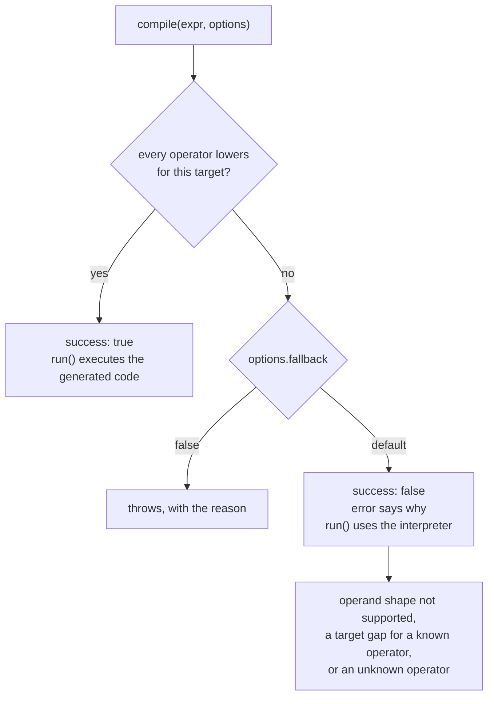

<Intro>
The Compute Engine can compile **LaTeX expressions** to **JavaScript functions**!
</Intro>

## Introduction

Some expressions can take a long time to evaluate numerically, for example if
they contain a large number of terms or involve a loop \\((\sum\\) or
\\(\prod\\)).

In this case, it is useful to compile the expression into a JavaScript function
that can be evaluated much faster.

For example this approximation: $ \pi \approx \textstyle\sqrt{6\sum^{10^6}_{n=1}\frac{1}{n^2}} $

```live
// import { parse, compile } from '@cortex-js/compute-engine';
const expr = parse("\\sqrt{6\\sum^{10^5}_{n=1}\\frac{1}{n^2}}");

// Numerical evaluation using the Compute Engine
console.time('evaluate');
const evaluated = expr.evaluate();
console.timeEnd('evaluate');
console.log(evaluated.toString());

// Compilation to a JavaScript function and execution
console.time('compile');
const result = compile(expr);
console.timeEnd('compile');
console.log(result.run?.());
```

## Compiling

**To get a compiled version of an expression** use the `compile()` function:

```javascript
import { compile } from '@cortex-js/compute-engine';

const f = compile("2\\prod_{n=1}^{\\infty} \\frac{4n^2}{4n^2-1}");
```

**To evaluate the compiled expression** call the `run` method on the
`CompilationResult` returned by `compile()`:

```javascript
console.log(f.run());
// ➔ 3.141592653589793
```

If the expression cannot be compiled, the `result.success` property will be
`false`.

A boxed `Program` from Epsil parsing can be passed directly to `compile()`.
Its declarations and global function signatures are already canonical; compilation
uses the existing sequence compiler. For example, a paired declaration
`let g: (integer) -> integer; function g(k) { k + 1 }; g(1)` compiles to a
JavaScript result of `2`. Invalid subexpressions still prevent compilation.
Compilation returns the final result; it does not provide interpreted Program
statement callbacks or publish variable values back to the caller's scope.

### Targets

The `to` option of `compile()` names the target. There are three:

- **`javascript`** (the default): a JavaScript function, run with `run()`.
- **`glsl`**: GLSL code for a WebGL 2 shader (see
  [What the GLSL Target Compiles](#what-the-glsl-target-compiles-cancompile)).
- **`interval-js`**: a JavaScript function that computes with interval
  arithmetic (see [Interval Arithmetic](#interval-arithmetic)).

Every engine compiles to the three targets, also an engine made from the
`@cortex-js/compute-engine/core` entry:

```javascript
import { ComputeEngine } from '@cortex-js/compute-engine/core';
import { compile } from '@cortex-js/compute-engine/compile';

const ce = new ComputeEngine();
compile(ce.box(['Sin', 'x']), { to: 'glsl' }).code;
// ➔ "sin(x)"
```

Another name in `to` is a decline whose `error` lists the three targets
(with `fallback: false`, it throws). The targets are not configurable. Version 0.194.0 removed the custom targets
(`ce.registerCompilationTarget()`, the option `target`, the classes
`JavaScriptTarget`, `GLSLTarget` and `BaseCompiler`) and the options
`functions`, `operators`, `imports`, `preamble`, `strictTypes` and
`broadcast`. A call that passes one of these options throws an error that
names the option and its replacement. The option `callerLocals` is accepted
and ignored. See the migration note in the
0.194.0 changelog entry.

### Validation and Fallback Behavior

`compile(expr, options)` checks the shape of each option (`to`, `vars`,
`inputs`, `fallback`, `constantFold`, …) and throws for an option of a wrong
type or a removed option.

By default, `compile()` falls back to interpretation (`success: false` with a
`run` function). To disable fallback and fail fast, set `fallback: false`.



The three reasons are described under
[Why a compilation declined](#why-a-compilation-declined).

### The `run()` Contract: Shaped Inputs, Read-Only Results

On the `javascript` target, `run()` requires inputs of the shape the compiled
code reads, and treats its results as read-only. The runner does a constant
amount of work per binding on each call, one `typeof`:

- a `{re, im}` value bound to a real binding throws a `TypeError` that names
  the binding (the unsigned pole `~oo` is projected to `Infinity` instead);
- a plain number bound to a complex binding is lifted to `{re, im: 0}`;
- a string or a typed array (`Float64Array`, …) bound to a binding the code
  reads as an array is refused: the compiled code reads plain arrays only, so
  convert a typed array once on your side with `Array.from(typed)`.

The string refusal applies to a binding declared with a bare collection type
(`indexed_collection`, `collection`, `list`), with a collection of non-text
elements (`list<number>`), with `list<string>` or `list<character>`, or whose
collection type the engine inferred from its uses. Compiled code would read
the string as UTF-16 code units, not as characters, so the `TypeError` names
the binding and says so. A binding whose type admits a string (`string`,
`indexed_collection<character>`) is not refused. These entry checks are on by
default; `compile(expr, { entryChecks: false })` turns them off, for a caller
that validates its own inputs.

```javascript
ce.declare('L', 'list<number>');
const f = compile(ce.box(['Sum', 'L']));
f.run({ L: 'abc' });
// ➔ throws TypeError: "L" is compiled as a JavaScript array, and compiled
//   code does not accept a string for it: it would read the string as UTF-16
//   code units, not as characters. Pass an array, or declare the binding
//   `string` to compile text.
```

A number bound to a binding declared as a list is not refused at entry, and
the result is undefined:

```javascript
f.run({ L: 5 });
// ➔ throws RangeError: a loop of more than 2^32 iterations
```

Nothing else is checked, converted, or copied:

- a value of another type is not refused, and the result is undefined: it
  can differ from the value of the interpreter, and between targets. With
  `x` declared `real`, `x + 1` gives `2` for `x = true` and `"ab1"` for
  `x = "ab"`. See [Supplying Inputs](#supplying-inputs);
- the entries of a list input are never read. A `{re, im}` object, a string
  or a typed array at an entry of a list the code reads on the real lane
  computes with that value, as it would in plain JavaScript;
- a returned collection or `{re, im}` object is the value the code built. It
  may be a value the runner keeps for every later call (a hoisted constant
  list, a bound symbol value), so do not write to a result: copy it first if
  you need to change it.

The result convention is kept: a value whose imaginary part is exactly zero
comes back as a plain number, inside a collection too, and a collection is
copied only when such a cell has to be rewritten. That check is one `typeof`
per cell of a returned collection, with no allocation.

The interpreter is the route that validates: evaluate the expression with
`.evaluate()` or `.N()` to diagnose a wrong input shape.

```typescript
const fn = compile(expr, { to: 'javascript' }).run!;
const T = Array.from(float64Board); // convert a typed array once
const v = fn({ x, y, T });          // no per-call walk, copy or check of T
```

### Running Compiled Code Without the Engine

The entry point `@cortex-js/compute-engine/runtime` exports
`createJavaScriptRuntime(options)`: the helper bundle that `run()` uses, with
no engine behind it. Store a `javascript` `CompilationResult` and run it on a
page, in a worker or on a server with `runtime.load(result)`:

```typescript
import { compile } from '@cortex-js/compute-engine';
import { createJavaScriptRuntime } from '@cortex-js/compute-engine/runtime';

const result = compile(ce.parse('x^2 + 1'), { to: 'javascript' });

const runtime = createJavaScriptRuntime({});
const f = runtime.load(result);
f({ x: 3 });
// ➔ 10
```

`load()` reads the `code`, `entryPlan`, `reconstructionDigits` and
`runtimeVersion` fields of the result, and the `preambleOnce` field when the
code has a preamble (with `k` declared `integer`, `At([1, 2, 3], k)` has one,
the definition of the helper `_at`). It
evaluates the definitions that read nothing per call (a constant list, a
memo) once, and it applies the same input steps as `run()`: a number given
for a complex binding is lifted, `~oo` given for a real binding is projected
to `Infinity`, another `{re, im}` value given for a real binding is refused,
and a string or a typed array given for a binding read as an array is
refused. `load()` throws when `result.runtimeVersion` is not
`runtime.runtimeVersion`, or when the stored code has none.

To run the stored code on a worker pool, the runtime entry also exports
`createKernelPool`, and `runtime.loadBroadcastAsync(result, { workers })`
returns the `broadcastAsync()` of the result: the same options (`out`,
`deadline`, `signal`, `chunk`, `inline`) and the same result (`done`, `route`,
`reason`), with `willUsePool(cells)` and `shippable`. The pool workers run the
entry `@cortex-js/compute-engine/kernel-worker`, so a worker that loads
stored code does not import the engine bundle.

```typescript
import {
  createJavaScriptRuntime,
  createKernelPool,
} from '@cortex-js/compute-engine/runtime';

const workers = createKernelPool({
  create: () =>
    new Worker(
      new URL('@cortex-js/compute-engine/kernel-worker', import.meta.url),
      { type: 'module' }
    ),
});
const run = createJavaScriptRuntime().loadBroadcastAsync(stored, { workers });
const { out, done, route } = await run({ x: xs }, { deadline: 100 });
```

Store the whole result, for example as `JSON.stringify(result)`, not only
the fields that `load()` reads. `loadBroadcastAsync()` sends a batch to a
worker only when the stored result has `shippable: true`. A host that copies
some fields and leaves out `shippable` gets every batch on the calling
thread, with `reason: 'not-shippable'` and no error. `workers` must be a pool
from `createKernelPool()`: another value throws a `TypeError`. The stored
fields are copied when the code is loaded, so load it again after a change.

The runtime exposes `load`, `frame`, `setFrame`, `iterationLimit`, `deadline`
and `runtimeVersion`. The module also exports `sysHelpers`, the stateless
helpers that compiled code calls as `_SYS.<name>`, which a runtime inherits.
A host that lowers its own operators the same way calls them from there:

```js
import { sysHelpers } from '@cortex-js/compute-engine/runtime';

sysHelpers.binomial(8, 3); // 56
```

The names and signatures of these helpers follow the code of a compilation
and can change in any release: compare `runtimeVersion`. The engine-bound
helpers (the random draws, `integrate`, `tick`) are members of a runtime,
not of `sysHelpers`. The options give the runtime the state it cannot read from an engine:

- `random`: the source of random draws outside a `WithRandomSeed` frame, and
  of the Monte-Carlo samples of the integrals. `null` denies draws; a draw
  then throws an error whose `name` is `CapabilityDeniedError` (test `e.name`,
  not `instanceof`: the class differs in each bundle).
- `frame`, or `runtime.setFrame()`: the frame of an interpreted
  `WithRandomSeed` that the code is called from (`{ seedLo, seedHi, next }` or
  `{ seed, next }`). After the call, `runtime.frame.next` is the advanced
  counter.
- `iterationLimit`: deprecated, with no effect. `ce.iterationLimit` applies
  to the interpreter only; compiled code is bounded by the compile option
  `iterationBudget` (see "Limiting Loops").
- `deadline`: an optional time after which the shuffle and choice loops throw.

A seeded program gives the same values interpreted, with `run()` and from the
stored code. A name that holds draws over literals under a number as the seed,
such as `a := WithRandomSeed(7, RandomChoice([0, 1), 3))`, compiles as its
value, a constant list, also on `glsl`; a seeded value that reads another name
or calls a user function declines. A `vars` entry that is not a read of the inputs object (for
example `vars: { c: 'Math.PI' }`) is copied into the code as text, so the
name it reads must exist where the code runs.

### Evaluating Many Points at Once: `broadcast()`

A plotter samples a function once per pixel column, or once per cell of an
implicit plot, and `run()` converts its argument object and wraps its result
on every call. `broadcast(inputs, options)` takes the inputs of every cell at
once and writes every result into one `Float64Array`: the conversions run once
per batch, the compiled body once per cell. Measured 2026-10-20: 20 % faster
than `run()` per cell on the main thread, and the batch is what a worker
thread receives (below). It is present on a `javascript` result compiled from
an expression (`calling: 'expression'`) and on an `interval-js` result
compiled from an expression.

```javascript
const f = compile(ce.parse('\\sin(x)\\cos(y) + a'));

const xs = new Float64Array([0, 0.5, 1]);
const ys = new Float64Array([0, 1]);

// Six cells: the two arrays are the axes of a grid, `x` varying fastest.
f.broadcast({ x: xs, y: ys, a: 0.5 }, { layout: 'grid' });
// ➔ Float64Array [0.5, 0.979…, 1.341…, 0.5, 0.759…, 0.954…]

// Three cells: every array holds one value per cell.
f.broadcast({ x: xs, y: new Float64Array([1, 1, 1]), a: 0.5 });
```

**Inputs.** `inputs` maps each free variable to a `Float64Array` or to a
number. A number is the same value for every cell (a document variable). With
the default layout, `'cells'`, every array holds one value per cell (for
`interval-js`, a `lo, hi` pair per cell) and all have the same cell count.
With `layout: 'grid'` the arrays are the axes of a regular grid, in key order
of `inputs`, the first varying fastest; the cell count is the product of their
lengths and nothing is expanded on the caller's side. `options.out` is a
caller-owned output array, filled and returned instead of a new one; it must
hold at least `outputs` values per cell (below).

**Index axes** (`grid` layout only). A variable that `options.indexes` names
is an axis whose value at each cell is the cell's position along that axis.
Its input is the axis length `n`, a non-negative integer, and the variable
takes the values `0, 1, …, n − 1`. The axis has its place in key order of
`inputs`, as a column `0 … n − 1` would, but no column is built, sent to a
worker or read. A kernel that reads a shared list by cell position declares
the index with a type such as `integer<0..>`; the values that the engine gives
are then in range by construction:

```javascript
ce.declare('F', 'list<number>');
ce.declare('m', 'integer<0..>');
ce.declare('n', 'integer<0..>');
const g = compile(ce.parse('F_{m + 4n + 1}'));

// 3 × 2 cells, `m` varying fastest: the same values as the columns
// m: [0, 1, 2] and n: [0, 1].
const F = [10, 11, 12, 13, 14, 15, 16, 17];
g.broadcast({ m: 3, n: 2, F }, { layout: 'grid', indexes: ['m', 'n'] });
// ➔ Float64Array [10, 11, 12, 14, 15, 16]
```

For `interval-js`, an index axis gives the point interval of each index. A
name in `indexes` must be a key of `inputs` and must not be a shared input;
with the `cells` layout the option throws.

**Shared inputs** (`javascript` only). An input can also be bound once for the
whole batch and read by index in the expression, for example the field values
of a grid that each cell reads around its own index:

```javascript
ce.declare('F', 'list<number>');
ce.declare('i', 'integer');
const f = compile(ce.parse('F_{i+1}'));

f.broadcast({ i: new Float64Array([0, 1, 2]), F: [1, 2, 3, 4] });
// ➔ Float64Array [1, 2, 3]
```

A variable is shared when the compiled code reads it as a list (its declared
type is a list type), or when `options.shared` names it: `{ shared: ['G'] }`
is the way to share a variable that has no declared type. Each name in
`shared` must be a key of `inputs`. A shared input is a plain array of numbers
or a `Float64Array`. A shared input is not a column of the `cells` layout and
not an axis of the `grid` layout: it does not count toward the cells. A plain
array for any other variable throws.

**Declared types.** `broadcast()`, `broadcastAsync()` and a kernel worker run
the compiled body once per cell. A declared type of an input is a promise of
the host: when an input breaks its declared type (a fractional `i` for
`integer<0..>`, a string in a list declared `list<number>`), the result is
not defined. The option `broadcast` of `compile()`, which built a second body
for batches, was removed in 0.194.0: call `broadcast()` of the result.

**Output of a `javascript` result.** One value per cell by default. A boolean
is `1` or `0`; a complex value with a zero imaginary part is its real part; a
cell whose evaluation throws, or gives any other non-number (a complex value
with a non-zero imaginary part, a list), is `NaN`. Cell for cell, the value is
the one `run()` gives: the same compiled body runs with the same conversions.
A length mismatch throws before the loop. A variable left out, or a value
outside its declared type (a boolean for a variable declared `real`), is not
refused: the result is undefined. With `a` left out, the example above gives
`NaN` in every cell.

**Several outputs per cell.** An expression whose type is a tuple of two or
more elements that can be numbers writes that many values per cell into the
same output array. An element typed `unknown` counts: `(x, y)` with undeclared
`x` and `y` writes two values per cell. An element that cannot be a number,
such as a string, gives one value per cell. With
`m` values per cell, cell `c` is at `[m·c, m·c + m)`. The result reports the
inferred `m` as `broadcastOutputs` (absent when it is 1), and
`options.outputs` (a positive integer) overrides it.

```javascript
const g = compile(ce.parse('(i, 2i)'));
g.broadcastOutputs;                                 // ➔ 2
g.broadcast({ i: new Float64Array([1, 2, 3]) });
// ➔ Float64Array [1, 2,  2, 4,  3, 6]
```

With more than one value per cell, the elements of an array answer go through
the conversions above one by one; an element past the end of the array is
`NaN`, and an answer that is not an array, or a cell that throws, is `NaN` in
every slot. With one value per cell (`outputs: 1`), an array answer is `NaN`,
as before. `shared` and `outputs` are `javascript` options: an `interval-js`
result throws a `TypeError` for either.

**Output of an `interval-js` result.** A `lo, hi, kind` triple per cell, at
offsets `3·i`, `3·i + 1` and `3·i + 2`. The kinds are the `INTERVAL_KIND`
codes, exported from the main entry and from
`@cortex-js/compute-engine/interval`:

| Code | Meaning | `lo`, `hi` |
|------|---------|------------|
| `interval` | an ordinary enclosure; a half-infinite bound is ordinary | the enclosure |
| `empty` | no value on the input (`sqrt([-2, -1])`) | NaN |
| `entire` | every real; nothing can be said | NaN |
| `singularPole` | the input crosses a pole (`1/x` on `[-1, 1]`) | NaN |
| `singularJump` | the input crosses a jump (`floor`) | the values on both sides |
| `partial` | part of the input is outside the domain (`sqrt([-1, 4])`) | the values inside |
| `boolTrue`, `boolFalse`, `boolMaybe` | a compiled comparison or logical expression | NaN |
| `error` | this cell threw, or gave bounds that are not numbers or are reversed | NaN |

A cell never rejects the batch. The `domainClipped` side of a `partial`
result and the `at` and `continuity` of a `singular` result are not reported.

```javascript
const g = compile(ce.parse('\\sqrt{x}'), { to: 'interval-js' });
g.broadcast({ x: new Float64Array([1, 4, -2, -1, -1, 4]) });
// ➔ [1, 2, INTERVAL_KIND.interval,  NaN, NaN, INTERVAL_KIND.empty,  0, 2, INTERVAL_KIND.partial]
```

### Worker Threads: `broadcastAsync()` and the Kernel Pool

`broadcastAsync(inputs, options)` takes the same inputs and `out` as
`broadcast()`, plus a `signal` (an `AbortSignal`), a `deadline` (milliseconds
of wall clock for the whole batch), a `chunk` (cells per task) and `inline`
(see below). It resolves to `{ out, done, route, reason }`, where `done` is
the number of leading cells that are valid: every cell, or fewer when the
deadline or the signal stopped the batch; the cells after `done` are
untouched. `route` is `'pool'` when workers ran the batch and
`'calling-thread'` when it ran (or, with `inline: false`, would have run) on
the calling thread; `reason` says why the pool did not take it:
`'no-pool'` (`ce.workers` is not set), `'pool-unusable'` (the workers hold
another runtime version), `'not-shippable'`, `'below-threshold'` or
`'pool-declined'` (a worker failed during the batch).

`broadcastAsync()` takes `shared` and `outputs` as `broadcast()` does; `done`
is still a count of cells, not of values. On a pool, the shared inputs go to
each worker once per call, with the first slice of the call that the worker
receives, and the worker keeps them until the call ends; each later slice
carries only its own cells. A `Float64Array` shared input is copied for each
worker and transferred, a plain array is cloned. The default stride travels
with the stored result (`broadcastOutputs`), so a worker and
`createJavaScriptRuntime().loadBroadcast(result)` lay out the cells the same
way, and the runtime reads the shared inputs from the stored entry plan.

Without a worker pool it runs the batch inline, in slices between yields to
the event loop, so a deadline still applies and a long batch does not block a
frame. The first slice also runs after a yield: no cell is computed before
`broadcastAsync()` returns. With a pool it splits the cells into one slice per worker (or `chunk`
cells per slice), ships them, and writes each returned slice into `out` as it
arrives. A batch under a threshold runs inline in any case: the pool measures
the cells per millisecond of each compiled function from its inline batches,
and ships a batch only when its serial time would exceed about 10 ms (before
the first measurement, 20 000 cells). Measured 2026-10-20 on an 18-core
machine: an implicit plot of 512×512 interval cells takes 175 ms inline and 34
ms on 8 workers; a 2000-column 1D plot takes under 2 ms and never ships.

A host that must never compute on the calling thread (a live plot that
repaints on every frame) has three tools:

- `inline: false` refuses the calling thread: when the pool would not take the
  batch, `broadcastAsync()` resolves at once with `done: 0`, computes nothing,
  and leaves the threshold measurement unchanged. When a worker fails during
  the batch, the cells the workers finished are kept and the rest is not
  computed.
- `result.willUsePool(cells)` says in advance whether a batch of that many
  cells would go to the pool, with the current `ce.workers` and threshold (for
  an `interval-js` result, `cells` counts intervals).
- `result.shippable` says whether the compiled result can run on a worker at
  all. It is `false` for code that draws random numbers and for a `vars`
  entry that names a host global (`vars: { c: 'Math.PI' }`); such a result
  always runs on the calling thread.

The engine creates no worker on its own. The host builds the pool and gives it
to one or more engines:

```javascript
import { ComputeEngine, createKernelPool } from '@cortex-js/compute-engine';

const pool = createKernelPool({
  // The worker file ships as one self-contained ES module,
  // `dist/esm-min/kernel-worker.js` (`@cortex-js/compute-engine/kernel-worker`).
  // Copy it next to your own files when your bundler does not resolve the
  // package at run time, and start it from its URL.
  create: () => new Worker(new URL('./kernel-worker.js', import.meta.url), { type: 'module' }),
  size: 4,        // default: one less than the hardware concurrency, at most 8
  prewarm: true,  // create the workers on idle time now, not on the first batch
});

const ce = new ComputeEngine();
ce.workers = pool;

const f = compile(ce.parse('\\sin(x)\\cos(y) + x^2 - y^2 - 0.3'), { to: 'interval-js' });
const { out, done } = await f.broadcastAsync(
  { x: xAxis, y: yAxis },
  { layout: 'grid', deadline: 30 }
);
```

In Node the factory returns a `worker_threads` `Worker` on the same file.

**An engine inside a worker.** When the engine itself runs in a dedicated
worker (to keep the page responsive), the code in that worker makes the pool,
with a factory that starts workers of its own (nested workers), and sets
`ce.workers` as above. Nothing comes from the page: the pool reads
`navigator.hardwareConcurrency`, which a worker has, and uses
`requestIdleCallback` for `prewarm` only when it exists. The worker URL must
be one that the worker can start, for example
`new URL('./kernel-worker.js', import.meta.url)` in a module worker. This was
checked on 2026-10-24 with a module worker that runs a batch and a `FindFit`
scan on its own pool of two nested module workers: same values as on one
thread, in Chromium 156, Firefox 157 and WebKit 27.2 (Playwright builds), and
with Node `worker_threads`. A pool made on the page cannot serve an engine in
a worker: the two threads would need a protocol between them, which does not
exist.

A worker reports the versions of the runtimes it holds; a stored result compiled
by another release is refused by the worker, and its slices then run inline.
`pool.dispose()` terminates the workers; a later batch creates them again. A
Content Security Policy must allow the worker script (`worker-src`) and
`new Function` in it (`'unsafe-eval'`): the worker rebuilds each function from
its text, as `createJavaScriptRuntime().load()` does. `SharedArrayBuffer` is
not needed; the arrays are transferred.

The two standalone runtimes have the same batch forms:
`createJavaScriptRuntime().loadBroadcast(result)` and
`createIntervalRuntime().loadBroadcast(result)` (from
`@cortex-js/compute-engine/interval`) rebuild a stored result as a
`broadcast()` function, with no engine behind it. An `interval-js` result
carries `runtimeVersion` for them, as a `javascript` result does.

### Parallel Loops: `runAsync()`

A `parallel for` loop (`ParallelLoop` in MathJSON) says that its passes are
independent. On `javascript` it compiles as a `for` loop: the passes run in
order on the calling thread, and give the interpreter's values. The body may
change a variable declared outside the loop only with `+=` (`AddTo`). The
compilation declines (`success: false`, and `run()` evaluates the program
with the interpreter) when the body assigns such a variable another way, when
it has a `break` or a `continue` of the loop itself (one of an inner loop is
allowed), and when the program draws a random number or sets a random seed:
the interpreter runs each pass in a random frame of its own, which compiled
code does not have. On `glsl` and `interval-js` it declines.

```javascript
ce.declare('H', 'list<integer>');
ce.declare('n', 'integer');

// let L = H
// parallel for k in 1..n { L[k % 3 + 1] += 1 }
// L
const count = compile(
  ce.box([
    'Block',
    ['Declare', 'L', "'unknown'", 'H'],
    [
      'ParallelLoop',
      ['AddTo', ['At', 'L', ['Add', ['Mod', 'k', 3], 1]], 1],
      ['Element', 'k', ['Range', 1, 'n']],
    ],
    'L',
  ])
);
count.success;                      // ➔ true
count.run({ H: [0, 0, 0], n: 100 }); // ➔ [33, 34, 33]; H is unchanged
```

A `javascript` result has `runAsync(inputs, options)`: the promise resolves
to the value of `run(inputs)`, and sends a `parallel for` to the engine's
worker pool (`ce.workers`, see the kernel pool above) when its passes only
add: to numbers (`s += e`) and to the elements of a list declared outside the
loop (`L[i] += e`), with no other read of them. The passes are split into one
range per worker, and the calling thread adds the partial sums in order. An
integer accumulator gets the value of `run()`; a real one can differ from it
in the last digits (the terms are added in another grouping). A loop that
does not qualify, and one of fewer passes than `options.minPasses` (default
20,000), runs in order on the calling thread. `options.onLoop` reports where
each loop ran, and `willParallelize()` says whether a loop would go to the
pool now:

```javascript
ce.workers = pool;
const routes = [];
await count.runAsync(
  { H: [0, 0, 0], n: 30000 },
  { onLoop: (r) => routes.push(r) }
);                          // ➔ [10000, 10000, 10000]
routes;                     // ➔ [{ passes: 30000, route: 'pool' }]
count.willParallelize();    // ➔ true
```

A worker stops at the deadline of a `ce.withTimeLimit()` around the call of
`runAsync()`, and the promise then rejects with its `CancellationError`. An
error of a pass rejects with the error that `run()` gives. Do not change
`inputs` until the promise settles: the program reads them after it waits.

### Limiting Loops: `iterationBudget`

A compiled `Loop` has no time check, so a loop that does not end stops the page
that runs it, also under `ce.withTimeLimit()`. When you run a document that you
did not write, set a limit when you compile it:

```js
const expr = ce.box(['Block', ['Declare', 'k', "'unknown'", 0],
  ['Loop', ['Assign', 'k', ['Add', 'k', 1]]], 'k']);
const { run } = compile(expr, { iterationBudget: 1e6 });
run({}); // throws a CancellationError, cause 'iteration-limit-exceeded'
```

Each iteration of a `Loop` adds one to one total for a call of the compiled
code, including nested loops and loops in the bodies of user functions. The next
call starts at 0. The limit is a count and not a time, so it stops at the same
pass on every machine. To get a time limit, measure the cost of a pass.

- `javascript` and `interval-js` throw. Stored code that you run with
  `createJavaScriptRuntime()` or `createIntervalRuntime()` keeps the limit.
- `broadcast()` gives `NaN` for a cell over the limit, as for any error of a
  cell. Each cell has its own count, so a batch costs up to cells × budget.
- `glsl` cannot throw: over the limit, the loops of the shader stop and the
  value is `NaN`. On this target the limit also applies to `Sum` and
  `Product`, and it is 10,000 passes when the option is not set (see "What
  the GLSL Target Compiles: `canCompile()`").
- A `Sum` or `Product` over the budget gives `NaN` and does not throw. On
  `interval-js` it gives the `entire` interval.
- On `interval-js`, a `Loop` over a `Range` of 2^32 elements or more gives the
  `entire` interval before its first pass, whatever the budget.

Without the option, the compiled code has no check.

### Constant Folding

A **pure** subexpression with no free variables is evaluated at compile time
and emitted as a literal instead of being lowered structurally:

```javascript
compile(ce.parse("\\sum_{n=1}^{10} n^2 + x")).code
// ➔ "(() => {\n  return (_.x + 385);\n})()"

compile(ce.parse("\\sqrt{2} x")).code
// ➔ "(() => {\n  return (1.4142135623730951 * _.x);\n})()"
```

Numbers and booleans fold. A constant collection does not fold in 0.194.0:
with `k` declared `integer`, the code of
`At(Map(y ↦ y^2, 1..6), k)` builds the list of squares on each call.

Folding declines — and the subtree compiles exactly as before — whenever any
of the following holds:

- the subtree is **impure** (`Random(…)` and friends keep drawing at run
  time);
- it mentions an **unknown**, a **`vars`-mapped input** (even one with an
  engine value — `vars` pins it live), or a name bound by an enclosing lambda
  or loop;
- it contains a `Sum` or `Product` over a **non-finite bound** (`Σ i,
  i=1..∞`): for a divergent series the interpreter's numeric evaluation
  silently returns an iteration-limit-truncated partial sum, and folding
  would bake that wrong number as a constant — such expressions keep their
  fail-closed structural behavior;
- it is estimated to cost too much to evaluate at compile time, or exceeds
  the engine's collection-size cap. The estimate is **deterministic** — it
  reads the expression and nothing else, so the same input always compiles
  to the same output, and folded code is safe to pin in a test. Constructs
  that multiply work are priced by their counts: a `Sum` or `Product` by its
  number of iterations, a `Map` or `Filter` by the size of its source. An
  expression whose count cannot be determined statically is not folded;
- the compilation records a capture set (the `symbolDeps` option, used by the
  engine's implicit-compilation cache): folding evaluates through engine
  state transitively and would under-report the dependencies the cache is
  keyed on, so such a compilation never folds.

The folded value is the **interpreter's** (`.N()`), so a folded constant can
differ in the last ulp from what the structural code would have computed in a
different operation order — compiled output tracks `evaluate()` by design
(`sin(π/6)` compiles to `0.5`, not `Math.sin(Math.PI / 6)`, which is
`0.49999999999999994`).

**To disable folding** — for example to inspect the structural lowering of a
constant expression — pass `constantFold: false`:

```javascript
compile(expr, { constantFold: false });
```

The interval-arithmetic target (`interval-js`) never constant-folds: a folded
point value would discard the outward-rounded enclosure that target exists to
compute.

### Why a compilation declined

When `success` is `false`, `CompilationResult.error` carries the reason (the
same text the `fallback: false` path throws). The message identifies which of
three things happened:

| Message shape                                                | Meaning                                                                                   |
| :----------------------------------------------------------- | :---------------------------------------------------------------------------------------- |
| `X: cannot compile — …` naming an operand or a component      | The head lowers, but not for these operand shapes (e.g. a collection-valued point component) |
| `X: cannot compile — the operator is known … no lowering`     | A target gap: the engine knows `X`, this target has no codegen for it                      |
| ``Unknown operator `X` ``                                     | No operator definition for `X` at all — a typo, or a symbol never declared as a function   |

`CompilationResult.unsupported` lists the same heads declaratively, so a caller
can branch on the condition without parsing the message. The list is empty when
`success` is `true`. A name that the expression binds (a local function, a
parameter of a function literal, an index) is never in the list: when a call of
such a name declines, only the message names it.

### Inputs With No Type and Values With No Settled Shape

Program and Block locals keep the contracts established during preparation.
Runtime writes cannot give an unknown local, or an empty unannotated list's
elements, a known static type. Supply annotations when compilation needs that
information. Declarations without an initializer conservatively decline
compilation, including a declaration followed by a straight-line initialization;
that form remains valid for interpreted execution.

Compiled code settles the shape of every value (a number, a complex number, a
string, a list, a point or a matrix) at compile time, and does not test it at
run time. Two declines follow from this rule. Both occur on every target, and
with the default fallback the interpreter computes the value.

**An input with no type declines**, with `diagnostic.code` `'untyped-input'`.
An input is a free symbol of the compiled code. When its type is `unknown` or
`any`, `unsupported` holds its name:

```javascript
const r = compile(ce.box(['If', ['Less', 'M', 3], 'M', 0]));
r.success          // ➔ false
r.unsupported      // ➔ ['M']
r.run({ M: [1, 5] }) // ➔ [1, 0], from the interpreter
```

When the expression declines for another reason, `unsupported` names the
inputs with no type too, after the cause of the decline: with `x` declared
`real` and `u` undeclared, `compile(ce.box(['Assign', 'u', ['If', ['Less',
'x', 0], 'u', 0]])).unsupported` is `['Assign', 'u']`.

Declare the input (`ce.declare('M', 'real')`). When the host can pass both
shapes, declare a union such as `real | list<real>`: a union compiles. A
parameter of a function is not an input, so `t ↦ 2t` compiles.

An input with no declared type has the type that the compiled expression
requires of it: in `x + 1`, `x` is a `number`, and `freeSymbolTypes` reports
it. A type that only another expression requires is not used, because
parsing an expression declares nothing. Declare the inputs, or call
`ce.infer()` with the expressions that use them, before you compile:

```javascript
const a = ce.parse('x + 1');
const b = ce.parse('x > 1');
compile(b).success;   // ➔ false: `x > 1` requires no type of `x`
ce.infer([a, b]);     // declares x: number
compile(b).success;   // ➔ true
```

The result of an operation such as `subs()` does not carry the types that the
operation required of a symbol that you made before it. Declare such a
symbol before you compile the result:

```javascript
const q = ce.symbol('q0');
const r = ce.parse('a \\cos(x)').subs({ a: q });
compile(r).success;   // ➔ false: `q0` has no type
ce.declare('q0', 'real');
compile(r).success;   // ➔ true
```

A name of the library that an expression reads as a variable (`N` in
`N + 1`) has no type until it is declared: `compile(ce.parse('N + 1'))`
declines, and compiles after `ce.declare('N', 'real')`.

**A value with no settled shape declines**, with `diagnostic.code`
`'unsettled-shape'`, and `unsupported` holds the sub-expression:

- A conditional whose branches have different shapes. With `x: real`,
  `If(x > 0, [1, 2], 3)` declines.
- A name that gets values of different shapes in one scope. A local has the
  type of its first value, and an assignment of a value of another type is the
  static error `assignment-type-mismatch`: `Block(p ≔ 0; p ≔ [1, 2]; p)` is
  invalid, so it declines with `'compile-error'`. The shapes can differ only
  when the declared type admits both, and a declared `any` does:
  `Block(Declare(p, "any", 0), Assign(p, [1, 2]), p)` declines. The order of
  the assignments is not examined, and the length of a list is not part of its
  shape: `Block(p ≔ [1, 2]; p ≔ [1, 2, 3]; p)` compiles. A declared type that
  is a union of shapes (`real | list<real>`) compiles with one body per
  member.
- Arithmetic over a symbol declared `any` or `value`, on the `javascript` and
  `interval-js` targets. Such a symbol can hold a number or a list.
  `(t: any) ↦ 2t` declines, and `unsupported` holds `t`. With the fallback, the
  interpreter gives `[2, 4]` for `[1, 2]`. Declare the shape, such as `real` or
  `list<real>`, to compile it.
- A function literal that assigns a name of an enclosing scope (a callback, a
  stored function, a user function that the code calls).
  `Block(p ≔ 0; Filter(L, u ↦ Block(p ≔ 5, u > 1)); p)` declines. The root of
  the compilation, and a function that `Apply` applies where it is written to
  scalar arguments, still compile. A function literal at the root that assigns
  a variable of the engine compiles to JavaScript, and so does a user function
  that it calls and that assigns such a variable (see
  [Variables That a Function Assigns](#variables-that-a-function-assigns)).
- A list whose element type is a union of shapes. With
  `CS: list<real | tuple<real, real>>` and `f := t ↦ 2t`, `Map(f, CS)`
  declines, and `unsupported` holds `CS`. With the fallback, the interpreter
  gives `[2, [6, 8]]` for `CS = [1, [3, 4]]`.
- An integer power of a list whose type admits both a matrix and a list of
  points (a bare `list`, `list<unknown>`, `list<any>`), and the product of
  such a list with another list. Compiled code holds a point as an array, so
  `[[1, 2], [3, -4]]` can be a matrix, whose square is the matrix power, or
  two points, whose square is the square of each coordinate. With
  `p: list`, `p^2` declines, and `unsupported` holds `p`. With the fallback,
  the interpreter gives `[[7, -6], [-9, 22]]` for `p = [[1, 2], [3, -4]]`.
  Declare `p` as a matrix of a stated size, `matrix<real^2x2>`, to compile
  it as a matrix: `p^2` is then the matrix power. Declare it as
  `list<tuple<real, real>>` (points) to compile it as points: `p^2` then
  gives `[[1, 4], [9, 16]]`. An input declared `list<list<real>>` declines,
  because compiled code reads it only by its elements (see
  [Lists of Lists](#lists-of-lists)). `p^{0.5}` and `3p` compile.

**A call selects the variant of the function from the static type of its
argument.** With `f := t ↦ 2t`, `f(L)` with `L: list<real>` compiles to a map
of the scalar variant over the list, and `f(p)` with `p: tuple<real, real>`
calls a variant compiled for a point. No test of the shape runs. An input
declared with a union of shapes gets one test, where it is bound, and one
body per member. With `y: real | tuple<real, real>`, `f(y)` compiles to
`Array.isArray(y) ? f_point(y) : f(y)`, and gives `6` for `y = 3` and
`[2, 4]` for `y = [1, 2]`. To avoid the test, declare one shape, or compile
one function for each shape.

### Which Definitions the Compiled Code Reads

A compilation reads each name from the scope the expression was boxed in,
as `evaluate()` does. A declaration of the same name in a scope that is
pushed later does not change the compiled code:

```js
ce.declare("x", "real");
ce.declare("a", "real");
ce.assign("a", 10);
const expr = ce.parse("x + a");

ce.pushScope();
ce.declare("a", "real");
ce.assign("a", 1);

compile(expr).run({ x: 2 });
// ➔ 12

compile(ce.rebind(expr)).run({ x: 2 });
// ➔ 3: `rebind()` gives the expression bound in the current scope
```

The same holds for a function that the expression calls: its body reads
the names of the scope the function was defined in.

An expression built from parts that were boxed in scopes that define a name
differently has no single scope to compile in. Its compilation declines,
with the name in `binding`, and the result falls back to the interpreter:

```js
const mixed = ce.function("Add", [expr, ce.parse("a")]);
const result = compile(mixed);
result.success;
// ➔ false
result.run({ x: 2 });
// ➔ 13: the interpreter reads 10 for the first `a` and 1 for the second
```

Box the expression in one scope, or bind it again with `ce.rebind()`.

#### Naming the Inputs: the `symbolic` Option

A symbol that holds a value is folded into the compiled code. To keep it as
an input, name it in the `symbolic` option. The name is then an input
wherever the compilation reads it, also inside the functions that the
expression calls, and its value is supplied at each run:

```js
ce.declare("x", "real");
ce.declare("a", "real");
ce.assign("a", 4);
ce.parse("f(x) := |a| x").evaluate();
const expr = ce.parse("f(x) + a");

compile(expr).run({ x: 2 });
// ➔ 12: `a` is folded as 4

compile(expr, { symbolic: ["a"] }).run({ x: 2, a: -3 });
// ➔ 3: `a` is an input, in the expression and in the body of `f`
```

The symbol needs a declared type (`ce.declare("a", "real")`). A symbol
whose type was only inferred from an assigned value makes the compilation
decline. Use `vars` when the input must have a given spelling in the
emitted code.

#### Giving the Types of the Inputs: the `inputs` Option

The `inputs` option names the inputs and gives their types at the call. No
declaration is needed, and nothing is declared after the call:

```js
ce.parse("g(t) := t x").evaluate();
const expr = ce.parse("g(2) + x");

compile(expr, { inputs: { x: "real" } }).run({ x: 3 });
// ➔ 9: `x` is an input in the expression and in the body of `g`
```

The given type wins over a declaration and over a stored value, for that
compilation only:

```js
ce.declare("x", "real");
ce.assign("n", ce.parse("[1, 2, 3]"));
const row = ce.parse("n x");

compile(row, { inputs: { n: "real" } }).run({ n: 2, x: 5 });
// ➔ 10: `n` is one number here, not the stored list
```

The expression keeps the canonical form it was boxed with, so give a type
that is the type the name had when the expression was boxed, or a subtype of
it (`list<real>` for a list, a range for `real`). A rewrite that was right
for the type at boxing is not undone by a wider type:

```js
ce.declare("x", "real");
ce.declare("k", "integer");
const power = ce.parse("(x^2)^k");
power.json;
// ➔ ["Power", "x", ["Multiply", 2, "k"]]: right for an integer `k`

compile(power, { inputs: { k: "real" } }).run({ x: -3, k: 0.5 });
// ➔ -3, and (x^2)^k is 3: the rewrite is wrong for k = 0.5
```

For a wider type, parse the expression in a scope that declares the name
with that type.

A function of the expression that reads the name, such as a Document row
`X(x, y) = kx/y` that reads the row `k = \max(y_w, 0.01)`, reads the input
too, and its body is typed with the given type for that compilation: with
`inputs: { k: "real" }`, `k` is a `real` there, not a `real<0.01..>`. The
same rule applies to the canonical form of the body. For a row read through a
function, a given type of another shape than the type of the row
(`list<real>` for a `real` row) makes the compilation decline.

A name of `inputs` that a function of the expression reads as a constant is
not an input: the compilation declines, and `diagnostic.binding` is the name.
Compile again without the name to read the constant.

### Supplying Inputs

The compiled code assumes that each input holds a value of its declared type,
and does not test it. So:

- **Declare the type and the shape of each input that you will pass**:
  `ce.declare("x", "real")`, `ce.declare("L", "list<real>")`,
  `ce.declare("P", "tuple<real, real>")`. An input with no type declines.
  An undeclared input has only the type that the compiled expression
  requires of it; `ce.infer()` declares the types that several expressions
  require.
- **A declared range is a promise too.** The compiler uses the range of the
  declared type to simplify the code: with `ce.declare("k", "real<0..5>")`,
  `|k|` compiles to `k`, and in `mode: "complex"` `\sqrt{k}` is a real square
  root. A value outside the range gives an unspecified result: the code of
  `|k|` returns `-2` for `k = -2`. An assumption (`ce.assume(...)`) does not
  change a type, so the compiler does not read it.
- **When an input can have two shapes**, compile one function for each
  shape, or declare the union (`real | tuple<real, real>`). One function for
  each shape has no run-time test. The union costs one test on each call,
  where the input is bound.
- **Supply every input** that `CompilationResult.freeSymbols` lists, with a
  value of its declared type. `freeSymbolTypes` gives the type of each one.
  The compiled code does not test for an input that is left out, so when a
  value can be missing, test it before the call.
- **A value outside its type gives an undefined result.** The result can
  differ from the value of the interpreter, and it can differ between
  targets. A declared `real` holds only finite values: to get a defined
  result for `NaN` or `±Infinity`, declare the input
  `real | signed_infinity | nan`.

```javascript
ce.declare("x", "real");
ce.declare("L", "list<real>");

const f = compile(ce.parse("x > 0"));
f.code;      // ➔ "(() => {\n  return (0 < _.x);\n})()"
f.run({});   // ➔ false: undefined result, x is left out
             //   (the interpreter has no value for x > 0)

compile(ce.box(["Sum", "L"])).run({});
// ➔ throws TypeError: undefined result, L is left out
```

An absent value is not an input. A declared type cannot name `missing`, so an
input cannot be declared `real | missing`.
[Values That Are Absent](#values-that-are-absent) describes the absent values
that a program produces.

### Values That May Be Lists

An input typed [`broadcastable<T>`](/compute-engine/guides/types/), a value
that may be a scalar or a list, has no settled shape, so the compilation
declines on every target, with `diagnostic.code` `'unsettled-shape'`. With the
default fallback, the interpreter computes the value:

```javascript
ce.declare('b', 'broadcastable<real>');
const r = compile(ce.parse('2b + 1'));
r.success;             // ➔ false
r.run({ b: 3 });       // ➔ 7
r.run({ b: [1, 2] });  // ➔ [3, 5]
```

Declare one shape (`real` or `list<real>`), or a union of shapes
(`real | list<real>`), to compile it.

### Two Lists of Run-Time Length

On the `javascript` target, an operation that reads two lists index by
index compares their lengths once, before its loop, when the compiler cannot
prove them equal: an element-wise operation (`L + K`, `L < K`), `Dot(L, K)`,
and a user function of scalar parameters called with two lists. Where the
lengths differ it throws a `RangeError`, where `evaluate()` gives the error
`incompatible-dimensions`:

```js
ce.declare("L", "list<real>");
ce.declare("K", "list<real>");

const sum = compile(ce.box(["Add", "L", "K"]));
sum.run({ L: [1, 2], K: [3, 4] });     // ➔ [4, 6]
sum.run({ L: [1, 2], K: [1, 2, 3] });
// throws RangeError: incompatible-dimensions: lists of lengths 2 and 3

const dot = compile(ce.box(["Dot", "L", "K"]));
dot.run({ L: [1, 2], K: [3, 4] });     // ➔ 11
```

Lists whose lengths the compiler proves equal (the same input, two stated
lengths) are not compared. The GLSL and interval targets compare no length:
there, the result for lists of two lengths is unspecified.

### Lists of Lists

The rows of a `list<list<integer>>` or a `list<list<real>>` can have
different lengths. On the `javascript` target, an input or a parameter of
one of these types is the host's array of arrays. So is such a list read by a
user function as a free input, a part of a tuple input
(`tuple<integer, list<list<integer>>>`) and a typed parameter of `Apply`.
Compiled code reads it in five ways: the element `g[i][j]`
(`At(At(g, i), j)`), which is `NaN` where an index is out of range; row by
row, by `Length(g)`, `Count(g)`, `IsEmpty(g)`, `IndexWhere`, `Fold` and
`Reduce` over `g`, and a `Map` over `g` whose value for each row is a number;
the row `g[i]` at an index known at run time (negative from the end), read
by a reader of a list; `Flatten(g)`, a new list of the elements of the rows
in order, which every reader of a list reads; and an argument of a user function at a parameter of
the same type or of type `list`, which takes it whole. An
element type `number` is read as `real`, except in the `complex` mode. Out of range the interpreter's row is
`Missing`: compiled, `Length(g[i])` and `First(g[i])` are `NaN`,
`IsMissing(g[i])` is `True`, and a sum of the row is unspecified. The row
`g[i]` as the result and `AssertPresent(g[i])` decline:

```js
ce.declare("g", "list<list<integer>>");
ce.declare("i", "integer");
ce.declare("j", "integer");

const f = compile(ce.box(["At", ["At", "g", "i"], "j"]));
f.run({ g: [[1, 2, 3], [4]], i: 2, j: 1 });  // ➔ 4
f.run({ g: [[1, 2, 3], [4]], i: 2, j: 3 });  // ➔ NaN

const sums = compile(
  ce.box(["Map", ["Function", ["Reduce", "r", "Add", 0], "r"], "g"])
);
sums.run({ g: [[1, 2, 3], [4]] });                     // ➔ [6, 4]

const flat = compile(ce.box(["Flatten", "g"]));
flat.run({ g: [[1, 2, 3], [4]] });                     // ➔ [1, 2, 3, 4]

const row = compile(ce.box(["Sum", ["At", "g", "i"]]));
row.run({ g: [[1, 2, 3], [4]], i: -1 });               // ➔ 4

const len = compile(ce.box(["Coalesce", ["Length", ["At", "g", "i"]], -1]));
len.run({ g: [[1, 2, 3], [4]], i: 1 });                // ➔ 3
len.run({ g: [[1, 2, 3], [4]], i: 3 });                // ➔ -1
compile(ce.box(["At", "g", "i"])).success;             // ➔ false
```

A program can also build such a list. A `Map` or a `Filter` whose value for
each element is a list of integers or reals, of a length known only at run
time, gives an array of arrays. Every reader above reads it, a local, an
`If` or a `Coalesce` can hold it, a user function can return it, a `Loop`, a
`Fold` or a `Reduce` can carry it, and as the result `run()` returns the
arrays:

```js
ce.declare("n", "integer");

const double = compile(ce.box(
  ["Map", ["Function",
    ["Map", ["Function", ["Multiply", 2, "x"], "x"], "r"], "r"], "g"]
));
double.run({ g: [[1, 2, 3], [4]] });                   // ➔ [[2, 4, 6], [8]]

const long = compile(ce.box(
  ["Filter", "g", ["Function", ["Greater", ["Length", "r"], 1], "r"]]
));
long.run({ g: [[1, 2, 3], [4]] });                     // ➔ [[1, 2, 3]]

const triangle = compile(ce.box(
  ["Map", ["Function", ["Range", 1, "k"], "k"], ["Range", 1, "n"]]
));
triangle.run({ n: 3 });                                // ➔ [[1], [1, 2], [1, 2, 3]]

const twice = compile(ce.box(
  ["Fold", ["Function",
    ["Map", ["Function",
      ["Map", ["Function", ["Add", "x", 1], "x"], "r"], "r"], "a"],
    "a", "k"], "g", ["Range", 1, "n"]]
));
twice.run({ g: [[1, 2, 3], [4]], n: 2 });              // ➔ [[3, 4, 5], [6]]
```

A list literal of such rows, `Join`, `ListJoin` and `Append` make such a list
too, and so does a `Fold` or a `Reduce` that starts from an empty list:

```js
const prefixes = compile(ce.box(
  ["Fold", ["Function", ["Join", "a", ["List", ["Range", 1, "k"]]], "a", "k"],
    ["List"], ["Range", 1, "n"]]
));
prefixes.run({ n: 3 });                                // ➔ [[1], [1, 2], [1, 2, 3]]

const more = compile(ce.box(["Append", "g", ["Range", 1, "n"]]));
more.run({ g: [[1, 2, 3], [4]], n: 2 });               // ➔ [[1, 2, 3], [4], [1, 2]]
```

`Transpose`, `MatrixMultiply` and `Trace` read a list that the program
builds when the program settles that its rows have one length: a `Map` whose
row length does not depend on the element. An input of type `list<list<…>>`
declines there, since its rows can have different lengths:

```js
ce.declare("m", "integer");

const table = ["Map", ["Function",
  ["Map", ["Function", ["Add", "i", ["Multiply", 10, "j"]], "j"],
    ["Range", 1, "m"]], "i"], ["Range", 1, "n"]];
compile(ce.box(["Transpose", table])).run({ n: 2, m: 3 });
// ➔ [[11, 12], [21, 22], [31, 32]]

const square = ["Map", ["Function",
  ["Map", ["Function", ["Add", "i", "j"], "j"], ["Range", 1, "n"]], "i"],
  ["Range", 1, "n"]];
compile(ce.box(["MatrixMultiply", square, square])).run({ n: 2 });
// ➔ [[13, 18], [18, 25]]

compile(ce.box(["Transpose", "g"])).success;           // ➔ false
```

To pass a matrix whose size is known only at run time, declare the input
with a matrix type without dimensions: `matrix`, `matrix<real>` or
`matrix<integer>`. The host passes an array of arrays. The type says that the
rows have one length, so the compiled code takes the length of the first row
as the length of every row and does not test the others: a value whose rows
have different lengths is outside its type, and the result is then
undefined.

```js
ce.declare("M", "matrix<real>");
ce.declare("A", "matrix<real>");
const M = [[1, 2, 3], [4, 5, 6]];

compile(ce.box(["Transpose", "M"])).run({ M });
// ➔ [[1, 4], [2, 5], [3, 6]]

compile(ce.box(["MatrixMultiply", "M", ["Transpose", "M"]])).run({ M });
// ➔ [[14, 32], [32, 77]]
```

Where `MatrixMultiply` reads two lengths that the compiler cannot prove
equal, the compiled code compares them once at run time and throws a
`RangeError` when they differ, where `evaluate()` gives the error
`incompatible-dimensions`. `Trace` does the same for a matrix that is not
square:

```js
const product = compile(ce.box(["MatrixMultiply", "M", "A"]));
product.run({ M, A: [[1], [0], [2]] });                // ➔ [[7], [16]]
product.run({ M, A: [[1, 0], [0, 1]] });
// throws RangeError: incompatible-dimensions: lists of lengths 3 and 2

const trace = compile(ce.box(["Trace", "M"]));
trace.run({ M: [[1, 2], [3, 4]] });                    // ➔ 5
trace.run({ M });
// throws RangeError: expected-square-matrix: Trace of a matrix of 2 rows
// and 3 columns
```

`Determinant`, `Inverse` and `MatrixPower` compare the number of rows with
the number of columns once, and throw a `RangeError` for a matrix that is not
square. `Shape` and `Rank` compile too. `RowReduce` of a matrix whose size is
known only at run time declines:

```js
const Q = [[1, 2], [3, 4]];

compile(ce.box(["Determinant", "M"])).run({ M: Q });       // ➔ -2
compile(ce.box(["Inverse", "M"])).run({ M: Q });
// ➔ [[-2, 1], [1.5, -0.5]]
compile(ce.box(["MatrixPower", "M", 2])).run({ M: Q });    // ➔ [[7, 10], [15, 22]]
compile(ce.box(["Shape", "M"])).run({ M });                // ➔ [2, 3]

compile(ce.box(["Determinant", "M"])).run({ M });
// throws RangeError: expected-square-matrix: a matrix of 2 rows and 3 columns

compile(ce.box(["RowReduce", "M"])).success;               // ➔ false
```

A matrix of a stated size, such as `matrix<real^2x3>`, compiles as before:
its sums are written out, and a length is compared only beside an operand
whose length is known at run time. A matrix with one stated dimension, and a
matrix of complex numbers or of booleans without stated dimensions, decline.

A list of lists of booleans, of points or of complex numbers, GLSL, the
interval target and the `bigint` mode decline.

A user function whose body is a list of lists whose lengths the body
settles, such as a `Map` of a `Map` over a `Range` of constant bounds, gives
a list of lists of those lengths. One step of the Game of Life compiles
this way, and `run()` returns an array of arrays:

```js
ce.declare("step", { signature: "(list<list<integer>>) -> list<list<integer>>" });
ce.assign("step", ce.box(["Function",
  ["Map", ["Function",
    ["Map", ["Function", ["Add", ["At", ["At", "G", "a"], "b"], 1], "b"],
      ["Range", 1, 2]], "a"], ["Range", 1, 2]],
  ["Typed", "G", "'list<list<integer>>'"]]));

const s = compile(ce.box(["Function", ["step", "H"],
  ["Typed", "H", "'list<list<integer>>'"]]));
s.run([[1, 2], [3, 4]]);  // ➔ [[2, 3], [4, 5]]
```

### String Operators and Integer Operations

A string compiles to `javascript` as a JavaScript string: an input declared
`string`, a string literal, and the text operators `Length` (of a string),
`ToUpperCase`, `ToLowerCase`, `CaseFold`, `Trim`, `TrimStart`, `TrimEnd`,
`StringRepeat`, `PadStart`, `PadEnd`, `StringReplace` (also with a literal
`RegExp`), `StartsWith`, `EndsWith`, `StringCompare`, `String` of strings,
`StringJoin` of a string, and `Equal`, `NotEqual` and `KroneckerDelta` of two
strings. The compiled value is the interpreter's: the
operators count characters (grapheme clusters), and a string input is read
as the engine reads one (NFC, a lone surrogate replaced with U+FFFD).

A list of strings compiles as an input declared `list<string>`, a list
literal, `Characters(s)` (also `GraphemeClusters(s)`) or the result of a list
operator: `Characters(s)` gives an array of strings, `StringJoin(L)` and
`StringJoin(L, sep)` join a list, `Length(Characters(s))` is the number of
characters, and `Map`, `Filter`, `Count`, `Any`, `All`, `Reverse`, `Take`,
`Drop`, `Rest`, `Most` and the rotations read its elements. Each element is
read with the interpreter's text (NFC), also an element of an input list.
`At(L, i)`, `First(L)` and `Last(L)` compile as the result, which is
`undefined` out of range, and in `IsMissing`, `Coalesce` and `AssertPresent`;
another use of such a read does not compile, and `Coalesce` is the remedy.
`Sort` and `Unique` of a list of strings or of characters compile, and so do
`Less`, `LessEqual`, `Greater` and `GreaterEqual` of two strings or of two
characters, in the interpreter's order: two strings by UTF-16 code units, two
characters by code points. `Max`, `Contains`, `Reduce` and the other operators
that combine strings do not compile, and the interpreter computes them:

```javascript
ce.declare('s', 'string');
ce.declare('L', 'list<string>');
ce.declare('i', 'integer');
compile(ce.box(['Characters', 's'])).run({ s: 'he\u0301llo' });
// ➔ ["h", "é", "l", "l", "o"]
compile(ce.box(['StringJoin', 'L', { str: '-' }])).run({ L: ['a', 'b', 'c'] });
// ➔ "a-b-c"
compile(
  ce.box(['Count', ['Characters', 's'], ['Function', ['Equal', 'c', { str: 'a' }], 'c']])
).run({ s: 'banana' });
// ➔ 3
compile(ce.box(['Map', 'ToUpperCase', 'L'])).run({ L: ['a', 'b'] });
// ➔ ["A", "B"]
compile(ce.box(['At', 'L', 'i'])).run({ L: ['a', 'b'], i: 5 });
// ➔ undefined
compile(
  ce.box(['ToUpperCase', ['Coalesce', ['At', 'L', 'i'], { str: 'z' }]])
).run({ L: ['a', 'b'], i: 5 });
// ➔ "Z"
compile(ce.box(['ToUpperCase', ['At', 'L', 'i']])).success;  // ➔ false
compile(ce.box(['Sort', 'L'])).run({ L: ['pear', 'fig', 'apple', 'fig'] });
// ➔ ["apple", "fig", "fig", "pear"]
compile(ce.box(['Unique', 'L'])).run({ L: ['pear', 'fig', 'apple', 'fig'] });
// ➔ ["pear", "fig", "apple"]
compile(ce.box(['Max', 'L'])).success;                        // ➔ false
```

`ColorToString(c)` and `ColorToString(c, format)` with a literal format
compile to `javascript` when `c` is a color constructor (`Rgb`, `Hsl`,
`Hsv`, `Oklab`, `Oklch`), a name whose value is one, a conversion of one to
its own space (`AsRgb(Rgb(…))`) or a tuple of three numbers, and give the
interpreter's string. Another color (`ColorMix`, a conversion to another
space) does not compile.

`RangeOf` and `At` of a string, an order of a character and a string, and `String`
of a number do not compile, and no string compiles to `glsl` or `interval-js`. Code with a
string input or a string result reports `strings: true` and has no batch
form: `broadcast()` and `broadcastAsync()` throw, and so do the batch
loaders of the runtime.

An operand that the interpreter answers with an error value (a negative
count, an empty pad) declines when it is a literal: with the default
fallback the interpreter evaluates the expression, and its error value
crosses the `run()` boundary as `NaN`. A computed operand compiles, and the
code throws a `RangeError` for a value outside the domain:

```javascript
ce.declare('s', 'string');
ce.declare('n', 'integer');
const p = compile(ce.box(['PadStart', 's', 5, { str: '0' }]));
p.success;          // ➔ true
p.run({ s: '7' });  // ➔ "00007"

compile(ce.box(['PadStart', 's', -1, { str: '0' }])).run({ s: '7' });
// ➔ NaN: the compilation declines, and the interpreter gives
//   Error("unexpected-argument", "PadStart: n must be a non-negative integer")

compile(ce.box(['PadStart', 's', 'n', { str: '0' }])).run({ s: '7', n: -1 });
// ➔ throws RangeError: PadStart: n must be a non-negative integer
```

The integer operations `Mod` and `GCD` compile, and compute with doubles: an
operand beyond the safe integer range (±2^53) is not checked.

### Rows of Different Lengths: `Chunk` and `Partition`

`Chunk(L, k)` and `Partition(L, n)` of a list whose length is known only at
run time, and `Partition(L, p)` of a predicate, give rows that can have
different lengths. On `javascript` they compile when `L` is an input or a
literal list of numbers or booleans. As the result of the expression, `run()`
returns an array of plain arrays, and the compilation result reports
`rows: true`: such code has no batch form, so `broadcast()`,
`broadcastAsync()` and the batch loaders of the runtime throw a `TypeError`,
and `shippable` is `false`. An expression that reduces each row, or that
reads the number of rows or one row at a constant index, compiles with no
such restriction:

```javascript
ce.declare('L', 'list<real>');
ce.declare('k', 'integer');
const c = compile(ce.box(['Chunk', 'L', 2]));
c.rows;                     // ➔ true
c.run({ L: [1, 2, 3] });    // ➔ [[1, 2], [3]]

const sums = compile(ce.box(['Map', ['Function', ['Sum', 'r'], 'r'], ['Chunk', 'L', 'k']]));
sums.run({ L: [1, 2, 3, 4, 5], k: 2 });  // ➔ [6, 9]
sums.run({ L: [1, 2, 3], k: 0 });
// ➔ throws RangeError: Chunk: expected a count in 1..10000, got 0
```

A count known at run time throws a `RangeError` where the interpreter leaves
the expression unevaluated (a count below 1, a count of `Chunk` above
10,000). Other uses of such rows, and `Chunk` or `Partition` of a computed
list (a `Range`, a `Map`), are evaluated by the interpreter. Rows of one
length (a list of a stated length that the count divides) are a list of
lists, with no such restriction.

## Implicit Compilation and the `jit` Setting

Beyond explicit `compile()` calls, the engine **compiles automatically** in a
number of implicit spots — for example when draining a large numeric `Map`,
or when an exact integer computation over a large collection is provably safe
to run in floating point. This is transparent: results are identical to the
interpreter's, and any compilation failure silently falls back to
interpretation.

The `jit` property of a `ComputeEngine` instance controls this behavior:

- **`"auto"`** (the default): implicit compilation is attempted where
  beneficial. If the environment forbids code generation altogether (a
  strict Content-Security-Policy page without `'unsafe-eval'`, an MV3
  browser extension), the engine detects this on the first attempt and
  latches to `"off"` engine-wide, so at most one CSP violation is reported.
- **`"off"`**: no implicit code generation is ever attempted; every implicit
  path uses the interpreter. Set it up front on hardened runtimes, or use it
  as a diagnostic kill switch to compare interpreter and compiled behavior.

Explicit `compile()` calls are not affected by this setting — a direct
request keeps failing loudly with the environment's own error.

Toggling `jit` is an engine-configuration change: caches whose entries were
produced on the other route are invalidated, so `jit = "off"` genuinely
re-runs the interpreter rather than serving previously compiled results.

## What Can Be Compiled

Three kinds of expressions can be compiled, and each produces a `run` function
with a different calling convention.

### Plain Expressions

A plain expression like `x^2 + 1` has free variables (unknowns). The compiled
`run` function takes a **vars object** mapping variable names to values:

```live
// import { compile } from '@cortex-js/compute-engine';
const f = compile("n^2");

for (let i = 1; i < 10; i++) console.log(f.run({ n: i }));
```

An expression with no unknowns can be called with no arguments:

```live
// import { compile } from '@cortex-js/compute-engine';
console.log(compile("\\sqrt{6\\sum^{100}_{n=1}\\frac{1}{n^2}}").run());
// ➔ 3.1320...
```

### Lambda Expressions

A lambda expression uses $\mapsto$ (`\mapsto`) to explicitly declare
parameters. The compiled `run` function takes **positional arguments**:

```live
// import { compile } from '@cortex-js/compute-engine';

// Single parameter
const f = compile("x \\mapsto x^2 + 1");
console.log(f.run(3));
// ➔ 10

// Multiple parameters
const g = compile("(x, y) \\mapsto x^2 + y^2");
console.log(g.run(3, 4));
// ➔ 25
```

Pass one argument for each parameter. The compiled function does not check the
number of arguments, so that a call costs nothing more than a plain JavaScript
call. With fewer arguments, the result is not defined: for example
`compile("x \\mapsto x > 0").run()` returns `false`, where the interpreter has
no value. Inside compiled code, a call with too few arguments is refused when
the expression is compiled, and the interpreter evaluates it instead.

A parameter with a default value (see
[Default Values](/compute-engine/guides/types/#default-values)) can be left
out of a compiled call, as in the interpreter. The default fills only an
argument that the call leaves out. An absent value given at that position
(`NaN` in JavaScript, for example) is passed to the body, and the result is
not defined, as for any other operator that gets an absent operand (see
[Values That Are Absent](#values-that-are-absent)):

```js
const f = compile(ce.box(["Function", "k",
  ["Optional", ["Typed", "k", "'real'"], 2]]));
f.success;     // ➔ false: the interpreter evaluates it
f.run();       // ➔ 2
f.run(5);      // ➔ 5
f.run(NaN);    // ➔ NaN
```

Inside compiled code, every target (JavaScript, GLSL and
interval-js) adds the default value to each call that leaves the argument out
when the expression is compiled. With
`g = (k: real = 2) ↦ k + 1`, `g()` compiles to `3`. With `L: list<real>`,
`g(At(L, 100))` passes the `NaN` of a read past the end of the list to `g`,
and the result is not defined (the JavaScript code gives `NaN`); the
interpreter passes `Missing` and gives `Missing`. To replace an absent
argument, write `Coalesce` in the call: `g(Coalesce(At(L, 100), 2))` gives `3`.

Lambdas are useful when the variable name is user-specified rather than assumed
by convention. A lambda like `\theta \mapsto 1 + \cos(\theta)` makes the
parameter explicit, avoiding ambiguity.

**Declared parameter types are checked when compiling, not when running.** A
call of a user function compiles only when the static type of each argument
proves the type of its parameter. The compiled call does not test the value
of the argument: a value outside the type of an input gives an undefined
result.

```js
ce.declare("h", { signature: "(x: integer) -> integer" });
ce.assign("h", ce.parse("x \\mapsto 2x"));
ce.declare("y", "real");
ce.declare("n", "integer");

const f = compile(ce.parse("h(y)"));
f.success;          // ➔ false: `y` is not proved an integer
f.run({ y: 2.5 });  // ➔ NaN, from the interpreter

const g = compile(ce.parse("h(n)"));
g.run({ n: 3 });    // ➔ 6
g.run({ n: 2.5 });  // ➔ 5: undefined result, 2.5 is not an integer
```

An argument whose static type has no value of the parameter type declines.
A body whose value cannot be of the declared result type is refused when the
function is assigned, so no call of it is compiled: with `h` declared
`(number) -> number`, `ce.assign("h", ce.parse("t \\mapsto [t, t]"))` throws
an `incompatible-type` error (see
[Typed Function Literals](/compute-engine/guides/types/#typed-function-literals)).

### Function Values

Compiled code calls a function only when it can see the function where the
call is written. A call compiles when the function is:

- a function defined with `ce.assign()` or `ce.declare()` with a value;
- a local of a block declared with a function literal as its value;
- a function literal written at the call site.

The callbacks of `Map`, `Filter`, `Sort`, `Fold` and `Reduce` compile when they
are one of these. A derivative of a defined function also compiles: with
`p = x ↦ x^3`, `p'(u)` (`Apply(Derivative(p, 1), u)`) compiles to a call of
the literal `x ↦ 3x^2`.

```js
ce.declare("L", "list<real>");
ce.declare("u", "real");
ce.assign("sq", ce.parse("t \\mapsto t^2"));
ce.assign("p", ce.parse("x \\mapsto x^3"));

compile(ce.box(["Map", "sq", "L"])).run({ L: [1, 2, 3] });  // ➔ [1, 4, 9]
compile(ce.box(["Filter", "L", ["Function", ["Greater", "x", 1], "x"]]))
  .run({ L: [1, 2, 3] });                                    // ➔ [2, 3]
compile(ce.parse("p'(u)")).run({ u: 2 });                    // ➔ 12
```

These forms do not compile, and with the default fallback the interpreter
evaluates them:

- a partial application or a curried call: `Apply(f, 1)` with `f` a function
  of two parameters, or `Apply(Apply(f, 1), u)`;
- a function passed as an argument to a user function, for example
  `h(x ↦ x + u)`, and a function with a parameter declared with a function
  type, for example `h = (g: function) ↦ g(1)`;
- a call whose value is a function: with `mk = a ↦ (x ↦ x + a)`,
  `Apply(mk(1), u)`;
- a call of a function stored in a local of a block that is assigned more than
  once, assigned inside a nested statement, or assigned the result of a call;
- a function literal applied to itself, `Apply(f, f, L)` with
  `f = (self, t) ↦ …self(self, Rest(t))…`: the argument `self` is a function
  passed as an argument.

A recursive function compiles when it is defined by name with a declared
signature; on JavaScript it is a recursive JavaScript function:

```js
ce.declare("T", "list<integer>");
ce.declare("s", "(list<integer>) -> integer");
ce.assign("s", ce.box(["Function",
  ["If", ["Equal", ["Length", "t"], 0], 0,
    ["Add", ["First", "t"], ["s", ["Rest", "t"]]]],
  "t"]));
compile(ce.box(["s", "T"])).run({ T: [1, 2, 3] });  // ➔ 6
```

```js
ce.assign("f", ce.box(["Function", ["Add", "x", "y"], "x", "y"]));
const r = compile(ce.box(["Apply", ["Apply", "f", 1], "u"]));
r.success;         // ➔ false
r.run({ u: 2 });   // ➔ 3, from the interpreter
```

The interpreter keeps first-class functions: function literals, closures,
currying, partial application and function values.

### Variables That a Function Assigns

A function literal that you compile to JavaScript can assign a variable of
the engine that it closes over, such as the state of an animation. The
variable must have a declared type of real, integer or boolean values, or of
a list of such values:

```js
ce.declare("s", "real");
ce.assign("s", 0.5);
const advance = compile(ce.box(["Function",
  ["Assign", "s", ["Add", "s", ["Divide", "t", 1000]]],
  ["Typed", "t", "'real'"]]));

advance.assigns;    // ➔ ["s"]
advance.run(16);    // ➔ NaN: the body ends in an assignment
ce.box("s").evaluate().re;  // ➔ 0.516
```

Each call of `run()` reads the value of each variable of `assigns` in the
engine, runs the code, and writes the new values back, as an evaluation of
the call does: after three calls of `advance.run(16)`, `s` is `0.548`. The
`code` reads no engine: it takes the value of each variable after the
arguments, and returns the value of the function followed by the new value
of each variable (`[NaN, 0.516]` for the call above). Such a result is not
`shippable`.

A list variable can change its length at each call. The `code` takes it as
an array and returns its new value as an array:

```js
ce.declare("L", "list<real>");
ce.assign("L", ce.box(["List", 1, 2]));
const grow = compile(ce.box(["Function",
  ["Assign", "L", ["Append", "L", "t"]],
  ["Typed", "t", "'real'"]]));

grow.run(3);
grow.run(4);
ce.box("L").evaluate().json;  // ➔ ["List", 1, 2, 3, 4]
```

A variable that holds a list of lists of integers or reals
(`list<list<integer>>`, or `list<list<number>>` outside the `complex` mode),
such as the grid of the Game of Life, is an array of arrays: the body reads
it as an input of that type and writes it with an `Assign` that is a
statement of the body, not in a branch or a loop:

```js
ce.declare("g", "list<list<integer>>");
ce.assign("g", ce.box(["List", ["List", 1, 0], ["List", 0, 0]]));
const flip = compile(ce.box(["Function",
  ["Assign", "g", ["Map", ["Function",
    ["Map", ["Function", ["Subtract", 1, ["At", ["At", "g", "i"], "j"]], "j"],
      ["Range", 1, 2]], "i"], ["Range", 1, 2]]],
  ["Typed", "t", "'real'"]]));

flip.run(16);                 // ➔ NaN
ce.box("g").evaluate().json;  // ➔ ["List", ["List", 0, 1], ["List", 1, 1]]
```

A user function that the body calls can read and assign a variable of a
real, integer or boolean type, itself or through the functions that it
calls. The function receives the current value at each call, and the call
writes back the new value in the order of the program:

```js
ce.declare("x", "real");
ce.assign("x", 0.5);
ce.declare("move", "(real) scope -> real");
ce.assign("move", ce.box(["Function",
  ["Block", ["Assign", "x", ["Add", "x", "dt"]], "x"],
  ["Typed", "dt", "'real'"]]));
const tick = compile(ce.box(["Function", ["move", "dt"],
  ["Typed", "dt", "'real'"]]));

tick.assigns;               // ➔ ["x"]
tick.run(2);                // ➔ 2.5
tick.run(3);                // ➔ 5.5
ce.box("x").evaluate().re;  // ➔ 5.5
```

A user function that reads the variable can also be given by name to `Map`,
`Filter` or `Reduce`. Each application reads the value at that point:

```js
ce.declare("getX", "(real) scope -> real");
ce.assign("getX", ce.box(["Function", ["Add", "x", "d"],
  ["Typed", "d", "'real'"]]));
// With x = 0.5
const shift = compile(ce.box(["Function",
  ["Block", ["Assign", "x", ["Add", "x", 1]], ["Map", "getX", ["List", "t", 10]]],
  ["Typed", "t", "'real'"]]));

shift.run(2);               // ➔ [3.5, 11.5]
ce.box("x").evaluate().re;  // ➔ 1.5
```

These decline, and fall back to the interpreter: another
target, a variable whose type is only inferred from its value, a constant, a
list of a stated length, a string or a complex variable, a variable with
no value, a call of a user function that assigns the variable in a `Sum` or
in a callback of a `Map` (a call in a `Loop` compiles), or over a list (`move(["List", 1, 2])`), a recursive user
function that assigns it, a user function that assigns a list variable, a
user function that reads it and is given as a value rather than by name, a
callback in the body (of a `Map`, for example) that assigns it, and an
expression that is not a function literal, such as `Block(Assign(s, s + 1))`.

### Functions of the Host

Compiled JavaScript calls a function that the host declared with an
`evaluate` function. Each call in the code evaluates the call in the engine,
at each evaluation and in the order of the program:

```js
const log = [];
ce.declare("hostDraw", {
  signature: "(real) -> nothing",
  evaluate: (ops) => { log.push(ops[0].re); return ce.symbol("Nothing"); },
});
const tick = compile(ce.box(["Function",
  ["hostDraw", ["Divide", "t", 1000]], ["Typed", "t", "'real'"]]));

tick.hostCalls;  // ➔ ["hostDraw"]
tick.run(16);    // ➔ NaN: the value Nothing
log;             // ➔ [0.016]
```

The arguments must be real numbers, integers, booleans, strings, `Nothing`,
values of a named tuple type, or tuples and lists whose elements are of
several kinds (at most four arguments). The function receives the value that
the interpreter gives it: a value of a named tuple type `Figure` is
`["Figure", …]`. An argument that is a finite lazy collection, such as
`["Range", 1, 3]` or a `Map` over a list, reaches the function as the `List`
of its elements in the interpreter, and the compiled code passes the same
`List`; such a list compiles when its length is known when the code is
compiled. A color, a value that holds a color, a collection inside a list
(`[1..3]`, which the interpreter passes as `["List", ["Range", 1, 3, 1]]`),
a list of a length known only at run time (`Range(1, n)`, a `Filter`)
and a list whose elements have an effect (a `Map` whose function draws a
random number or calls a function of the host) as an argument decline. The result type must be `real`, `integer`,
`boolean` or `nothing`: with the signature `(real) -> any`, the call
declines. A value `nothing` can only be the value of the compiled function,
also through a function of the program that returns it, such as
`function draw(...args) { figureDraw(listFrom(args)) }`. The code calls the engine,
so the result is not `shippable` and cannot be loaded without the engine. A
call in a function that assigns a variable of the engine declines.

### Tuple Expressions

A tuple expression like `(\cos(t), \sin(t))` compiles to a function that returns
a JavaScript array:

```live
// import { compile } from '@cortex-js/compute-engine';
const f = compile("(\\cos(t), \\sin(t))");

const [x, y] = f.run({ t: Math.PI / 5 });
console.log(x, y);
```

This is particularly useful for parametric curves. Both `Tuple` and `List`
expressions compile to arrays.

On JavaScript, an input can be a tuple whose parts are strings and numbers,
such as `tuple<string, integer>`. The host passes an array, and the compiled
code reads each part at a constant index: `At(T, 1)`, `At(T, -1)`, or
`First(T)`, `Second(T)`, `Third(T)` and `Last(T)`:

```javascript
ce.declare('T', 'tuple<string, integer>');
const f = compile(
  ce.box([
    'If',
    ['Equal', ['At', 'T', 1], "'A'"],
    ['Multiply', 2, ['At', 'T', 2]],
    ['Add', ['At', 'T', 2], 1],
  ])
);
f.run({ T: ['A', 3] }); // ➔ 6
f.run({ T: ['B', 3] }); // ➔ 4
```

Any other read of such a tuple (`T` as a whole, `Length(T)`, `T[n]` at an index
known only at run time, an argument of a function) declines, and so does the
input on GLSL, in the interval mode and in the `bigint` mode.

### Dictionary Expressions

On JavaScript a dictionary literal compiles, and `run()` returns an object
of its keys:

```js
const f = compile(ce.box([
  "Dictionary",
  ["Tuple", "'x'", ["Cos", "t"]],
  ["Tuple", "'y'", ["Sin", "t"]],
]));
console.log(f.success);
// ➔ true
console.log(f.run({ t: 0 }));
// ➔ { x: 1, y: 0 }
```

A read of a key, `d.x` or `d["x"]` in Epsil (`["At", d, "'x'"]`), compiles.
A key that the dictionary does not have, an index that is not a key
(`d[1]`), and other operations on a dictionary (`Length`, `Keys`,
arithmetic) do not compile, and the interpreter computes them. A function
declared by the host with `evaluate` receives the dictionary of the engine,
with each value that is a `List` or a `Tuple` literal
(`{"p" -> (t, 1)}`); a value that can be a lazy collection, such as a
`Range`, does not compile there.
A dictionary does not compile to `glsl`, to `interval-js` or in the `bigint`
mode.

### Control Structures

Control structures such as conditionals, loops, and blocks can be compiled to
JavaScript.

#### `If` and `Which` (Conditionals)

`If` expressions compile to ternary operators and `Which` expressions (used by
`\begin{cases}`) compile to chained ternaries:

```live
// import { compile } from '@cortex-js/compute-engine';

// If expression
const f = compile("\\keyword{if} x > 0 \\keyword{then} x \\keyword{else} -x");
console.log(f.run({ x: -5 }));
// ➔ 5

// Which / cases expression
const g = compile("\\begin{cases} x^2 & x > 0 \\\\ -x & x < 0 \\\\ 0 \\end{cases}");
console.log(g.run({ x: 3 }));
// ➔ 9
```

When no condition matches, compiled `Which` returns `NaN`. The interpreter
answers `Missing` for the same input — the absence marker has no value in the
target's floating-point model, so it projects to `NaN`. See
[Non-Finite Results](#non-finite-results). A selection whose arms are all
provably not numbers — strings, lists — answers the target's missing-object
literal instead, `undefined` in JavaScript, so that
`IsMissing` and `Coalesce` work on a compiled string selection; an arm whose
type is unknown counts as a number. Under a list of conditions, a position
that no clause selects is `NaN` for a number and `[NaN, NaN]` for a point,
never `undefined`, and a string arm is refused (the compilation falls back
to the interpreter). An `If` with no else-branch is
the one-clause `Which`: `If(c, t)` compiles on every target and returns
`NaN` when `c` is false (`[NaN, NaN]` for a point).

When the branch is a list, such as a restriction of a list of curves, the
`If` compiles on `javascript` and `interval-js` (and on GLSL for a list of
stated length) where `At`, `First` or `Last` reads an element, where `Max`,
`Min` or `Sum` reduces the list, or where arithmetic changes it before one of
these reads it. The element is `NaN` where `c` is false. This holds also when
a user function returns the `If`, and when a name holds it as its value (the
name alone then gives a list of `NaN`). `Length`, `Rest`, `IsMissing`,
`Coalesce` and the other readers of the list decline: the interpreter gives
`Missing` there, and a compiled list is never absent.

```js
ce.declare("x", "real");
ce.assign("C", ce.box(["Function",
  ["If", ["LessEqual", 0, "w", 6], ["Add", "w", ["List", 0, 4, 2]]], "w"]));

const f = compile(ce.box(["At", ["C", "x"], 1]));
f.run({ x: 1.5 });  // ➔ 1.5
f.run({ x: 7 });    // ➔ NaN
compile(ce.box(["Length", ["C", "x"]])).success;  // ➔ false
```

Under a list of conditions, `If(c, L)` with a list `L` reads `L` to the
shorter of the two lists, as the interpreter does.

An `If` whose branch is a statement — an
assignment, a loop — is a guard statement, not a value, and keeps its own
rules (see the statement sections below).

#### `Match`, `x is T` and `N`

A `Match` (the Epsil `match`) compiles when each case is a string or a real
number constant (`== "rect"`, `== 3`), `_`, or a `Tuple` of names. The
subject is evaluated once; a case of a constant is a clause of a `Which` on
the subject, and `_` takes every value. A `Tuple` pattern is chosen at
compile time from the shape of the subject: it is taken by a tuple of its
length, and binds each name to an element. When the subject is a constant,
one case remains, and the other cases need not have its shape.

```javascript
ce.declare('k', 'string');
ce.declare('x', 'real');
ce.declare('P', 'tuple<real, real>');
const area = compile(ce.box(['Match', 'k',
  ['MatchCase', { str: 'square' }, ['Power', 'x', 2]],
  ['MatchCase', { str: 'circle' }, ['Multiply', 'Pi', ['Power', 'x', 2]]],
  ['MatchCase', '_', 0]]));
area.run({ k: 'square', x: 3 });   // ➔ 9
area.run({ k: 'hexagon', x: 1 });  // ➔ 0
compile(ce.box(['Match', 'P',
  ['MatchCase', ['Tuple', '_a', '_b'], ['Add', 'a', 'b']],
  ['MatchCase', '_', 0]])).run({ P: [1, 2] });
// ➔ 3
```

A case with a guard, a pattern of another kind (a name, a list, a range), a
`Match` with no `_` case, and cases whose values have different shapes (a
number and a list) do not compile.

`MatchesType(x, T)` (the Epsil `x is T`) compiles to `true` when the
declared or inferred type of `x` is a subtype of `T`, and to `false` when
the two types have no value in common; the compiled code has no test of a
type. With `x: real`, `x is real` is `true` and `x is string` is `false`,
and `x is integer` does not compile. The type of a `Match` is the type of
its case values only when each value is a literal and a case takes every value
(`_`). Otherwise it is `unknown`, and `x is T` of that `Match` does not compile.

`N(x)` and `N(x, p)` of a number, a string or a boolean compile to `x`, for a
precision `p` of at least 15 digits; a smaller precision does not compile,
because the interpreter rounds to `p` digits. On `interval-js`, `N` of a
number does not compile.

### Values That Are Absent

An absent value — the `NaN` or `undefined` of an unmatched `Which`, or of a read
past the end of a list (`At`, `First`, `Last`) — is guaranteed at three kinds
of places in compiled code:

- **where it is produced**: the producer gives `NaN` for a numeric result, a
  point of `NaN` coordinates (`[NaN, NaN]`) for a point, and the target's absent
  object (`undefined` in JavaScript) otherwise;
- **where it is moved without computation**: `At`, `First`, `Last`, `Rest`,
  `Length`, `Reverse`, and the binding of a `Map` callback parameter keep the
  hole in its position (`Length([1, Missing])` is 2 everywhere);
- **where it is discharged**: `IsMissing`, `Coalesce` (`??`) and
  `AssertPresent` (`?!`) give the interpreter's value for an absent operand,
  whatever its spelling. A point whose coordinates are all `NaN` is absent for
  them, also when its type is `tuple<real, real>`. A default parameter is not
  a discharge: it fills only an argument that the call leaves out. The three
  compile on JavaScript, where `AssertPresent` of an absent value throws an
  `Error` whose message starts with `expected-present`. On GLSL, `IsMissing`
  and `Coalesce` compile, and `AssertPresent` of a value that can be absent is
  refused. On interval-js the three compile, and the test is a verdict over
  the box: `'maybe'` where the operand is absent over part of it, where
  `Coalesce` gives the hull of its operands; `AssertPresent` of a value absent
  over the whole box gives `entire`. `IsMissing` of a colour is refused on
  every target, and so is a discharge of a colour read whose index can be
  out of range; a `Coalesce` or `AssertPresent` of a colour that is present
  compiles. A string read out of range (`S[n]` with `S: list<string>`) is
  `undefined` on JavaScript, and its discharges compile (`IsMissing(S[n])`
  is `true` for `n` past the end). A row of a list of fixed-length rows read
  out of range (`P[i]` with `P: list<list<real^2>>`) is `undefined` on
  JavaScript; it compiles only as the whole program (`P[i]`, or the body of a
  function literal), so every discharge of it is refused. The discharges
  are refused in the `bigint` mode,
  and for an operand computed as a real number that can have a complex value
  (`Coalesce(Sqrt(x), 0)` with `x: real`; with `mode: 'complex'` it
  compiles). A refused compilation falls back to the interpreter.

Every other operator applied to an absent operand gives the target's own
value, and nothing is promised about it or about anything computed from it:
`undefined + 1` is `NaN`, `undefined > 0` is `false`, and `undefined[0]`
throws. The interpreter keeps its own
propagation (`Missing + 1` is `Missing`, `Missing > 0` is `False`), so a program
that computes on an absent value before discharging it can give one value in
the interpreter and another when compiled. Discharge first:

```javascript
ce.declare("S", "list<string>");
ce.declare("n", "integer");

// Guaranteed on every route: the absent value is discharged first.
compile(ce.parse("\\mathrm{IsMissing}(S[n])")).run({ S: ["a"], n: 5 });
// ➔ true
compile(ce.parse("\\mathrm{Coalesce}(S[n], \"d\")")).run({ S: ["a"], n: 5 });
// ➔ "d"

ce.declare("L", "list<real>");
compile(ce.parse("\\mathrm{Coalesce}(L[n], 0)")).run({ L: [1, 2], n: 5 });
// ➔ 0
```

```live
// import { compile } from '@cortex-js/compute-engine';

// No clause covers x = 0, and there is no fallback clause
const h = compile("\\begin{cases} x^2 & x > 0 \\\\ -x & x < 0 \\end{cases}");
console.log(h.run({ x: 0 }));
// ➔ NaN
```

#### `Sum` and `Product`

`Sum` and `Product` with numeric bounds compile to `for` loops with accumulator
variables:

```live
// import { compile } from '@cortex-js/compute-engine';

// Fourier approximation
const f = compile("\\sum_{k=0}^{5} \\frac{\\sin((2k+1)x)}{2k+1}");
console.log(f.run({ x: 1.0 }));
```

#### `Loop`, `Break`, `Continue`, `Return`

`Loop` is imperative control flow, compiled for effect. `Loop(body,
Element(...), ...)` compiles to plain `for` loops with no result collection.
A bare `Loop(body)`, with no indexing set, compiles on JavaScript only (GLSL
and `interval-js` decline it): a `Break` ends it, and so does the
`iterationBudget` option or a deadline of the engine (`ce.withTimeLimit()`).
`Break` and `Continue` compile to their JavaScript equivalents; `Return` has
no compiled form, so an expression that holds one runs on the interpreter.

The value of a loop is `Nothing` (or the value of a `Break(v)`), and the
compiled code has no form for it. So a loop whose value is used — the whole
expression, the last statement of a block, the body of a function — does not
compile, and `run()` uses the interpreter. Use the loop as a statement, and
end the block with the value it should have:

```live
// import { compile } from '@cortex-js/compute-engine';

const loop = compile("\\keyword{for} i \\keyword{from} 1 \\keyword{to} 10 \\keyword{do} i^2");
console.log(loop.success);
// ➔ false (the value of the loop is used)

const sum = compile("s \\coloneq 0; \\keyword{for} i \\keyword{from} 1 \\keyword{to} 10 \\keyword{do} s \\coloneq s + i^2; s");
console.log(sum.success, sum.run());
// ➔ true 385
```

On JavaScript, a block local that holds a list of reals, integers or booleans
can be changed element by element, with `xs = ReplaceAt(xs, i, v)` or
`xs[i] += v` (`AddTo(At(xs, i), v)`). The declaration copies the value, so an
input is never changed, and each update then writes the element in place. A
negative index counts from the end; an index that is 0, not an integer or out
of range throws `out-of-range` when the code runs. The compilation declines when
the list has another name or is used in a way that could see a write (`ys = xs`,
a function literal that reads `xs`, `f(xs)`), when an update writes a value of
another type (`0.5` into a list of integers), and when the local is a constant.
The other reads of the list are `xs[i]`, `Length(xs)` and the result of the
block. On `glsl` and `interval-js` such a local declines.

```live
// import { compile } from '@cortex-js/compute-engine';

ce.declare('L', 'list<real>');
const double = ['Assign', 'xs',
  ['ReplaceAt', 'xs', 'i', ['Multiply', 2, ['At', 'xs', 'i']]]];
const loop = ['Loop', double, ['Element', 'i', ['Range', 1, ['Length', 'L']]]];

const inPlace = compile(ce.box(['Block',
  ['Declare', 'xs', "'list<real>'", 'L'], loop, 'xs']));
console.log(inPlace.success, inPlace.run({ L: [1, 2, 3] }));
// ➔ true [2, 4, 6]

// `f` reads `xs`: the compilation declines, and the interpreter runs it
const aliased = compile(ce.box(['Block',
  ['Declare', 'xs', "'list<real>'", 'L'],
  ['Declare', 'f', "'function'", ['Function', ['Sum', 'xs']]],
  loop, ['f']]));
console.log(aliased.success, aliased.run({ L: [1, 2, 3] }));
// ➔ false 12
```

A block local that holds a list can also be replaced as a whole, `xs = value`,
when every write of it has that form: a list of reals, integers or booleans,
or a list of points. Its length can change at each write, in a loop or in the
arms of an `If`, and the list can be read in any way (`ys = xs`, `f(xs)`). A
written value of another type (a point of three numbers into a list of
pairs), a local that is also changed element by element, and an empty list of
no stated type decline. On `glsl` and `interval-js` such a local declines.

```live
// import { compile } from '@cortex-js/compute-engine';

ce.declare('L', 'list<real>');
const grow = compile(ce.box(['Block',
  ['Declare', 'xs', "'unknown'", 'L'],
  ['Loop', ['Assign', 'xs', ['ListJoin', 'xs', ['List', ['Multiply', 2, 'i']]]],
    ['Element', 'i', ['Range', 1, 3]]],
  'xs']));
console.log(grow.success, grow.run({ L: [0.5] }));
// ➔ true [0.5, 2, 4, 6]
```

On GLSL, a `Loop` over a constant integer range compiles in a block, and a
`Break` in it, as the branch of an `If` with no else, stops the loop: the
shader keeps a flag that ends the `for` loop. A `Loop` whose range reads an
input declines on GLSL in 0.194.0.

On `interval-js`, the condition of an `If` in a `Loop` body is compared with
interval arithmetic, and a pass of the loop runs one branch only. When the
input intervals decide the condition, the loop gives the value that the
interpreter gives: with `x` declared `real`,
`n ≔ 0; Loop(Block(n ≔ i; If(i > x, Break())), i ∈ 1..5); n + 1` gives
`[4, 4]` for `x = 2` and for `x = [2.2, 2.8]`. When the condition is true at
some points of an input interval and false at others, the pass where the loop
stops is not known, and the result is `{ kind: 'entire' }` (`x = [1.5, 2.5]`).

#### `Comprehension`

`Comprehension` compiles to nested `for (const x of ...)` loops that push
each computed value into a result array, which is returned:

```live
// import { compile } from '@cortex-js/compute-engine';

const f = compile("x^2 \\keyword{for} x = [1...5]");
console.log(f.run());
// ➔ [1, 4, 9, 16, 25]
```

On `glsl`, a comprehension declines in 0.194.0, also over a constant range.

#### Multi-statement constructs on the shader targets

A shader has no expression-level loop or IIFE, so on GLSL a `Sum` or
`Product` with a symbolic bound is emitted as **statements** (with constant
bounds it unrolls into an ordinary expression instead). Such a loop is hoisted
ahead of the value that consumes it, so it can appear anywhere in an
expression: with `n` declared `integer`, `0.03\sum_{k=0}^{n}kx` compiles, and
a nested sum is hoisted into its enclosing loop body rather than out of it.
A bound with no declared or inferred type declines (see "What the GLSL
Target Compiles: `canCompile()`").

A `Block`, with the `Loop` statements in it, is valid as the whole
expression and as the body of a user function, and declines when used as a
sub-expression.

A shader has no dynamic array, so a literal `List`, `Tuple` or `PointList` is
written into the shader as a constant array constructor:

```javascript
ce.declare('k', 'integer');
const big = ce.box(['List', ...Array.from({ length: 300 }, (_, i) => i)]);
compile(ce.box(['At', big, 'k']), { to: 'glsl' }).code;
// ➔ "(k == floor(k) && k != 0.0 && abs(k) <= float(300) ? float[300](0.0, 1.0, …"
```

#### `Block` and `where`

`Block` expressions create scoped variable bindings. The `where` syntax provides
a convenient way to define local variables:

```live
// import { compile } from '@cortex-js/compute-engine';

const f = compile("r^2 \\text{ where } r \\coloneq x^2 + y^2");
console.log(f.run({ x: 3, y: 4 }));
// ➔ 625
```

An item of a `where` clause is a binding (`r \coloneq v`, or `r = v` with a
symbol on the left) or a condition (any other relation). Each binding is a
`Declare(r, "unknown", v)` statement of one `Block`, and the conditions wrap
the body in a single-branch `If`, which gives `NaN` for a number when a
condition is false, as a restriction `e\{c\}` does:

```live
// import { compile } from '@cortex-js/compute-engine';

const g = compile("x^2 \\text{ where } a \\coloneq 2, x > a");
console.log(g.run({ x: 3 }), g.run({ x: 1 }));
// ➔ 9 NaN
```

The serializer writes such a `Block`, and every single-branch `If`, with
`where`: `ce.parse("x^2\\{x>0\\}+1").latex` is
`x^2+1\text{ where }0\lt x`.

A compiled local has a value from its declaration: `Declare(x, type, v)`, or,
in LaTeX, the first assignment of the name at the level of the block, which
parses as a `Declare`. A `Declare` with no value is valid in a block, and the
interpreter gives the local its value at the first assignment, but the
compilation declines it: `Block(Declare(x, "integer"), Assign(x, 1), x + 1)`
is `2` in the interpreter and is not compiled. A `Declare` in a branch or in
a loop body, an `Assign` to a name that no scope declares, and a read of a
local before its declaration are static errors
(`declaration-below-statement`, `assignment-to-undeclared-variable`,
`read-before-declaration`), so the compilation declines. An assignment is a statement, never an operand: `f(a \coloneq 2)` is
the error `assignment-in-operand`. A later assignment must keep the type of the
local, or it is the error `assignment-type-mismatch`.

A compiled block writes only the locals that it declares, and the locals of an
enclosing compiled block. A write to a symbol of the engine, to an input or to
a `vars` name declines, because compiled code has no binding of the engine to
change. Return the value and let the host assign it, or declare a local with a
value and read the local:

```live
// import { compile } from '@cortex-js/compute-engine';

const h = compile("m \\coloneq n + 1; 2m");
console.log(h.run({ n: 1 }));
// ➔ 4
```

A block with an assignment or a declaration compiles as a statement, as the
body of a function, or as the compiled expression. As an operand it declines:
`1 + Block(b ≔ x; 2b)` declines. A block whose last statement is an assignment
has the value `Nothing`, so it declines where its value is used. End the block
with the name.

A `vars` entry is a value, the same at each read. A string entry is source
text that the JavaScript code puts in at each read of the name: `x + 2x` with
`vars: { x: 'q' }` is `q + 2 * q`. Use a plain read of a value (`'_.s'`, a
name). An entry with an effect (`'nextValue()'`) runs once for each read, or
not at all, and the result is then unspecified.

## Variable Names

The compiled function expects variable names as they appear in the parsed
MathJSON expression. Greek letters become their English names:

| LaTeX       | Variable Name |
|-------------|---------------|
| `x`, `y`    | `"x"`, `"y"`  |
| `t`         | `"t"`         |
| `\theta`    | `"theta"`     |
| `\alpha`    | `"alpha"`     |
| `u`, `v`    | `"u"`, `"v"`  |

Use the wrong name and you'll get `NaN` silently:

```javascript
const f = compile("1 + \\cos(\\theta)");

f.run({ theta: 0.5 }); // ✓ correct → 1.8776
f.run({ x: 0.5 });     // ✗ wrong key — returns NaN
```

**To discover the variable names** in an expression, use `expr.unknowns` (or
its alias `expr.freeVariables`). These properties return only the free
variables — symbols that are not constants, operators, or bound by scoping
constructs like `Sum` or `Product`:

```live
console.log(parse("n^2").unknowns);

console.log(parse("a^2+b^3").unknowns);

console.log(parse("\\sin(\\theta)").unknowns);
```

## Complex Numbers

The JavaScript target has full complex arithmetic support. When the compiler
detects that a subexpression involves complex values, it automatically emits
complex-aware code for all operations touching that subexpression.

### When Complex Arithmetic Is Used

The compiler decides at compile time whether each subexpression is
complex-valued. This happens when:

- The expression contains `i` (`ImaginaryUnit`)
- A symbol has been declared with a complex type
- An operation is applied to a complex-valued operand

The detection is **static** — based on the expression's structure, not on
runtime values. What happens to a radical of a real operand whose sign is not
known depends on the compile [mode](#modes-strict-complex). Under the
default `strict` mode the radical compiles to the real `Math.sqrt`, because
`x` has no declared complex type, so `compile("\\sqrt{x}").run({ x: -4 })` is
`NaN`, and `2` at `x = 4`. Under `mode: "complex"`, `\sqrt{x}` is
**promoted**: it is lowered through the complex kernel, and the same call
returns `{ re: 0, im: 2 }`, as `evaluate()` gives.

### Result Format

When an expression _is_ complex-valued, the compiled `run` function returns a
`{ re: number, im: number }` object instead of a plain number:

```live
// import { compile } from '@cortex-js/compute-engine';

// Explicit complex expression — compiler knows it's complex
const f = compile("(1 + 2i)^2");
console.log(f.run());
// ➔ { re: -3, im: 4 }
```

Complex-aware operations include all the standard arithmetic (`+`, `-`, `*`,
`/`), trigonometric functions (`sin`, `cos`, `tan`, and their inverses and
hyperbolic variants), `exp`, `ln`, `sqrt`, `pow`, `abs`, `arg`, `conjugate`,
`Re`, and `Im`.

### Extracting Real and Imaginary Parts

Use `Re` and `Im` to extract components from a complex expression:

```live
// import { compile } from '@cortex-js/compute-engine';

const f = compile("\\Re((1 + 2i)^2)");
console.log(f.run());
// ➔ -3  (a plain number, not an object)
```

### Mixing Real and Complex Operands

When a complex operand is combined with a real operand, the result is complex:

```live
// import { compile } from '@cortex-js/compute-engine';
const f = compile("x + 2i");
console.log(f.run({ x: 3 }));
// ➔ { re: 3, im: 2 }
```

### GLSL Target

The GLSL target also supports complex arithmetic, but represents complex numbers
as `vec2` values — the `.x` component is the real part, `.y` is the imaginary
part:

```glsl
// Complex literal: 3 + 4i
vec2(3.0, 4.0)

// Imaginary unit
vec2(0.0, 1.0)
```

Simple operations like addition, subtraction, negation, and scalar multiplication
use native `vec2` operations. More involved operations — complex multiplication,
division, exponentiation, and transcendentals — use helper functions emitted in
a **preamble** block:

| Operation | GLSL Helper |
|-----------|-------------|
| `z * w`   | `_gpu_ir_cmul(w, z)` |
| `z / w`   | `_gpu_ir_cdiv(z, w)` |
| `z ^ w`   | `_gpu_ir_cpow(z, w)` |
| `sqrt(z)` | `_gpu_ir_csqrt(z)` |
| `exp(z)`  | `_gpu_ir_cexp(z)` |
| `ln(z)`   | `_gpu_ir_cln(z)` |

The preamble holds only the helpers that the code calls, and the helpers they
call (`_gpu_ir_cpow` calls `_gpu_ir_carg`). If the expression is
purely real, no preamble is generated.

Component extraction maps to native swizzle operations:

```glsl
Re(z)        →  z.x
Im(z)        →  z.y
Abs(z)       →  length(z)      // built-in
Arg(z)       →  _gpu_ir_carg(z)
Conjugate(z) →  (z * vec2(1.0, -1.0))
```

The same complex value analysis used by the JavaScript target determines
whether each subexpression needs complex or real code paths in GLSL.

### Result Convention

A compiled JavaScript unit returns a real value as a plain `number` and a
non-real value as `{ re, im }` — and both directions are guaranteed at the
`run()` boundary: a value whose imaginary part is **exactly** zero comes back
as a `number`, and a returned `{ re, im }` always has `im !== 0`. So a
consumer's per-sample test is the single `typeof v === 'number'`, and a
`{ re, im }` with a non-zero imaginary part tells "outside the real domain"
from a genuine `NaN`. Booleans are never coerced.

```live
// import { compile } from '@cortex-js/compute-engine';

console.log(compile("(1 + 0i) * 5").run());   // 5 (a plain number)
console.log(compile("\\sqrt{x}").run({ x: 4 }));    // 2
console.log(compile("\\sqrt{x}").run({ x: -1 }));   // { re: 0, im: 1 }
```

The transcendental complex kernels chop their own roundoff dust at the
machine scale (as the interpreter does), which is what lets the boundary test
be exact: `arcsin(0.5)` compiled through the complex kernel is the number
`0.5235…`, while `1 + 10^{-12} i` stays `{ re: 1, im: 1e-12 }` — nothing is
chopped in ring arithmetic.

### Non-Finite Results

The engine distinguishes three kinds of non-finite number — the signed
infinities $+\infty$ and $-\infty$, complex infinity $\tilde\infty$, and `NaN`.
A floating-point target has only two: IEEE `Infinity`/`-Infinity` and `NaN`.
Compiled code therefore reports a **projection** of the interpreted answer, and
the two agree everywhere except at the direction-less infinity.

The signed infinities and `NaN` round-trip. `\ln(0)` is $-\infty$ interpreted
and `-Infinity` compiled; a `NaN` argument stays `NaN` through a compiled
numeric head, exactly as it does through `evaluate()`:

```live
// import { compile } from '@cortex-js/compute-engine';

console.log(compile("\\ln(x)").run({ x: 0 }));
// ➔ -Infinity

console.log(compile("\\mathrm{Heaviside}(x)").run({ x: NaN }));
// ➔ NaN
```

Complex infinity has no distinct floating-point value, so a pole projects onto
the positive infinity. Interpreting $1/0$ gives $\tilde\infty$, which carries no
direction; the compiled unit answers `Infinity`, and `-Infinity` for the
negative-zero approach that IEEE arithmetic does distinguish:

```live
// import { compile } from '@cortex-js/compute-engine';

const f = compile("\\frac{1}{x}");
console.log(f.run({ x: 0 }));    // ➔ Infinity
console.log(f.run({ x: -0 }));   // ➔ -Infinity
```

This projection reaches a comparison in a branch. In the interpreter a pole
has no order, so `1/x > 0` at `x = 0` is `False` and `\{1/x > 0: 1, 0\}` is
`0` (user decision of 2026-10-21); the compiled unit compares `Infinity > 0`,
which is `true`, and gives `1`. The two answers differ at the pole only. A
closed form with no variable (`\{1/0 > 0: 1, 0\}`) is folded at compile time to
the interpreter's answer, `0`.

On the `glsl` target, an infinity or a `NaN` computed at run time
is not guaranteed. GPU drivers (Metal, for example) can assume that no
infinity or `NaN` occurs at run time. A division by zero in a shader can therefore give a
finite value, and so can a function of its result. For example,
`\sin(2\pi T/P)` at `P = 0` is `NaN` on the `javascript` target, but on an
Apple GPU the shader returned a finite number. The compiled
shader does not test each divisor for zero, because that test would add work
to every division. When the value at a zero divisor matters, write the test
in the expression, for example `\{P = 0: \operatorname{NaN}, \sin(2\pi T/P)\}`:
a comparison is reliable on a GPU.

On `glsl` only, a product with a factor that the driver can prove is zero is
`0`, even when the other factor is `NaN` or an infinity:
`\operatorname{NaN} \cdot 0 \cdot \cos(x)` gives `0` on an Apple GPU (WebGL2
over ANGLE Metal), and WebGPU gives `NaN`.

In 0.194.0 the shader calls the built-ins `max`, `min`, `clamp`, `sin`,
`cos` and `sign` directly: `\max(x, y)` compiles to `max(x, y)` and
`\operatorname{Clamp}(x, 0, 1)` to `min(max(x, 0.0), 1.0)`. With a `NaN`
operand the value is the driver's: on Apple GPUs `max`, `min` and `clamp`
return the other operand, and `sin`, `cos` and `sign` return 0, where the
interpreter gives `NaN`. When the value at a `NaN` operand matters, test it
in the expression.

A `NaN` keeps its value through the other operations that were measured:
addition, multiplication by a value that is not zero, `\tan`, `\sinh`,
`\cosh`, `\tanh`, `\exp`, `\ln`, `\sqrt{}`, `\arcsin`, `\arccos`,
`\arctan`, `\lfloor x \rfloor` and the other rounding functions, `\bmod`,
`|x|`, `0/0` and `\infty - \infty`.

Absence markers project the same way. `Missing` — what an unmatched `Which`
returns, and what an else-less `If` and a false restriction `e\{c\}` return
for a value that is neither a number nor a point — is not a number, so the chained ternary ends in a literal `NaN` (see
[`If` and `Which`](#if-and-which-conditionals)). The same value reaches `run()`
when the expression was never compiled at all and fell back to
interpretation: its `Missing` crosses the boundary as `NaN` too. What a
further operator makes of that value is not specified; see
[Values That Are Absent](#values-that-are-absent).

**Type guards follow the finite-by-default lattice.** Every bare numeric type
name denotes a **finite** value, so the guard a compiled parameter test emits
rejects `Infinity` and `NaN` exactly as the interpreter's signature check does:
`real` lowers to `Number.isFinite`, `integer` to `Number.isInteger`, and
`complex` to a test that a plain number is finite or that both parts of a
`{ re, im }` pair are. `+oo | -oo` — the signed pair — is the guard for
the infinities.

The `infinity` and `nan` tiers have no faithful test in the target's value
model, because the projection above is lossy in exactly the place those tiers
distinguish. A definition whose parameters use either one therefore **declines
as a whole** and runs interpreted, rather than dispatching on a test that would
disagree with `evaluate()`. This is the usual fail-closed posture for a
construct the target cannot represent.

### Modes: `strict`, `complex`

JavaScript has no complex number: a compiled value is a `number` or a
`{ re, im }` object, and the compiler decides which **statically, per node**.
What a compile **mode** fixes is what a numeric binding whose static type is
**wide** (`unknown`, `number`, an unannotated parameter, a `Block` local not
declared real) is shaped as — and what happens when a complex-shaped value
reaches one:

- **`strict`** (the default on every target) — the shader targets' model, on
  every target: the lane of a value follows its static type. A
  `complex`-typed value, a `Complex(…)` literal, `i`, an operation whose
  result type is complex, and a radical of a **provably** negative operand
  are complex-shaped; everything else is real. Nothing promotes: an
  operation whose exact value is complex on the real lane gives `NaN`
  (`√x` at `x = −1` is `NaN`, as `Math.sqrt` gives). A complex-shaped value
  meeting a wide binding — `b(z)` for `b(x) := 2x` and `z: complex` —
  **fails closed** with a `LaneMismatch` decline naming the binding to
  declare complex. A binding typed `number` is real under `strict`: the
  value you give for it must be real. A complex value there gives an
  unspecified result. With `L: list<tuple<number, real>>` at
  `[(1 + i, 2)]` and `hr = (p: tuple<real, real>) ↦ p[1] + p[2]`,
  `hr(L[1])` compiled under `strict` gives the string `"[object Object]2"`;
  under `mode: 'complex'` it gives `{ re: 3, im: 1 }`, the value of
  `evaluate()`. To pass complex values, compile with `mode: 'complex'` or
  declare the binding `complex`. A call of a user function declared with an
  `unknown` result, such as `F: (real) -> unknown` assigned
  `w ↦ sin(w)·√(1 − e²)`, has the lane of its compiled body, also when the
  engine reports the result type `complex`: with `e: real`, `F(t)` is real,
  and `NaN` at `t = 0.7, e = 2`. A result declared `complex` is complex.
- **`complex`** — a wide binding is complex, lifted at its use; an
  unknown-sign `Sqrt`/`Ln`/`Log`, and `x^{0.3}`-style powers (a non-integer
  exponent of an unknown-sign base), **promote**: they lower through the
  complex kernels, so the compiled value matches `evaluate()`. User
  functions are emitted once. Always sound, only slower (~2.3× on affected
  chains). A kernel whose value is real still returns a plain `number`: a
  `{ re, im }` object comes back only when the imaginary part is not zero
  (`(√x)²` at `x = −4` is the number `-4`).

The `auto` mode of version 0.177.0 and earlier (the former default: `strict`
plus promotion, and a redo in `complex` mode after a lane mismatch) is
removed. `compile(expr, { mode: 'auto' })` declines with the diagnostic code
`'unsupported-mode'`; use `mode: 'complex'`, which gives the values `auto`
gave.

| Input                                       | Default (`strict`)            | `mode: 'complex'`  |
| ------------------------------------------- | ----------------------------- | ------------------ |
| `Sqrt(x)`, `x: real`, at `x = -4`           | `NaN`                         | `{ re: 0, im: 2 }` |
| `Sqrt(x)^2`, `x: real`, at `x = -4`         | `NaN`                         | `-4`               |
| `x + 2i`, `x: real`, at `x = 1`             | `{ re: 1, im: 2 }`            | `{ re: 1, im: 2 }` |
| `compile(e, { mode: 'auto' })`              | `unsupported-mode` decline    |                    |

The special functions whose value is complex for some real operands —
`HurwitzZeta`, `LerchPhi`, `PolyLog`, `EllipticK`, the complete `EllipticE`,
`Hypergeometric2F1`, `LambertW`, `PolyGamma` and `Gamma` — promote under
`complex` the same way. The complex kernel is used where the operand facts do not prove
the value real (`x ≥ −1/e` for `LambertW`, `z ≤ 1` for `PolyLog`, `m ≤ 1` for
the elliptic integrals), so under `mode: 'complex'` compiled `LambertW(x)` at
`x = −1` is `{ re: -0.318…, im: 1.337… }`, as `.N()` gives, and compiled
`LerchPhi(3, 2, 1)` is `0.7734 − 1.1505i`; under `strict` both are `NaN`. The
GLSL target has a complex lane for `HurwitzZeta`, `PolyGamma` (of an integer
order), `Gamma`, `LerchPhi` and `PolyLog`, and declines a provably complex value of the other
heads. `Zeta` of a complex operand, such as `|ζ(1/2 + it)|` with `t`
declared `real`, compiles on JavaScript under `strict` and `complex`, with
the interpreter's kernel. So do `Zeta(z, a)` of a real `a` and `Digamma(z)`,
on JavaScript and GLSL: with `a` declared `real`,
`compile(ce.parse('\\zeta(z, a)'), { to: 'glsl' }).code` is
`"_gpu_ir_czeta_generalized(z, a)"`, and `Digamma(z)` is
`"_gpu_ir_cpolygamma(0.0, z)"`. For `a < 0` the GLSL kernel adds the terms
`|a + k|^(-z)` left of 0, with the same error as `HurwitzZeta` below, at the
scale of the sizes of its terms; a complex `a` declines.
On GLSL, `Zeta`, `HurwitzZeta`, `PolyGamma` and
`Gamma` of a complex operand compile to single-float kernels
(`compile(ce.parse('\\zeta(z)'), { to: 'glsl' }).code` is
`"_gpu_ir_czeta(z)"` with `z` declared `complex`), for a domain coloring:
the error of `Zeta`, `HurwitzZeta` and `PolyGamma` of an order of 1 or more
is about 1e-5 of the size of the terms of their sum, so it is absolute next
to a zero of ζ, and for `HurwitzZeta` with `Re(s) < 0` it can be a few
percent of the value. `PolyLog` and `LerchPhi` of a complex operand
compile on GLSL too (`compile(ce.box(['PolyLog', 2, 'z']), { to: 'glsl' }).code`
is `"_gpu_ir_cpolylog(vec2(2.0, 0.0), z)"`): within about 3e-5 of the value,
or `NaN` where no method of the kernel holds its error budget, such as
`LerchPhi(z, s, a)` past the unit circle for `a ≠ 1`. `Arcsec` and `Arccsc` of a real operand of unknown
magnitude are typed `complex | infinity | nan`, so with `x` declared `real`
the compiled `Arcsec(x)` at `x = 0.5` is `{ re: 0, im: 1.317… }` under
`mode: 'complex'`.

```live
// import { ComputeEngine, compile } from '@cortex-js/compute-engine';

const ce = new ComputeEngine();
ce.declare("t", "real");
ce.parse("z(t) \\coloneq \\sqrt{t-1}").evaluate();

// Interpreted — promotes to complex, then |·| brings it back to a real
console.log(ce.parse("|z(t)/2 - 1|").subs({ t: 0.3 }).N().toString());  // 1.08397416943394

// Compiled with `mode: 'complex'` — the same value
const r = compile(ce.parse("|z(t)/2 - 1|"), { mode: "complex" });
console.log(r.run({ t: 0.3 }), r.mode);                          // 1.08397416943394 "complex"

// Compiled by default (`strict`) — the real kernel, NaN
console.log(compile(ce.parse("|z(t)/2 - 1|")).run({ t: 0.3 }));  // NaN
```

Every result reports what was used:

- `result.mode` — `'strict'`, `'complex'` or `'bigint'`, the mode the code
  was compiled under (the requested mode, `'strict'` when none was
  requested). It is not a test of the shape of a value: `x + 2i` compiled
  under `strict` returns `{ re, im }`. Test a returned value with
  `typeof v === 'number'`;
- `result.diagnostic` — on any decline, the structured form of `error`
  (`code`, `kind: 'capability' | 'correctness'`, `message`, and for a lane
  mismatch its `boundary` and a user-legible `binding` such as "the
  parameter `x` of `b`").

Ordering comparisons and the real-only heads (`Floor`, `Mod`, `Max`, `Erf`,
…) over a value that **may** be complex — a `complex`-typed symbol, a promoted
radical — compile under `complex` with a **runtime rule**: the operand is
bound once, and the comparison is `false` / the head `NaN` when the value's
imaginary part is not exactly zero (`z < 2` is `true` at `z = 1`, `false` at
`z = i`; `y > √x` is `false` where `x < 0`). A **statically** non-real
operand of a real-only head (`Floor(2i)`) has no compiled value and is a
compile-time decline in every mode; a statically non-real operand of an
ordering comparison (`i < 2`) folds to `false`, the interpreter's answer (a
value with no order decides false, user decision of 2026-10-21), while
`i < x` with `x` free declines; `strict` declines every complex operand of
such a head.

The single most effective lever is not a mode: **declare the narrowest type
you can.** A symbol declared `real` is never a wide binding — `2a + 1`,
`b(a)`, `a < 3` stay on the real kernel in every mode (its unknown-sign
radical still promotes under `complex`, because promotion is about sign, not
wideness); a symbol declared `complex` is complex-shaped in every mode and
never a mismatch.

A function's declared result is read the same way. A function declared
`(real) -> real` whose body holds an unknown-sign radical or logarithm compiles
its body on the real kernel under `strict`, and gives `NaN` outside the real
domain. Under `mode: 'complex'` such a function declines, and `run()` uses the
interpreter.

```javascript
ce.declare('p', { signature: '(real) -> real' });
ce.assign('p', ce.parse('k \\mapsto \\sin(2.4k)\\sqrt{(k-0.5)/16}'));
ce.declare('k', 'real');
const r = compile(ce.parse('p(k)'));
r.preamble;
// ➔ "const u0_p = (v0) => {\n  return (Math.sin((2.4 * v0)) * Math.sqrt((0.0625 * (v0 + (-0.5)))));\n};"
r.run({ k: 0.1 });
// ➔ NaN
compile(ce.parse('p(k)'), { mode: 'complex' }).success;
// ➔ false
```

`mode` is an option of `compile()`; a mode a target does not offer is an
`unsupported-mode` decline, never a silent coercion. `javascript` and `glsl`
offer `strict` and `complex` (`\sqrt{x}` with `mode: 'complex'` compiles to
`_gpu_ir_csqrt(vec2(x, 0.0))` on `glsl`), and `javascript` also offers
`bigint`; `interval-js` offers `strict` only.

> **Removed:** the `complexPromotion` option is gone, and a call that still
> passes it gets no warning. `complexPromotion: true` used to select
> `mode: 'complex'`; such a call now compiles in the default `strict` mode.
> Pass `mode: 'complex'` to keep the old behavior.

## Custom Operators

The operators of compiled code are not configurable: version 0.194.0 removed
the `compile()` options `operators`, `functions`, `imports` and `preamble`,
which replaced the code of an operator with a host function. A list input
does not need them: arithmetic on lists of the same length compiles element
by element.

```javascript
ce.declare('u', 'list<real>');
ce.declare('v', 'list<real>');
ce.declare('w', 'list<real>');
ce.declare('z', 'list<real>');

const f = compile(ce.parse('u * v + w - z'));
f.run({ u: [2, 3, 4], v: [1, 1, 1], w: [5, 6, 7], z: [1, 2, 3] });
// ➔ [6, 7, 8]
```

An operator that you declare compiles when its definition has a `compile`
handler that rewrites it into operators of the library (see the next
section). The same code then runs on every target:

```javascript
ce.declare('x', 'real');
ce.declare('Twice', {
  signature: '(real) -> real',
  evaluate: ([a], { engine }) => engine.number(2 * a.re),
  compile: ([a]) => a.engine.function('Multiply', [a.engine.number(2), a]),
});

const f = compile(ce.parse('\\operatorname{Twice}(x) + 1'));
f.run({ x: 3 });
// ➔ 7

compile(ce.parse('\\operatorname{Twice}(x) + 1'), { to: 'glsl' }).code;
// ➔ "((2.0 * x) + 1.0)"
```

An operator with an `evaluate` handler and no `compile` handler does not
compile: the compilation declines, `unsupported` names the operator, and
`run()` evaluates the expression with the interpreter, which calls
`evaluate`:

```javascript
ce.declare('Halve', {
  signature: '(real) -> real',
  evaluate: ([a], { engine }) => engine.number(a.re / 2),
});

const g = compile(ce.parse('\\operatorname{Halve}(x) + 1'));
g.success;        // ➔ false
g.unsupported;    // ➔ ["Halve"]
g.run({ x: 3 });  // ➔ 2.5, from the interpreter
```

Compiled code cannot call a host function in 0.194.0: a call of a `vars`
name, or of a function-typed symbol with no value, declines.

### Compile Handlers on an Operator Definition

An operator definition can have a `compile` handler, which changes how that
operator compiles. To change a library operator, attach the handler to the
engine's own definition (a new declaration of the operator replaces its
`evaluate` and `canonical` handlers). The handler receives the operands, a
`compile` callback and a context whose `language` is the target
(`'javascript'`, `'glsl'`, `'interval-javascript'`). It returns one of two
results:

- `undefined`: the operator compiles as if it had no handler.
- an expression: it is compiled in place of the node, on every target. A
  node of the expression that the handler created is compiled with no handler
  consulted, whatever its operator, so an `At` in the result of a handler of
  `At` is the library's `At`. The operands the handler received, and the
  nodes inside them, are compiled as usual, handlers consulted, where the
  result holds them as the same objects (also when canonicalization merges
  an operand into a new node, as `Add(Add(a, b), c)` becomes `Add(a, b, c)`):
  reuse the objects you are given. An operand rebuilt (for example from its
  JSON) is a created node, and an operator inside it no longer gets its
  handler.

A handler that throws an error makes the compilation decline
(`success: false`), and `run()` uses the interpreter, which calls the
operator's `evaluate` handler; the diagnostic names the handler and the
error's message. Throw to refuse a node whose arguments the handler cannot
express as library operators. A `CancellationError` is not a decline: it
stops the compilation. A handler that returns text, or that calls the
`compile` callback, also makes the compilation decline.
Before 0.194.0 a handler could return the code of the target as a string;
write the same computation as an expression of library operators instead.
The operator-definition fields `compileHelpers` and `compileShippable` were
removed with it.

```js
const ce = new ComputeEngine();
ce.declare('i', 'real');

const def = ce.lookupDefinition('At');
def.operator.compile = (args, _compile, { language }) => {
  if (args.length !== 2) return undefined;
  // Read at the floor of the index; a position below 1 has no element.
  return ce.function('At', [
    args[0],
    ce.function('Max', [ce.function('Floor', [args[1]]), 0]),
  ]);
};

const f = compile(ce.box(['At', ['List', 10, 20, 30], 'i']));
f.run({ i: 2.9 });  // ➔ 20
f.run({ i: 0.5 });  // ➔ NaN
```

The handler changes the compiled code only: `evaluate()` of `At([10, 20,
30], 2.9)` is still `NaN`. A handler on a control-flow head (`If`, `Sum`,
`Product`, `Block`, `Function`, `Loop`, …) is ignored, except on `Which`. A
handler can be called more than once for one node in one compilation: it
must be a pure function of its operands and context for the duration of a
`compile()` call.

## The GLSL and Interval Targets

### Compiling to Different Targets

Use the `to` option to specify the target language:

```javascript
import { parse, compile } from '@cortex-js/compute-engine';

const expr = parse("x^2 + y^2");

// Compile to JavaScript (default)
const jsResult = compile(expr);
console.log(jsResult.run({ x: 3, y: 4 })); // → 25

// Compile to GLSL
const glslResult = compile(expr, { to: 'glsl' });
console.log(glslResult.code); // → ((x * x) + (y * y))
```

### What the GLSL Target Compiles: `canCompile()`

A shader draws pixels, in 32-bit floats, on each frame. The `glsl` target
compiles:

- **Values**: real numbers, integers, booleans, complex numbers (a `vec2`),
  points and vectors of 2 to 4 real components, constant lists, and list
  inputs whose type gives a length (`list<number^1600>`). A list input is a
  uniform array, or a texture with the `storage` option (below). A list of
  points of a stated length is an array of vectors: `[(x, y), (y, x)]` is
  `vec2[2](vec2(x, y), vec2(y, x))`, and an input of type
  `list<tuple<real, real>^3>` is a `vec2[3]` uniform. Every free symbol has
  one of these types, declared or inferred from its use.
- **Operations**: arithmetic, the elementary and special functions of the
  shader library, the parts of a complex number, comparisons and logic on
  numbers and booleans, `If` and `Which` when every branch has the same type.
  An `If` with no else branch gives `NaN` where its condition is false.
- **Sums and indexing**: `Sum` and `Product` over integer ranges (their
  bounds can read an input), and `At` with an integer index on a list or a
  point.
- **List operators** of a list whose length is stated or a point: `First`,
  `Second`, `Third`, `Last`, `Count`, `IsEmpty`, `Rest`, `Most`, `Reverse`,
  `Take` and `Drop` (with a constant count), `RotateLeft`, `RotateRight`,
  `Mean`, `Dot`, `Norm`, `ArgMax`, `ArgMin`, `MaxBy` and `MinBy` (with or
  without a key function), and `Cross` of two vectors of three components.
- **Functions**: calls of user functions with no recursion.
- **Work done when compiling**: constant folding and derivatives with a
  closed form.

Random draws, matrices (other than a list of rows of 2 to 4 numbers, an
array of vectors), `Integrate`, `Median`, `Sort`, `Ordering`, `Unique`,
lists whose length is known only at run time, colors, a list
local changed element by element, comprehensions, `parallel for`, symbolic operations,
strings, dictionaries, function values and recursion do not compile to
`glsl` in 0.194.0.

`canCompile(expr, options)` tells whether `compile(expr, options)` gives
code. It takes the options of `compile()` and answers `{ ok: true }` (with
`shippable` on `javascript`), or `{ ok: false, diagnostic }` with the diagnostic of the
decline that `compile()` gives. It runs the whole compilation, so it costs as
much as `compile()`. It never throws. On `javascript` and `interval-js` it
answers in the same way.

`canCompile` is also exported by the main package, beside `compile`, where
it takes a LaTeX string, a MathJSON expression or an expression, as the
free function `compile` does:

```javascript
import { canCompile } from '@cortex-js/compute-engine';

canCompile('\\sin(x) + x^2', { to: 'glsl' });
// ➔ { ok: true }
```

```javascript
import { ComputeEngine } from '@cortex-js/compute-engine';
import { compile, canCompile } from '@cortex-js/compute-engine/compile';

const ce = new ComputeEngine();

canCompile(ce.parse('\\sin(x) + x^2'), { to: 'glsl' });
// ➔ { ok: true }

ce.declare('x', 'real');
canCompile(ce.box(['Add', ['Random'], 'x']), { to: 'glsl' });
// ➔ { ok: false, diagnostic: {
//      code: 'outside-profile', kind: 'capability',
//      message: "Could not compile: Random: Random on glsl",
//      operator: 'Random', … } }
```

An input with no type is the cause of many declines, and a declaration
repairs it. The bound `n` of this sum has no type:

```javascript
canCompile(ce.parse('0.03\\sum_{k=0}^{n}kx'), { to: 'glsl' }).diagnostic.message;
// ➔ "Could not compile: the input `n` has no type (`unknown` or `any`).
//    Declare the type of each input, for example with
//    `ce.declare(\"n\", \"real\")`."

ce.declare('n', 'integer');
canCompile(ce.parse('0.03\\sum_{k=0}^{n}kx'), { to: 'glsl' });
// ➔ { ok: true }
```

A user function is a shader function, which the code calls:

```javascript
ce.declare('z', 'complex');
ce.assign('sq', ce.box(['Function', ['Power', 'u', 2], 'u']));

const r = compile(ce.box(['sq', 'x']), { to: 'glsl' });
r.code;
// ➔ "float v4 = _fn_ir_u0_sq(x);\nreturn v4;"
r.preamble;
// ➔ "float _fn_ir_u0_sq(float v1) {\n  return (v1 * v1);\n}"
```

A parameter with no declared type takes the type of its argument. A call
with an argument of another type declines:

```javascript
canCompile(ce.box(['Add', ['sq', 'x'], ['Real', ['sq', 'z']]]), { to: 'glsl' })
  .diagnostic;
// ➔ { code: 'lane-mismatch', kind: 'correctness',
//     message: "Could not compile: z: an argument of sq that is not real",
//     value: 'z' }
```

A parameter whose type is a list with no length, as the engine infers it
from the `At` reads of the body, takes the type of its argument the same
way: a list of 2 to 4 numbers, or a point, gives a `vecN` parameter.

```javascript
ce.declare('y', 'real');
ce.declare('d', '(list<number>, list<number>) -> number');
ce.assign('d', ce.box(['Function',
  ['Add', ['Multiply', ['At', 'a', 1], ['At', 'b', 1]],
          ['Multiply', ['At', 'a', 2], ['At', 'b', 2]]],
  'a', 'b']));

compile(ce.parse('d([x, y], [1, 2])'), { to: 'glsl' }).code;
// ➔ "float v17 = _fn_ir_u0_d(vec2(x, y), vec2(1.0, 2.0));\nreturn v17;"
```

A call of a user function with a list of 2 to 4 reals has the value that
the interpreter gives. When every parameter of the function is scalar, the
interpreter applies the function to each element of the list, and the
shader code calls the function on each component. Otherwise the list binds
its parameter whole, as a `vec2` to `vec4`:

```javascript
ce.assign('f', ce.box(['Function', ['Mod', 'u', 1], 'u']));
compile(ce.box(['f', ['List', ['Negate', 'x'], ['Negate', 'y']]]), { to: 'glsl' })
  .code;
// ➔ "float v11 = _fn_ir_u0_f((-x));\nfloat v14 = _fn_ir_u0_f((-y));\nreturn vec2(v11, v14);"

ce.assign('R', ce.box(['Function',
  ['List',
    ['Sum', ['Multiply', 'V', ['List', ['Cos', 't'], ['Negate', ['Sin', 't']]]]],
    ['Sum', ['Multiply', 'V', ['List', ['Sin', 't'], ['Cos', 't']]]]],
  'V', 't']));
compile(ce.box(['R', ['List', 'x', 'y'], 0.5]), { to: 'glsl' }).code;
// ➔ "vec2 v28 = _fn_ir_u0_R(vec2(x, y), 0.5);\nreturn v28;"
```

For an expression that does not compile, `compile()` to `glsl` declines with
the same diagnostic: `success` is `false` and `run()` uses the interpreter,
or, with `fallback: false`, it throws an error with the message.

```javascript
const r = compile(ce.parse('\\int_0^x \\sin(t)\\,dt'), { to: 'glsl' });
r.success;           // ➔ false
r.diagnostic.code;   // ➔ "outside-profile"
```

The answer depends only on the expression, the options and the declarations
that the expression reaches (the types of its symbols, the definitions of the
functions it calls). A program can keep it until one of those declarations
changes.

**A limit on the loops of a shader.** A shader cannot throw, and a loop with
a large bound can stop the GPU long enough for the browser to lose the WebGL
context. The code of `compile()` to `glsl` compares the number of passes of
a loop with a limit before the loop runs. Over the limit, the loop does not
run and the value is `NaN`. The limit is the `iterationBudget` option,
10,000 by default. With `iterationBudget: 100`, `\sum_{k=1}^{n} kx`
compiles to:

```glsl
float v13;
if (((n - 1.0) < 100.0)) {
  float v11 = 0.0;
  int v6_hi = int(clamp(n, -1073741824.0, 1073741824.0));
  for (int v6_i = int(clamp(1.0, -1073741824.0, 1073741824.0)); v6_i <= v6_hi; v6_i++) {
    float v6 = float(v6_i);
    v11 = (v11 + (v6 * x));
  }
  v13 = v11;
} else {
  v13 = uintBitsToFloat(0x7fc00000u);
}
return v13;
```

### Lists in Shader Storage: the `storage` Option

On the `glsl` target, a free symbol that holds a list of numbers is by
default a shader array of a fixed length (`uniform float S[1600];`), which you
declare and fill. The `storage` option says where the values of a list live
instead, per symbol name. The option is checked on every target, but only the
shader target uses it: an unknown
kind, or a name that is not a free symbol of the expression, throws an error.

A free symbol whose type gives no length (`list<number>`, `list`,
`set<number>`, `matrix`) has no shader declaration, so a compilation that
reads it declines and falls back to the interpreter. Declare the length in
the type (`list<number^8>`).

| Kind | Targets | The list | Reads |
| :--- | :--- | :--- | :--- |
| `'sampler2D'` | `glsl` | A fixed length (`list<number^1600>`), in a single-channel float texture that you declare and upload | `At(S, i)` |

A user-defined function that receives a list input of the expression as an
argument takes the uniform array or the texture as a parameter:

```javascript
ce.declare('H', 'list<number^1600>');
ce.declare('g', '(list<real>, real) -> real');
ce.assign('g', ce.box(['Function', ['Multiply', ['At', 'L', 1600], 'x'], 'L', 'x']));
const r = compile(ce.box(['g', 'H', 'x']), {
  to: 'glsl',
  storage: { H: 'sampler2D' },
});
// r.code: "float v7 = _fn_ir_u0_g(H, x);\nreturn v7;"
// r.preamble holds:
// float _fn_ir_u0_g(sampler2D v2, float v3) {
//   return (v3 * _gpu_ir_texel(v2, int(1599.0)));
// }
```

### Inputs That a User Function Reads

A user-defined function is a shader function at file scope. When its body
reads an input of the expression, the shader function takes that input as a
parameter, and each call passes it:

```javascript
ce.declare('x', 'real');
ce.parse('g(u) := u + x').evaluate();
const r = compile(ce.parse('g(1)'), { to: 'glsl' });
// r.code: "float v5 = _fn_ir_u0_g(1.0, x);\nreturn v5;"
// r.preamble:
// float _fn_ir_u0_g(float v1, float v2) {
//   return (v1 + v2);
// }
```

So the code also works inside a function of your own, such as
`float userFn(float x, float y) { … }`, where `x` is a parameter and not a
uniform. The option `callerLocals`, which was needed for this before
0.194.0, is accepted and ignored. A call of such a function at a place where a local or
a parameter of the same name hides the input declines: with
`h(x) := g(x) \cdot y`, `h(3)` declines.

### Interval Arithmetic

The `interval-js` target is designed for reliable function plotting. It
operates on intervals `[lo, hi]` rather
than point values, providing guaranteed enclosures of the true result and
detecting singularities. The guarantee holds for compiled code: a program that
`interval-js` does not compile is evaluated by the interpreter
(`success: false`), which gives a point only at a point input and only when
the value is exactly a double, and otherwise `entire` (`'maybe'` for a
boolean).

#### Why Interval Arithmetic?

Standard plotting approaches sample functions at regular intervals, which can:
- Miss features (spikes between sample points)
- Create aliasing (high-frequency oscillations appear as lower frequencies)
- Produce wild line segments at singularities (like `tan(π/2)`)
- Render discontinuities as vertical lines

Interval arithmetic addresses these by:
- Returning wide intervals when uncertainty is high (triggers refinement)
- Explicitly detecting division by zero and other singularities
- Indicating when function domains are restricted

#### JavaScript Interval Target (`interval-js`)

```javascript
import { compile } from '@cortex-js/compute-engine';

const f = compile("\\sin(x) / x", { to: 'interval-js' });

// Call with interval inputs
const value = f.run({ x: { lo: -0.1, hi: 0.1 } });
console.log(value);
// → { kind: 'singular' }  // Division by interval containing zero
```

The function accepts an object where keys are variable names and values are
`Interval` objects with `lo` and `hi` properties.

A lambda expression compiles to a function of its arguments, as on the
`javascript` target (`calling: 'lambda'`). Each argument is a number (a point
interval) or an `Interval`:

```javascript
const g = compile("(x, y) \\mapsto x^2 + y", { to: 'interval-js' });
g.run({ lo: 1, hi: 2 }, 0.5);
// → { kind: 'interval', value: { lo: 1.5, hi: 4.5 } }
```

Such a function takes only its arguments, so a lambda whose body reads another
variable (`x \mapsto a x`) does not compile (`success: false`), and it has no
`broadcast()`.

**When a program does not compile.** A program that the target does not
compile declines: with the default `fallback`, the result has
`success: false`, the reason in `error` and its code in `diagnostic.code`
(`'outside-profile'`, `'untyped-input'`, `'unsupported-mode'`, …), and a
`run` that evaluates with the interpreter; with `fallback: false` the
compilation throws a `CompileDeclineError`. A `mode` other than `'strict'`
and a `vars` entry that is not a read of the inputs object (`'_.c'`)
decline. An input with no declared type whose inferred type is a number
(`x` in `\Gamma(x)` is `complex | infinity`) is read as a real interval, since
every value the host passes is one: `\Gamma(x)` compiles, and its
`freeSymbolTypes.x` is
`{ type: 'complex | infinity', lowered: 'interval', provenance: 'inferred' }`.
An input declared `complex` declines.

```javascript
const s = compile('\\zeta(x)', { to: 'interval-js' });
s.success;               // → false
s.diagnostic.code;       // → 'outside-profile'
s.run({ x: { lo: 0.2, hi: 0.4 } });
// → { kind: 'entire' }
```

#### Result Types

The compiled function returns an `IntervalResult` discriminated union:

| Kind | Meaning | Example |
|------|---------|---------|
| `interval` | Normal result with bounds | `sin([0, π])` → `{ kind: 'interval', value: { lo: 0, hi: 1 } }` |
| `empty` | No valid output values | `sqrt([-2, -1])` → `{ kind: 'empty' }` |
| `entire` | Result spans all reals | Division with mixed signs near zero |
| `singular` | Contains a pole/asymptote | `1 / [-1, 1]` → `{ kind: 'singular' }` |
| `partial` | Partially valid domain | `sqrt([-1, 4])` → `{ kind: 'partial', value: { lo: 0, hi: 2 }, domainClipped: 'lo' }` |

#### Examples

```javascript
import { compile } from '@cortex-js/compute-engine';

// Simple function - normal result
const sinResult = compile('\\sin(x)', { to: 'interval-js' });
sinResult.run({ x: { lo: 0, hi: Math.PI } });
// → { kind: 'interval', value: { lo: 0, hi: 1 } }

// Singularity detection
const recipResult = compile('1/x', { to: 'interval-js' });
recipResult.run({ x: { lo: -1, hi: 1 } });
// → { kind: 'singular' }

// Partial domain
const sqrtResult = compile('\\sqrt{x}', { to: 'interval-js' });
sqrtResult.run({ x: { lo: -1, hi: 4 } });
// → { kind: 'partial', value: { lo: 0, hi: 2 }, domainClipped: 'lo' }

// Multi-variable expressions
const fnResult = compile('x^2 + y', { to: 'interval-js' });
fnResult.run({ x: { lo: 1, hi: 2 }, y: { lo: 0, hi: 0.5 } });
// → { kind: 'interval', value: { lo: 1, hi: 4.5 } }
```

#### Many Cells at Once

`result.broadcast()` evaluates an `interval-js` function over an array of
cells in one call and encodes each result as a `lo, hi, kind` triple, and
`result.broadcastAsync()` runs the batch on a worker pool. See *Evaluating
Many Points at Once* and *Worker Threads* above.

#### Plotting Integration

The interval results enable adaptive plotting algorithms:

```javascript
function shouldSubdivide(result, tolerance) {
  switch (result.kind) {
    case 'singular':
    case 'entire':
      return true;  // Always refine near singularities
    case 'interval':
    case 'partial':
      return (result.value.hi - result.value.lo) > tolerance;
    case 'empty':
      return false;  // Nothing to plot
  }
}
```


## Performance Benchmarks

### JavaScript Benchmarks

To measure the performance of compiled code, the project includes a benchmark script:

**JavaScript Benchmarks** (Node.js):
```bash
npm run test compute-engine/compile-performance
```

### Expected Results

The benchmarks test the same mathematical expressions across different targets:

| Target | Performance | Use Case |
|--------|------------|----------|
| **JavaScript Compiled** | 40-2900x faster than eval | CPU computation, real-time calculations |
| **GLSL** | Massively parallel on GPU | Graphics, WebGL shaders |

**Key Insights**:
- JavaScript compilation is excellent for single-threaded CPU performance
- GLSL enables GPU parallelism for millions of simultaneous operations

## Limitations

**Precision:** Compiled functions use machine-precision (64-bit) floating-point
arithmetic only. Arbitrary-precision and symbolic calculations are not available.

**Complex numbers:** The JavaScript target supports complex arithmetic when the
expression involves complex-valued operands (e.g., `i`, complex-typed symbols).
Complex results are returned as `{ re, im }` objects. See
[Complex Numbers](#complex-numbers) for details and
[Result Convention](#result-convention): a real value is a plain `number`, so `typeof v === 'number' ? v : NaN` projects to the reals.

**Unsupported functions:** Most standard mathematical functions are supported,
but some cannot be compiled. When compilation fails, `compile()` returns a
`CompilationResult` with `success` set to `false`.

By default, a fallback `run` function based on the CE's numerical evaluator is
provided so the expression still produces a result (at lower performance). Set
`{ fallback: false }` to throw instead.

```live
// import { compile, parse } from '@cortex-js/compute-engine';
function compileOrEvaluate(latex) {
  const result = compile(latex);
  if (result.success) {
    return result.run() + " (compiled)";
  } else {
    const evaluated = parse(latex).N();
    return evaluated.numericValue + " (evaluated)";
  }
}

// `compile()` can handle this expression
console.log(compileOrEvaluate("\\frac{\\sqrt{5}+1}{2}"));

// `compile()` cannot handle `Expand`, so it falls back
// and we use numerical evaluation with expr.N()
console.log(compileOrEvaluate("\\operatorname{Expand}((x+1)^2)"));
```

**A limit compiles when it reads no input.** `Limit(t ↦ sin(t)/t, 0)` compiles
to its value, `1`, computed when the expression is compiled. A limit at a point
that is an input, or of a body that reads an input, declines: the interpreter
computes a symbolic limit at each point first, which compiled code does not.
`ND(f, x)` of a function literal compiles to JavaScript, with the numeric
derivative that `.N()` computes.

**Target coverage varies.** Not every function that compiles to JavaScript also
compiles to GLSL or interval-js. The interval-js target covers the
arithmetic, the elementary functions (roots, exponentials, logarithms,
trigonometric and hyperbolic functions and their inverses), `Abs`, `Floor`,
`Factorial`, `Gamma`, `Erf`, `Erfc`, `Sinc`, `FresnelS`, `FresnelC`,
`LambertW` of one operand (the principal branch), `Chop`
(with a constant tolerance: `Chop(x)` takes the engine's tolerance at compile
time), `Argument` of a real and `EvaluateAt` of a function literal, and of the
list operators `First`, `Second`, `Third`, `Last`, `Count`,
`IsEmpty`, `Rest`, `Most`, `Reverse`, `Take`, `Drop`, `RotateLeft`,
`RotateRight`, `Mean`, `Dot`, `Norm` and `Cross`. `Rest`, `Most`, `Take` and `Drop`
need an input of a stated length (`list<real^3>`) and a constant count;
`Reverse`, the rotations and `Mean` also take a list of any length; `Median`,
`Sort`, `Ordering`, `Unique`, `ArgMax`, `ArgMin`, `MaxBy` and `MinBy` decline there. An input with no declared type is read as a real, so `\Gamma(x)`
compiles with `x` undeclared; an input declared `complex` declines. `Zeta`,
`BesselJ`, `Digamma` and complex values decline. On each target,
`canCompile()` tells whether an expression compiles; see
[What the GLSL Target Compiles](#what-the-glsl-target-compiles-cancompile)
for the GLSL target.

When a target fails, callers should fall back to a more capable target (e.g.,
GLSL → JavaScript, interval-js → JavaScript).
