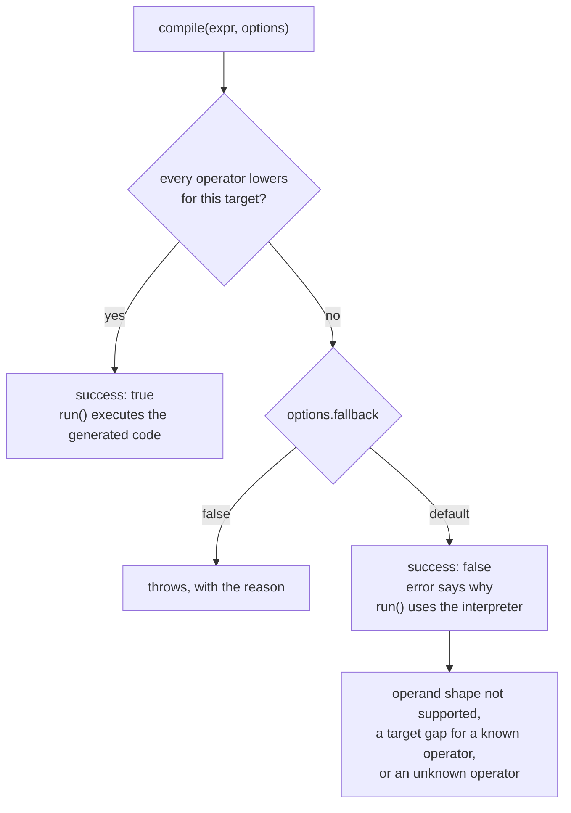

<Intro>
The Compute Engine can compile **LaTeX expressions** to **JavaScript functions**!
</Intro>

## Introduction

Some expressions can take a long time to evaluate numerically, for example if
they contain a large number of terms or involve a loop \\((\sum\\) or
\\(\prod\\)).

In this case, it is useful to compile the expression into a JavaScript function
that can be evaluated much faster.

For example this approximation: $ \pi \approx \textstyle\sqrt{6\sum^{10^6}_{n=1}\frac{1}{n^2}} $

```live
// import { parse, compile } from '@cortex-js/compute-engine';
const expr = parse("\\sqrt{6\\sum^{10^5}_{n=1}\\frac{1}{n^2}}");

// Numerical evaluation using the Compute Engine
console.time('evaluate');
const evaluated = expr.evaluate();
console.timeEnd('evaluate');
console.log(evaluated.toString());

// Compilation to a JavaScript function and execution
console.time('compile');
const result = compile(expr);
console.timeEnd('compile');
console.log(result.run?.());
```

## Compiling

**To get a compiled version of an expression** use the `compile()` function:

```javascript
import { compile } from '@cortex-js/compute-engine';

const f = compile("2\\prod_{n=1}^{\\infty} \\frac{4n^2}{4n^2-1}");
```

**To evaluate the compiled expression** call the `run` method on the
`CompilationResult` returned by `compile()`:

```javascript
console.log(f.run());
// ➔ 3.141592653589793
```

If the expression cannot be compiled, the `result.success` property will be
`false`.

### Validation and Fallback Behavior

Compilation APIs enforce runtime contracts to catch malformed extension payloads
early:

- `ce.registerCompilationTarget(name, target)` validates target names and
  required `LanguageTarget` methods (`getOperators()`, `getFunctions()`,
  `createTarget()`, `compile()`).
- `compile(expr, options)` validates option payload shape for `to`, `target`,
  `operators`, `functions`, `vars`, `imports`, `preamble`, `fallback`, and
  `constantFold`.

By default, `compile()` falls back to interpretation (`success: false` with a
`run` function). To disable fallback and fail fast, set `fallback: false`.



The three reasons are described under
[Why a compilation declined](#why-a-compilation-declined).

### The `run()` Contract: Shaped Inputs, Read-Only Results

On the `javascript` target, `run()` requires inputs of the shape the compiled
code reads, and treats its results as read-only. The runner does a constant
amount of work per binding on each call, one `typeof`:

- a `{re, im}` value bound to a real binding throws a `TypeError` that names
  the binding (the unsigned pole `~oo` is projected to `Infinity` instead);
- a plain number bound to a complex binding is lifted to `{re, im: 0}`;
- a string or a typed array (`Float64Array`, …) bound to a binding the code
  reads as an array is refused: the compiled code reads plain arrays only, so
  convert a typed array once on your side with `Array.from(typed)`.

The string refusal applies to a binding declared with a bare collection type
(`indexed_collection`, `collection`, `list`), with a collection of non-text
elements (`list<number>`), with `list<string>` or `list<character>`, or whose
collection type the engine inferred from its uses. Compiled code would read
the string as UTF-16 code units, not as characters, so the `TypeError` names
the binding and says so. A binding whose type admits a string (`string`,
`indexed_collection<character>`) is not refused. These entry checks are on by
default; `compile(expr, { entryChecks: false })` turns them off, for a caller
that validates its own inputs.

```javascript
ce.declare('S', 'indexed_collection');
const f = compile(ce.box(['Length', ['Drop', 'S', 1]]));
f.run({ S: 'abc' });
// ➔ throws TypeError: "S" (type `indexed_collection`) is compiled as a
//   JavaScript array, and compiled code does not accept a string for it: it
//   would read the string as UTF-16 code units, not as characters. Pass an
//   array, or declare the binding `string` to compile text.
```

A number bound to a binding declared as a list is not refused at entry, since
some lowerings accept a scalar. When the compiled body then fails because it
needed an array, the error names the binding and keeps the body's message as
its `cause`:

```javascript
ce.declare('S', 'list<number>');
compile(ce.box(['Sum', 'S'])).run({ S: 5 });
// ➔ throws TypeError: "S" (type `list<number>`) received a number: compiled
//   code reads such a binding as a JavaScript array, and the compiled body
//   failed (_.S.reduce is not a function). Pass an array.
```

Nothing else is checked, converted, or copied:

- the entries of a list input are never read. A `{re, im}` object, a string
  or a typed array at an entry of a list the code reads on the real lane
  computes with that value, as it would in plain JavaScript;
- a returned collection or `{re, im}` object is the value the code built. It
  may be a value the runner keeps for every later call (a hoisted constant
  list, a bound symbol value), so do not write to a result: copy it first if
  you need to change it.

The result convention is kept: a value whose imaginary part is exactly zero
comes back as a plain number, inside a collection too, and a collection is
copied only when such a cell has to be rewritten. That check is one `typeof`
per cell of a returned collection, with no allocation.

The interpreter is the route that validates: evaluate the expression with
`.evaluate()` or `.N()` to diagnose a wrong input shape.

```typescript
const fn = compile(expr, { to: 'javascript' }).run!;
const T = Array.from(float64Board); // convert a typed array once
const v = fn({ x, y, T });          // no per-call walk, copy or check of T
```

### Running Compiled Code Without the Engine

The entry point `@cortex-js/compute-engine/runtime` exports
`createJavaScriptRuntime(options)`: the helper bundle that `run()` uses, with
no engine behind it. Store a `javascript` `CompilationResult` and run it on a
page, in a worker or on a server with `runtime.load(result)`:

```typescript
import { compile } from '@cortex-js/compute-engine';
import { createJavaScriptRuntime } from '@cortex-js/compute-engine/runtime';

const result = compile(ce.parse('x^2 + 1'), { to: 'javascript' });

const runtime = createJavaScriptRuntime({});
const f = runtime.load(result);
f({ x: 3 });
// ➔ 10
```

`load()` reads the `code`, `entryPlan`, `reconstructionDigits` and
`runtimeVersion` fields of the result, and the `preambleOnce`,
`preamblePerCall` and `callCode` fields when the code has a preamble. It
evaluates the definitions that read nothing per call (a constant list, a
memo) once, and it applies the same input conversions as `run()`: a
real given to a complex-declared symbol is lifted, and a `Float64Array` for a
list symbol is copied. `load()` throws when `result.runtimeVersion` is not
`runtime.runtimeVersion`, or when the stored code has none.

The runtime exposes `load`, `frame`, `setFrame`, `iterationLimit`, `deadline`
and `runtimeVersion`. The other helpers are internal and can change in any
release. The options give the runtime the state it cannot read from an engine:

- `random`: the source of random draws outside a `WithRandomSeed` frame, and
  of the Monte-Carlo samples of the integrals. `null` denies draws; a draw
  then throws an error whose `name` is `CapabilityDeniedError` (test `e.name`,
  not `instanceof`: the class differs in each bundle).
- `frame`, or `runtime.setFrame()`: the frame of an interpreted
  `WithRandomSeed` that the code is called from (`{ seedLo, seedHi, next }` or
  `{ seed, next }`). After the call, `runtime.frame.next` is the advanced
  counter.
- `iterationLimit`: the cap on the lazy-stream walks (default 1024; `0` or
  less means no limit, as for `ce.iterationLimit`).
- `deadline`: an optional time after which the shuffle and choice loops throw.

A seeded program gives the same values interpreted, with `run()` and from the
stored code. Functions passed in the `functions` or `imports` compile options
are copied into the code as source, so a closure loses its enclosing scope,
and a function given by name must exist where the code runs.

### Evaluating Many Points at Once: `broadcast()`

A plotter samples a function once per pixel column, or once per cell of an
implicit plot, and `run()` converts its argument object and wraps its result
on every call. `broadcast(inputs, options)` takes the inputs of every cell at
once and writes every result into one `Float64Array`: the conversions run once
per batch, the compiled body once per cell. Measured 2026-10-20: 20 % faster
than `run()` per cell on the main thread, and the batch is what a worker
thread receives (below). It is present on a `javascript` result compiled from
an expression (`calling: 'expression'`) and on an `interval-js` result.

```javascript
const f = compile(ce.parse('\\sin(x)\\cos(y) + a'));

const xs = new Float64Array([0, 0.5, 1]);
const ys = new Float64Array([0, 1]);

// Six cells: the two arrays are the axes of a grid, `x` varying fastest.
f.broadcast({ x: xs, y: ys, a: 0.5 }, { layout: 'grid' });
// ➔ Float64Array [0.5, 0.979…, 1.341…, 0.5, 0.759…, 0.954…]

// Three cells: every array holds one value per cell.
f.broadcast({ x: xs, y: new Float64Array([1, 1, 1]), a: 0.5 });
```

**Inputs.** `inputs` maps each free variable to a `Float64Array` or to a
number. A number is the same value for every cell (a document variable). With
the default layout, `'cells'`, every array holds one value per cell (for
`interval-js`, a `lo, hi` pair per cell) and all have the same cell count.
With `layout: 'grid'` the arrays are the axes of a regular grid, in key order
of `inputs`, the first varying fastest; the cell count is the product of their
lengths and nothing is expanded on the caller's side. `options.out` is a
caller-owned output array, filled and returned instead of a new one; it must
hold at least `outputs` values per cell (below).

**Shared inputs** (`javascript` only). An input can also be bound once for the
whole batch and read by index in the expression, for example the field values
of a grid that each cell reads around its own index:

```javascript
ce.declare('F', 'list<number>');
ce.declare('i', 'integer');
const f = compile(ce.parse('F_{i+1}'));

f.broadcast({ i: new Float64Array([0, 1, 2]), F: [1, 2, 3, 4] });
// ➔ Float64Array [1, 2, 3]
```

A variable is shared when the compiled code reads it as a list (its declared
type is a list type), or when `options.shared` names it: `{ shared: ['G'] }`
is the way to share a variable that has no declared type. Each name in
`shared` must be a key of `inputs`. A shared input is a plain array of numbers
or a `Float64Array`; the compiled code reads plain arrays only, so a
`Float64Array` is copied into one, once per batch, before the cell loop. A
shared input is not a column of the `cells` layout and not an axis of the
`grid` layout: it does not count toward the cells. A plain array for any other
variable throws.

**Output of a `javascript` result.** One value per cell by default. A boolean
is `1` or `0`; a complex value with a zero imaginary part is its real part; a
cell whose evaluation throws, or gives any other non-number (a complex value
with a non-zero imaginary part, a list), is `NaN`. Cell for cell, the value is
the one `run()` gives: the same compiled body runs with the same conversions.
A missing variable, a length mismatch or a wrong element type throws before
the loop.

**Several outputs per cell.** An expression whose type is a tuple of two or
more elements that can be numbers writes that many values per cell into the
same output array. An element typed `unknown` counts: `(x, y)` with undeclared
`x` and `y` writes two values per cell. An element that cannot be a number,
such as a string, gives one value per cell. With
`m` values per cell, cell `c` is at `[m·c, m·c + m)`. The result reports the
inferred `m` as `broadcastOutputs` (absent when it is 1), and
`options.outputs` (a positive integer) overrides it.

```javascript
const g = compile(ce.parse('(i, 2i)'));
g.broadcastOutputs;                                 // ➔ 2
g.broadcast({ i: new Float64Array([1, 2, 3]) });
// ➔ Float64Array [1, 2,  2, 4,  3, 6]
```

With more than one value per cell, the elements of an array answer go through
the conversions above one by one; an element past the end of the array is
`NaN`, and an answer that is not an array, or a cell that throws, is `NaN` in
every slot. With one value per cell (`outputs: 1`), an array answer is `NaN`,
as before. `shared` and `outputs` are `javascript` options: an `interval-js`
result throws a `TypeError` for either.

**Output of an `interval-js` result.** A `lo, hi, kind` triple per cell, at
offsets `3·i`, `3·i + 1` and `3·i + 2`. The kinds are the `INTERVAL_KIND`
codes, exported from the main entry and from
`@cortex-js/compute-engine/interval`:

| Code | Meaning | `lo`, `hi` |
|------|---------|------------|
| `interval` | an ordinary enclosure; a half-infinite bound is ordinary | the enclosure |
| `empty` | no value on the input (`sqrt([-2, -1])`) | NaN |
| `entire` | every real; nothing can be said | NaN |
| `singularPole` | the input crosses a pole (`1/x` on `[-1, 1]`) | NaN |
| `singularJump` | the input crosses a jump (`floor`) | the values on both sides |
| `partial` | part of the input is outside the domain (`sqrt([-1, 4])`) | the values inside |
| `boolTrue`, `boolFalse`, `boolMaybe` | a compiled comparison or logical expression | NaN |
| `error` | this cell threw, or gave bounds that are not numbers or are reversed | NaN |

A cell never rejects the batch. The `domainClipped` side of a `partial`
result and the `at` and `continuity` of a `singular` result are not reported.

```javascript
const g = compile(ce.parse('\\sqrt{x}'), { to: 'interval-js' });
g.broadcast({ x: new Float64Array([1, 4, -2, -1, -1, 4]) });
// ➔ [1, 2, INTERVAL_KIND.interval,  NaN, NaN, INTERVAL_KIND.empty,  0, 2, INTERVAL_KIND.partial]
```

### Worker Threads: `broadcastAsync()` and the Kernel Pool

`broadcastAsync(inputs, options)` takes the same inputs and `out` as
`broadcast()`, plus a `signal` (an `AbortSignal`), a `deadline` (milliseconds
of wall clock for the whole batch) and a `chunk` (cells per task). It resolves
to `{ out, done }`, where `done` is the number of leading cells that are
valid: every cell, or fewer when the deadline or the signal stopped the batch;
the cells after `done` are untouched.

`broadcastAsync()` takes `shared` and `outputs` as `broadcast()` does; `done`
is still a count of cells, not of values. On a pool, the shared inputs go to
each worker once per call, with the first slice of the call that the worker
receives, and the worker keeps them until the call ends; each later slice
carries only its own cells. A `Float64Array` shared input is copied for each
worker and transferred, a plain array is cloned. The default stride travels
with the stored result (`broadcastOutputs`), so a worker and
`createJavaScriptRuntime().loadBroadcast(result)` lay out the cells the same
way, and the runtime reads the shared inputs from the stored entry plan.

Without a worker pool it runs the batch inline, in slices between yields to
the event loop, so a deadline still applies and a long batch does not block a
frame. With a pool it splits the cells into one slice per worker (or `chunk`
cells per slice), ships them, and writes each returned slice into `out` as it
arrives. A batch under a threshold runs inline in any case: the pool measures
the cells per millisecond of each compiled function from its inline batches,
and ships a batch only when its serial time would exceed about 10 ms (before
the first measurement, 20 000 cells). Measured 2026-10-20 on an 18-core
machine: an implicit plot of 512×512 interval cells takes 175 ms inline and 34
ms on 8 workers; a 2000-column 1D plot takes under 2 ms and never ships.

The engine creates no worker on its own. The host builds the pool and gives it
to one or more engines:

```javascript
import { ComputeEngine, createKernelPool } from '@cortex-js/compute-engine';

const pool = createKernelPool({
  // The worker file ships as one self-contained ES module,
  // `dist/esm-min/kernel-worker.js` (`@cortex-js/compute-engine/kernel-worker`).
  // Copy it next to your own files when your bundler does not resolve the
  // package at run time, and start it from its URL.
  create: () => new Worker(new URL('./kernel-worker.js', import.meta.url), { type: 'module' }),
  size: 4,        // default: one less than the hardware concurrency, at most 8
  prewarm: true,  // create the workers on idle time now, not on the first batch
});

const ce = new ComputeEngine();
ce.workers = pool;

const f = compile(ce.parse('\\sin(x)\\cos(y) + x^2 - y^2 - 0.3'), { to: 'interval-js' });
const { out, done } = await f.broadcastAsync(
  { x: xAxis, y: yAxis },
  { layout: 'grid', deadline: 30 }
);
```

In Node the factory returns a `worker_threads` `Worker` on the same file. A
worker reports the versions of the runtimes it holds; a stored result compiled
by another release is refused by the worker, and its slices then run inline.
`pool.dispose()` terminates the workers; a later batch creates them again. A
Content Security Policy must allow the worker script (`worker-src`) and
`new Function` in it (`'unsafe-eval'`): the worker rebuilds each function from
its text, as `createJavaScriptRuntime().load()` does. `SharedArrayBuffer` is
not needed; the arrays are transferred.

The two standalone runtimes have the same batch forms:
`createJavaScriptRuntime().loadBroadcast(result)` and
`createIntervalRuntime().loadBroadcast(result)` (from
`@cortex-js/compute-engine/interval`) rebuild a stored result as a
`broadcast()` function, with no engine behind it. An `interval-js` result
carries `runtimeVersion`, `preambleOnce` and `preamblePerCall` for them, as a
`javascript` result does.

### Constant Folding

A **pure** subexpression with no free variables is evaluated at compile time
and emitted as a literal instead of being lowered structurally — on every
target:

```javascript
compile(ce.parse("\\mathrm{Sum}(\\mathrm{Take}(\\mathrm{Map}(\\_ \\mapsto \\_^2, 1..20), 10))")).code
// ➔ "385"

compile(ce.parse("x + \\mathrm{Sum}(\\mathrm{Map}(\\_ \\mapsto \\_^2, 1..5))")).code
// ➔ "_.x + 55"
```

Numbers, booleans, and **constant collections** fold. A constant collection
becomes a literal list, which matters most when the collection is constant but
its consumer is not:

```javascript
const r = compile(ce.box(['At', ['Map', ['Function', ['Square', 'y'], 'y'],
                                 ['Range', 1, 6]], 'k']));
r.code         // ➔ "_SYS.at(_lit_1, _.k)"
r.preambleOnce // ➔ "const _lit_1 = [1, 4, 9, 16, 25, 36];\n"
```

The index `k` is a run-time input, so the expression as a whole cannot fold —
but its base is baked once at compile time instead of being rebuilt and
mapped over on every call. The baked list is a preamble local that `run()`
evaluates once per compiled function (it is in `preamble`, and in
`preambleOnce` for a runtime that splits the two), so a caller that runs
`code` itself must include the preamble, as for a bound symbol value
(`_val_*`) or a user function (`_fn_*`). A written list literal of three or
more numbers (`[1, 2, 3]`, a matrix of them) is hoisted the same way. Collection folding is bounded: it applies to a
**finite, indexed** collection (a `Set` has no defined element order, so it
never folds) of at most 50 **numeric** elements. A longer collection, or one
holding strings, tuples or nested collections, compiles structurally.

Folding declines — and the subtree compiles exactly as before — whenever any
of the following holds:

- the subtree is **impure** (`Random(…)` and friends keep drawing at run
  time);
- it mentions an **unknown**, a **`vars`-mapped input** (even one with an
  engine value — `vars` pins it live), or a name bound by an enclosing lambda
  or loop;
- it mentions an operator whose emission you overrode with the `functions` or
  `operators` options (folding would evaluate the engine's definition, not
  yours);
- it contains a `Sum` or `Product` over a **non-finite bound** (`Σ i,
  i=1..∞`): for a divergent series the interpreter's numeric evaluation
  silently returns an iteration-limit-truncated partial sum, and folding
  would bake that wrong number as a constant — such expressions keep their
  fail-closed structural behavior (a *bounded* infinite pipeline like
  `Sum(Take(Map(_ ↦ _^2, 1..∞), 10))` still folds);
- it is estimated to cost too much to evaluate at compile time, or exceeds
  the engine's collection-size cap. The estimate is **deterministic** — it
  reads the expression and nothing else, so the same input always compiles
  to the same output, and folded code is safe to pin in a test. Constructs
  that multiply work are priced by their counts: a `Sum` or `Product` by its
  number of iterations, a `Map` or `Filter` by the size of its source. An
  expression whose count cannot be determined statically is not folded —
  though a bound supplied by a *consumer* still counts, which is why
  `Sum(Take(Map(f, 1..∞), 10))` folds while `Sum(Map(f, 1..∞))` does not;
- the compilation records a capture set (the `symbolDeps` option, used by the
  engine's implicit-compilation cache): folding evaluates through engine
  state transitively and would under-report the dependencies the cache is
  keyed on, so such a compilation never folds.

The folded value is the **interpreter's** (`.N()`), so a folded constant can
differ in the last ulp from what the structural code would have computed in a
different operation order — compiled output tracks `evaluate()` by design
(`sin(π/6)` compiles to `0.5`, not `Math.sin(Math.PI / 6)`, which is
`0.49999999999999994`).

**To disable folding** — for example to inspect the structural lowering of a
constant expression — pass `constantFold: false`:

```javascript
compile(expr, { constantFold: false });
```

The interval-arithmetic target (`interval-js`) never constant-folds: a folded
point value would discard the outward-rounded enclosure that target exists to
compute.

### Why a compilation declined

When `success` is `false`, `CompilationResult.error` carries the reason (the
same text the `fallback: false` path throws). The message identifies which of
three things happened:

| Message shape                                                | Meaning                                                                                   |
| :----------------------------------------------------------- | :---------------------------------------------------------------------------------------- |
| `X: cannot compile — …` naming an operand or a component      | The head lowers, but not for these operand shapes (e.g. a collection-valued point component) |
| `X: cannot compile — the operator is known … no lowering`     | A target gap: the engine knows `X`, this target has no codegen for it                      |
| ``Unknown operator `X` ``                                     | No operator definition for `X` at all — a typo, or a symbol never declared as a function   |

`CompilationResult.unsupported` lists the same heads declaratively, so a caller
can branch on the condition without parsing the message.

### Values That May Be Lists

An operand typed
[`broadcastable<T>`](/compute-engine/guides/types/) — a value that may be a
scalar or a list, such as the result of a call whose return type is
`unknown` — compiles differently per target:

- **JavaScript**: arithmetic and element-wise math functions compile through a
  runtime broadcast helper. The same compiled artifact returns a scalar for a
  scalar binding and the element-wise list for a list binding, matching the
  interpreter.
- Shapes that cannot be lowered soundly **fail closed** (a compilation error;
  with the default fallback, the interpreter is used): a product of two or
  more possibly-list operands (a run-time matrix would require the matrix
  product, not an element-wise one), `Equal`/`NotEqual` over a possibly-list
  operand, and complex-element broadcasts.
- **Python**: arithmetic over a possibly-list operand always fails closed —
  Python's `*` and `+` repeat or concatenate a plain `list` rather than
  broadcasting, so scalar code would silently compute the wrong value.
  Function heads that lower to NumPy calls (`np.sin`, …) are unaffected —
  NumPy broadcasts natively.
- **GLSL/WGSL**: such operands compile as scalar slots, unchanged — shader
  targets have no dynamic lists.

### Out-of-Domain Operands to String Operators

Several string operators take an operand whose domain the interpreter enforces
by returning an **error value**: `RangeOf`'s `from` (an integer of 1 or more)
and its needle (a non-empty sequence), `StringReplace`'s `target` (a non-empty
string) and `count` (a positive integer), `StringRepeat`'s `n` (a non-negative
integer), and `PadStart`/`PadEnd`'s `n` (a non-negative integer) and `pad` (a
non-empty string). Compiled code has no representation for an error value, so
each of those operands takes one of three routes.

**A valid literal compiles bare.** The check happens once, at compile time, and
nothing is emitted for it:

```javascript
compile(ce.box(['PadStart', 's', 5, { str: '0' }])).code
// ➔ '_SYS.spad(_.s, 5, "0", true)'
```

**An invalid literal declines to compile**, and so does a computed operand the
engine can already *prove* out of domain (`Negate(k)` for a `k` known positive,
a symbol assigned `""`). The result is `success: false` with a message naming
the operator and the rule; with the default fallback the interpreter runs the
expression instead, and returns its error value:

```javascript
const r = compile(ce.box(['PadStart', 's', -1, { str: '0' }]));
r.success;
// ➔ false
r.error;
// ➔ "PadStart: cannot compile — `n` must be a non-negative integer of at most
//    1000000, and this operand is the literal `-1`, which the interpreter
//    answers with an error value. Fail closed (D6)."
```

This is the first row of the [decline table](#why-a-compilation-declined) — the
head lowers, just not for this operand — so it is reported in `error` only;
`CompilationResult.unsupported` stays empty, because `PadStart` itself is not a
target gap.

**A computed operand compiles and is guarded at run time.** The emitted code
carries a domain check that **throws a `RangeError`** naming the operator and
the rule when the value turns out to be out of domain:

```javascript
ce.declare('s', 'string');
ce.declare('w', 'integer');

const p = compile(ce.box(['PadStart', 's', 'w', { str: '0' }]));
p.code;
// ➔ '_SYS.spad(_.s, _SYS.domi(_.w, 0, 1000000, "PadStart: `n` must be a
//    non-negative integer of at most 1000000"), "0", true)'

p.run({ s: '7', w: 5 });
// ➔ "00007"

p.run({ s: '7', w: -1 });
// ➔ throws RangeError: PadStart: `n` must be a non-negative integer of at
//   most 1000000
```

Throwing is the deliberate divergence. The interpreter answers an out-of-domain
operand with an error value; a compiled artifact returns a plain JavaScript
value and cannot carry one, so it fails loudly rather than returning a wrong
answer. `Slice` in the same target already sets that precedent — a non-literal
span argument compiles and the emitted code throws
`RangeError: Slice: the span argument is not an ascending index range at run
time`.

The integer operations `Mod`, `Remainder`, `GCD` and `LCM` use the same
convention for magnitude. Compiled code works in doubles, so an operand beyond
the safe integer range (±2^53) or an infinity throws a `RangeError` that names
the operation and the value, instead of returning a different number. The
Python target raises a `ValueError` with the same message. The `Mod(x, 1)`
fractional-part forms are not checked. A plot kernel that samples
`Mod(1/x, 2)` at `x = 0` throws at that sample. A constant operand is folded
from the exact value, so `DigitSum(2^1000)` compiles to `1366`.

```javascript
ce.declare('x', 'integer');
const m = compile(ce.box(['Mod', 'x', 10]));
m.run({ x: 2 ** 60 + 1 });
// ➔ throws RangeError: Mod: 1152921504606847000 is beyond the safe integer
//   range of compiled code (±9007199254740991); evaluate with the interpreter
//   for the exact result
```

The upper bound in those messages is not arbitrary. The interpreter reads these
counts with `asSmallInteger`, which answers `null` — hence an error value —
above **1 000 000**, so the compiled guard uses the same ceiling; without it
`StringRepeat(s, 2000001)` would build a multi-megabyte string where the
interpreter errors. `RangeOf`'s `from` is the exception: it is read with
`toInteger`, which has no ceiling, so a large `from` is not an error at all —
just a search that starts past the end and answers `Nothing`.


## Implicit Compilation and the `jit` Setting

Beyond explicit `compile()` calls, the engine **compiles automatically** in a
number of implicit spots — for example when draining a large numeric `Map`,
or when an exact integer computation over a large collection is provably safe
to run in floating point. This is transparent: results are identical to the
interpreter's, and any compilation failure silently falls back to
interpretation.

The `jit` property of a `ComputeEngine` instance controls this behavior:

- **`"auto"`** (the default): implicit compilation is attempted where
  beneficial. If the environment forbids code generation altogether (a
  strict Content-Security-Policy page without `'unsafe-eval'`, an MV3
  browser extension), the engine detects this on the first attempt and
  latches to `"off"` engine-wide, so at most one CSP violation is reported.
- **`"off"`**: no implicit code generation is ever attempted; every implicit
  path uses the interpreter. Set it up front on hardened runtimes, or use it
  as a diagnostic kill switch to compare interpreter and compiled behavior.

Explicit `compile()` calls are not affected by this setting — a direct
request keeps failing loudly with the environment's own error.

Toggling `jit` is an engine-configuration change: caches whose entries were
produced on the other route are invalidated, so `jit = "off"` genuinely
re-runs the interpreter rather than serving previously compiled results.

## What Can Be Compiled

Three kinds of expressions can be compiled, and each produces a `run` function
with a different calling convention.

### Plain Expressions

A plain expression like `x^2 + 1` has free variables (unknowns). The compiled
`run` function takes a **vars object** mapping variable names to values:

```live
// import { compile } from '@cortex-js/compute-engine';
const f = compile("n^2");

for (let i = 1; i < 10; i++) console.log(f.run({ n: i }));
```

An expression with no unknowns can be called with no arguments:

```live
// import { compile } from '@cortex-js/compute-engine';
console.log(compile("\\sqrt{6\\sum^{100}_{n=1}\\frac{1}{n^2}}").run());
// ➔ 3.1320...
```

### Lambda Expressions

A lambda expression uses $\mapsto$ (`\mapsto`) to explicitly declare
parameters. The compiled `run` function takes **positional arguments**:

```live
// import { compile } from '@cortex-js/compute-engine';

// Single parameter
const f = compile("x \\mapsto x^2 + 1");
console.log(f.run(3));
// ➔ 10

// Multiple parameters
const g = compile("(x, y) \\mapsto x^2 + y^2");
console.log(g.run(3, 4));
// ➔ 25
```

Lambdas are useful when the variable name is user-specified rather than assumed
by convention. A lambda like `\theta \mapsto 1 + \cos(\theta)` makes the
parameter explicit, avoiding ambiguity.

**Declared parameter types are checked.** A compiled call of a user function
whose parameters have declared types checks the argument at run time when its
static type does not prove the declared type. The compiled value is `NaN`
where the interpreter answers an `incompatible-type` error:

```js
ce.declare("h", { signature: "(x: integer) -> integer" });
ce.assign("h", ce.parse("x \\mapsto 2x"));
ce.declare("y", "real");

const f = compile(ce.parse("h(y)"));
f.run({ y: 3 });    // ➔ 6
f.run({ y: 2.5 });  // ➔ NaN  (the interpreter gives an incompatible-type error)

compile(ce.box(["Map", "h", ["List", 1, 2.5]])).run();
// ➔ [2, NaN]  (a function value handed to Map is checked per element)
```

An argument whose static type is already below the declared type needs no
test, and a parameter typed `number` or `complex` has none. The declared
result type is not checked in compiled code.

### Tuple Expressions

A tuple expression like `(\cos(t), \sin(t))` compiles to a function that returns
a JavaScript array:

```live
// import { compile } from '@cortex-js/compute-engine';
const f = compile("(\\cos(t), \\sin(t))");

const [x, y] = f.run({ t: Math.PI / 5 });
console.log(x, y);
```

This is particularly useful for parametric curves. Both `Tuple` and `List`
expressions compile to arrays.

### Control Structures

Control structures such as conditionals, loops, and blocks can be compiled to
JavaScript.

#### `If` and `Which` (Conditionals)

`If` expressions compile to ternary operators and `Which` expressions (used by
`\begin{cases}`) compile to chained ternaries:

```live
// import { compile } from '@cortex-js/compute-engine';

// If expression
const f = compile("\\keyword{if} x > 0 \\keyword{then} x \\keyword{else} -x");
console.log(f.run({ x: -5 }));
// ➔ 5

// Which / cases expression
const g = compile("\\begin{cases} x^2 & x > 0 \\\\ -x & x < 0 \\\\ 0 \\end{cases}");
console.log(g.run({ x: 3 }));
// ➔ 9
```

When no condition matches, compiled `Which` returns `NaN`. The interpreter
answers `Missing` for the same input — the absence marker has no value in the
target's floating-point model, so it projects to `NaN`. See
[Non-Finite Results](#non-finite-results). A selection whose arms are all
provably not numbers — strings, lists — answers the target's missing-object
literal instead, `undefined` in JavaScript and `None` in Python, so that
`IsMissing` and `Coalesce` work on a compiled string selection; an arm whose
type is unknown counts as a number. An `If` with no else-branch is
the one-clause `Which`: `If(c, t)` compiles on every target and returns
`NaN` when `c` is false. An `If` whose branch is a statement — an
assignment, a loop — is a guard statement, not a value, and keeps its own
rules (see the statement sections below).

```live
// import { compile } from '@cortex-js/compute-engine';

// No clause covers x = 0, and there is no fallback clause
const h = compile("\\begin{cases} x^2 & x > 0 \\\\ -x & x < 0 \\end{cases}");
console.log(h.run({ x: 0 }));
// ➔ NaN
```

#### `Sum` and `Product`

`Sum` and `Product` with numeric bounds compile to `for` loops with accumulator
variables:

```live
// import { compile } from '@cortex-js/compute-engine';

// Fourier approximation
const f = compile("\\sum_{k=0}^{5} \\frac{\\sin((2k+1)x)}{2k+1}");
console.log(f.run({ x: 1.0 }));
```

#### `Loop`, `Break`, `Continue`, `Return`

`Loop` is imperative control flow, compiled for effect: bare `Loop(body)`
compiles to a JavaScript `while (true) { ... }` loop, and `Loop(body,
Element(...), ...)` compiles to plain `for`/`for-of` loops with no result
collection — the compiled expression's value is `undefined`. `Break`,
`Continue`, and `Return` compile to their JavaScript equivalents:

```live
// import { compile } from '@cortex-js/compute-engine';

const f = compile("\\keyword{for} i \\keyword{from} 1 \\keyword{to} 10 \\keyword{do} i^2");
console.log(f.run());
// ➔ undefined (Loop is evaluated for effect)
```

#### `Comprehension`

`Comprehension` compiles to nested `for (const x of ...)` loops that push
each computed value into a result array, which is returned:

```live
// import { compile } from '@cortex-js/compute-engine';

const f = compile("x^2 \\keyword{for} x = [1...5]");
console.log(f.run());
// ➔ [1, 4, 9, 16, 25]
```

`Comprehension` is not compilable to GLSL or WGSL (shaders have no dynamic
arrays). Imperative `Loop` is still compilable to GLSL/WGSL.

#### Multi-statement constructs on the shader targets

A shader has no expression-level loop or IIFE, so on GLSL and WGSL a `Sum` or
`Product` with a symbolic bound is emitted as **statements** (with constant
bounds it unrolls into an ordinary expression instead). Such a loop is hoisted
ahead of the value that consumes it, so it can appear anywhere in an
expression — `0.03\sum_{k=0}^{n}kx` compiles, and a nested sum is hoisted into
its enclosing loop body rather than out of it.

A loop inside a **conditionally-evaluated branch** — an `If`, `When`, `Which` or
`Match` arm — fails closed (`success: false`) instead. A shader conditional is
an expression, not a statement, so there is no place to put the loop inside the
branch; hoisting it out would run it whichever branch is selected, which changes
the result whenever the branch draws from the random stream.

`Loop` and `Block` are not hoisted either — they remain valid only as a whole
function body, and fail closed when used as a sub-expression.

A shader has no dynamic array, so a literal `List`, `Tuple`, `PointList` or
`Range` is written into the shader as a constant array constructor. The `glsl`
and `wgsl` targets accept at most **256** elements this way. A larger constant
collection is a `capability` decline with the diagnostic code
`inline-collection-too-large`; the message names the element count and the
limit. Ship such a collection as a texture (a `storage: sampler2D` input read
with `At`) instead. The `javascript` and `interval-js` targets have no such
limit: a list of any length is one array constant there.

```javascript
const big = ce.box(['List', ...Array.from({ length: 300 }, (_, i) => i)]);
const r = compile(ce.box(['At', big, 'k']), { to: 'glsl' });
r.diagnostic.code;
// ➔ "inline-collection-too-large"
r.error;
// ➔ "Could not compile `List`: a constant collection of 300 elements is above
//    the 256 elements a shader array constructor takes on this target. Ship
//    the collection as a texture (a `storage: sampler2D` input, read with
//    `At`) instead."
```

#### `Block` and `where`

`Block` expressions create scoped variable bindings. The `where` syntax provides
a convenient way to define local variables:

```live
// import { compile } from '@cortex-js/compute-engine';

const f = compile("r^2 \\text{ where } r \\coloneq x^2 + y^2");
console.log(f.run({ x: 3, y: 4 }));
// ➔ 625
```

## Variable Names

The compiled function expects variable names as they appear in the parsed
MathJSON expression. Greek letters become their English names:

| LaTeX       | Variable Name |
|-------------|---------------|
| `x`, `y`    | `"x"`, `"y"`  |
| `t`         | `"t"`         |
| `\theta`    | `"theta"`     |
| `\alpha`    | `"alpha"`     |
| `u`, `v`    | `"u"`, `"v"`  |

Use the wrong name and you'll get `NaN` silently:

```javascript
const f = compile("1 + \\cos(\\theta)");

f.run({ theta: 0.5 }); // ✓ correct → 1.8776
f.run({ x: 0.5 });     // ✗ wrong key — returns NaN
```

**To discover the variable names** in an expression, use `expr.unknowns` (or
its alias `expr.freeVariables`). These properties return only the free
variables — symbols that are not constants, operators, or bound by scoping
constructs like `Sum` or `Product`:

```live
console.log(parse("n^2").unknowns);

console.log(parse("a^2+b^3").unknowns);

console.log(parse("\\sin(\\theta)").unknowns);
```

## Complex Numbers

The JavaScript target has full complex arithmetic support. When the compiler
detects that a subexpression involves complex values, it automatically emits
complex-aware code for all operations touching that subexpression.

### When Complex Arithmetic Is Used

The compiler decides at compile time whether each subexpression is
complex-valued. This happens when:

- The expression contains `i` (`ImaginaryUnit`)
- A symbol has been declared with a complex type
- An operation is applied to a complex-valued operand

The detection is **static** — based on the expression's structure, not on
runtime values. What happens to a radical of a real operand whose sign is not
known depends on the compile [mode](#modes-auto-strict-complex). Under the
default `auto` mode, `\sqrt{x}` is **promoted**: it is lowered through the
complex kernel, so `compile("\\sqrt{x}").run({ x: -4 })` is `{ re: 0, im: 2 }`,
as `evaluate()` gives, and `2` at `x = 4`. Under `mode: "strict"` the
radical compiles to the real `Math.sqrt`, because `x` has no declared complex
type, and the same call returns `NaN`. To get a complex result in every mode,
make the expression explicitly complex, e.g. `\sqrt{x + 0i}`.

### Result Format

When an expression _is_ complex-valued, the compiled `run` function returns a
`{ re: number, im: number }` object instead of a plain number:

```live
// import { compile } from '@cortex-js/compute-engine';

// Explicit complex expression — compiler knows it's complex
const f = compile("(1 + 2i)^2");
console.log(f.run());
// ➔ { re: -3, im: 4 }
```

Complex-aware operations include all the standard arithmetic (`+`, `-`, `*`,
`/`), trigonometric functions (`sin`, `cos`, `tan`, and their inverses and
hyperbolic variants), `exp`, `ln`, `sqrt`, `pow`, `abs`, `arg`, `conjugate`,
`Re`, and `Im`.

### Extracting Real and Imaginary Parts

Use `Re` and `Im` to extract components from a complex expression:

```live
// import { compile } from '@cortex-js/compute-engine';

const f = compile("\\Re((1 + 2i)^2)");
console.log(f.run());
// ➔ -3  (a plain number, not an object)
```

### Mixing Real and Complex Operands

When a complex operand is combined with a real operand, the result is complex:

```live
// import { compile } from '@cortex-js/compute-engine';
const f = compile("x + 2i");
console.log(f.run({ x: 3 }));
// ➔ { re: 3, im: 2 }
```

### GLSL Target

The GLSL target also supports complex arithmetic, but represents complex numbers
as `vec2` values — the `.x` component is the real part, `.y` is the imaginary
part:

```glsl
// Complex literal: 3 + 4i
vec2(3.0, 4.0)

// Imaginary unit
vec2(0.0, 1.0)
```

Simple operations like addition, subtraction, negation, and scalar multiplication
use native `vec2` operations. More involved operations — complex multiplication,
division, exponentiation, and transcendentals — use helper functions emitted in
a **preamble** block:

| Operation | GLSL Helper |
|-----------|-------------|
| `z * w`   | `_gpu_cmul(z, w)` |
| `z / w`   | `_gpu_cdiv(z, w)` |
| `z ^ w`   | `_gpu_cpow(z, w)` |
| `sqrt(z)` | `_gpu_csqrt(z)` |
| `exp(z)`  | `_gpu_cexp(z)` |
| `ln(z)`   | `_gpu_cln(z)` |

The preamble is **dependency-aware**: each helper declares its prerequisites
(e.g., `_gpu_cpow` depends on `_gpu_cexp`, `_gpu_cmul`, and `_gpu_cln`), and
only the needed functions are emitted in topological order. If the expression is
purely real, no preamble is generated.

Component extraction maps to native swizzle operations:

```glsl
Re(z)        →  (z).x
Im(z)        →  (z).y
Abs(z)       →  length(z)      // built-in
Arg(z)       →  atan(z.y, z.x)
Conjugate(z) →  vec2(z.x, -z.y)
```

The same complex value analysis used by the JavaScript target determines
whether each subexpression needs complex or real code paths in GLSL.

### Result Convention

A compiled JavaScript unit returns a real value as a plain `number` and a
non-real value as `{ re, im }` — and both directions are guaranteed at the
`run()` boundary: a value whose imaginary part is **exactly** zero comes back
as a `number`, and a returned `{ re, im }` always has `im !== 0`. So a
consumer's per-sample test is the single `typeof v === 'number'`, and a
`{ re, im }` with a non-zero imaginary part tells "outside the real domain"
from a genuine `NaN`. Booleans are never coerced.

```live
// import { compile } from '@cortex-js/compute-engine';

console.log(compile("(1 + 0i) * 5").run());   // 5 (a plain number)
console.log(compile("\\sqrt{x}").run({ x: 4 }));    // 2
console.log(compile("\\sqrt{x}").run({ x: -1 }));   // { re: 0, im: 1 }
```

The transcendental complex kernels chop their own roundoff dust at the
machine scale (as the interpreter does), which is what lets the boundary test
be exact: `arcsin(0.5)` compiled through the complex kernel is the number
`0.5235…`, while `1 + 10^{-12} i` stays `{ re: 1, im: 1e-12 }` — nothing is
chopped in ring arithmetic.

### Non-Finite Results

The engine distinguishes three kinds of non-finite number — the signed
infinities $+\infty$ and $-\infty$, complex infinity $\tilde\infty$, and `NaN`.
A floating-point target has only two: IEEE `Infinity`/`-Infinity` and `NaN`.
Compiled code therefore reports a **projection** of the interpreted answer, and
the two agree everywhere except at the direction-less infinity.

The signed infinities and `NaN` round-trip. `\ln(0)` is $-\infty$ interpreted
and `-Infinity` compiled; a `NaN` argument stays `NaN` through a compiled
numeric head, exactly as it does through `evaluate()`:

```live
// import { compile } from '@cortex-js/compute-engine';

console.log(compile("\\ln(x)").run({ x: 0 }));
// ➔ -Infinity

console.log(compile("\\mathrm{Heaviside}(x)").run({ x: NaN }));
// ➔ NaN
```

Complex infinity has no distinct floating-point value, so a pole projects onto
the positive infinity. Interpreting $1/0$ gives $\tilde\infty$, which carries no
direction; the compiled unit answers `Infinity`, and `-Infinity` for the
negative-zero approach that IEEE arithmetic does distinguish:

```live
// import { compile } from '@cortex-js/compute-engine';

const f = compile("\\frac{1}{x}");
console.log(f.run({ x: 0 }));    // ➔ Infinity
console.log(f.run({ x: -0 }));   // ➔ -Infinity
```

This projection reaches a comparison in a branch. In the interpreter a pole
has no order, so `1/x > 0` at `x = 0` is `False` and `\{1/x > 0: 1, 0\}` is
`0` (user decision of 2026-10-21); the compiled unit compares `Infinity > 0`,
which is `true`, and gives `1`. The two answers differ at the pole only. A
closed form with no variable (`\{1/0 > 0: 1, 0\}`) is folded at compile time to
the interpreter's answer, `0`.

Absence markers project the same way. `Missing` — what an unmatched `Which`,
an else-less `If` and a false restriction `e\{c\}` return — is not a
number, so the chained ternary ends in a literal `NaN` (see
[`If` and `Which`](#if-and-which-conditionals)). The same value reaches `run()`
when the expression was never compiled at all and fell back to
interpretation: its `Missing` crosses the boundary as `NaN` too.

**Type guards follow the finite-by-default lattice.** Every bare numeric type
name denotes a **finite** value, so the guard a compiled parameter test emits
rejects `Infinity` and `NaN` exactly as the interpreter's signature check does:
`real` lowers to `Number.isFinite`, `integer` to `Number.isInteger`, and
`complex` to a test that a plain number is finite or that both parts of a
`{ re, im }` pair are. `+oo | -oo` — the signed pair — is the guard for
the infinities.

The `infinity` and `nan` tiers have no faithful test in the target's value
model, because the projection above is lossy in exactly the place those tiers
distinguish. A definition whose parameters use either one therefore **declines
as a whole** and runs interpreted, rather than dispatching on a test that would
disagree with `evaluate()`. This is the usual fail-closed posture for a
construct the target cannot represent.

### Modes: `auto`, `strict`, `complex`

JavaScript has no complex number: a compiled value is a `number` or a
`{ re, im }` object, and the compiler decides which **statically, per node**.
What a compile **mode** fixes is what a numeric binding whose static type is
**wide** (`unknown`, `number`, an unannotated parameter, a `Block` local not
declared real) is shaped as — and what happens when a complex-shaped value
reaches one:

- **`strict`** — the shader targets' model, on every target: shape follows the
  static type. A `complex`-typed value, a `Complex(…)` literal, `i`, and a
  radical of a **provably** negative operand are complex-shaped; a wide
  binding is real; nothing promotes (`√x` at `x = −1` is `NaN`, as
  `Math.sqrt` gives); and a complex-shaped value meeting a wide binding —
  `b(z)` for `b(x) := 2x` and `z: complex` — **fails closed** with a
  `LaneMismatch` decline naming the binding to declare complex. This is
  today's real-kernel codegen byte for byte, plus that decline class.
- **`complex`** — a wide binding is complex, lifted at its use; unknown-sign
  radicals promote; user functions are emitted once. Always sound, only
  slower (~2.3× on affected chains).
- **`auto`** (the default on `javascript` and `python`) — `strict` shapes plus
  **promotion**: an unknown-sign `Sqrt`/`Ln`/`Log`, and `x^{0.3}`-style
  powers (a non-integer number exponent of an unknown-sign base), lower
  through the complex kernels so the compiled value matches `evaluate()`; and
  if — and only if — a promoted or typed complex value reaches a wide binding,
  the compilation is redone **once** in `complex` mode. Nothing else
  escalates. Radicals whose operand is non-negative under the compiler's own
  "wide is real" premise — `√(x² + y²)`, `√((x−a)² + (y−b)²)`, `√|x|`,
  `ln(x²)` — keep the real kernel and cost nothing.

The special functions whose value is complex for some real operands —
`HurwitzZeta`, `LerchPhi`, `PolyLog`, `EllipticK`, the complete `EllipticE`,
`Hypergeometric2F1`, `LambertW` and `Gamma` — promote under `auto` and
`complex` the same way. The complex kernel is used where the operand facts do
not prove the value real (`x ≥ −1/e` for `LambertW`, `z ≤ 1` for `PolyLog`,
`m ≤ 1` for the elliptic integrals), so compiled `LambertW(x)` at `x = −1` is
`{ re: -0.318…, im: 1.337… }`, as `.N()` gives, and compiled `LerchPhi(3, 2, 1)`
is `0.7734 − 1.1505i`; under `strict` both are `NaN`. The GLSL and WGSL
targets have no complex lane for these heads and decline a provably complex
value. `Arcsec` and `Arccsc` of a real operand of unknown magnitude are typed
`complex | infinity | nan`, so with `x` declared `real` the compiled
`Arcsec(x)` at `x = 0.5` is `{ re: 0, im: 1.317… }`.

```live
// import { ComputeEngine, compile } from '@cortex-js/compute-engine';

const ce = new ComputeEngine();
ce.parse("z(t) \\coloneq \\sqrt{t-1}").evaluate();

// Interpreted — promotes to complex, then |·| brings it back to a real
ce.assign("t", 0.3);
console.log(ce.parse("|z(t)/2 - 1|").N().toString());          // 1.08397416943394

// Compiled, by default (`auto`) — the same value; the radical was PROMOTED
const r = compile(ce.parse("|z(t)/2 - 1|"));
console.log(r.run({ t: 0.3 }), r.mode, r.promoted);              // 1.08397416943394 "strict" true

// `strict` — today's real kernel, NaN
console.log(compile(ce.parse("|z(t)/2 - 1|"), { mode: "strict" }).run({ t: 0.3 }));  // NaN
```

Every result reports what was used, so a consumer can tell "this row would
not be real on the shader lane" without guessing:

- `result.mode` — `'strict'` or `'complex'`, the discipline the code was
  compiled under (`auto` reports the attempt that produced the code);
- `result.promoted` — whether a promotable head was lowered through a complex
  kernel; a compile-time fact decided from the source, so the same source
  always reports the same flag;
- `result.escalation` — under `auto`, the `LaneMismatch` diagnostic of the
  strict attempt when the compilation was redone in complex mode
  (`boundary`, a user-legible `binding` such as "the parameter `x` of `b`",
  and the offending `value`);
- `result.diagnostic` — on any decline, the structured form of `error`
  (`code`, `kind: 'capability' | 'correctness'`, `message`, and the
  lane-mismatch payload above).

Ordering comparisons and the real-only heads (`Floor`, `Mod`, `Max`, `Erf`,
…) over a value that **may** be complex — a `complex`-typed symbol, a promoted
radical — compile under `auto` and `complex` with a **runtime rule**: the
operand is bound once, and the comparison is `false` / the head `NaN` when the
value's imaginary part is not exactly zero (`z < 2` is `true` at `z = 1`,
`false` at `z = i`; `y > √x` compiles and is `false` where `x < 0`). A
**statically** non-real operand of a real-only head (`Floor(2i)`) has no
compiled value and is a compile-time decline in every mode; a statically
non-real operand of an ordering comparison (`i < 2`) folds to `false`, the
interpreter's answer (a value with no order decides false, user decision of
2026-10-21), while `i < x` with `x` free declines; `strict` declines every complex
operand of such a head, as before.

The single most effective lever is not a mode: **declare the narrowest type
you can.** A symbol declared `real` is never a wide binding — `2a + 1`,
`b(a)`, `a < 3` stay on the real kernel in every setting (its unknown-sign
radical still promotes under `auto`, because promotion is about sign, not
wideness); a symbol declared `complex` is complex-shaped in every setting and
never a mismatch.

A function's declared result is read the same way. A function declared
`(real) -> real` whose body holds an unknown-sign radical or logarithm compiles
its body on the real kernel in every mode, with `promoted: false`, and gives
`NaN` outside the real domain. A body that is complex because of a
complex-typed operand still declines.

```javascript
ce.declare('p', { signature: '(real) -> real' });
ce.assign('p', ce.parse('k \\mapsto \\sin(2.4k)\\sqrt{(k-0.5)/16}'));
ce.declare('k', 'real');
const r = compile(ce.parse('p(k)'));
r.preamble;
// ➔ "const _fn_p = (k) => Math.sin(2.4 * k) * Math.sqrt(0.0625 * (k + -0.5));"
r.promoted;
// ➔ false
r.run({ k: 0.1 });
// ➔ NaN
```

Under `auto` on the JavaScript target, a user function called from a `Sum`,
`Product` or comprehension whose index has literal integer bounds is compiled
once more for the range of that index when the range proves the sign of such a
head. With `p := k ↦ 1.45 √((k − 0.5)/16) cos(2.4k)`, a bare `p(t)` promotes
the radical, but `\sum_{k=1}^{16} p(k) x` compiles the copy
`_fn_p_integer_1___ = (k) => 1.45 * Math.cos(2.4 * k) * Math.sqrt(0.0625 * (k + -0.5))`
on the real kernel, with `promoted: false`. A copy is made only when it removes
a promoted head, so a function with no such head keeps one definition.

`mode` is per compilation, on `CompileTarget` (the target
default) or on `compile()`'s options; a mode a target does not offer
(`complex` on `glsl`) is a `capability` decline, never a silent coercion. The
shader targets and `interval-js` offer `strict` only.

> **Deprecated:** `complexPromotion: true` maps to `mode: 'complex'` (a
> console warning, once), and is ignored on a target without complex mode.
> Since `auto` already promotes, most callers can simply drop it.

## Custom Operators

By default, operators like `+`, `-`, `*`, `/` compile to their JavaScript equivalents. However, you can override operators to use custom function calls instead. This is particularly useful for:

- **Vector and matrix operations** - where `[1,2,3] + [4,5,6]` should call a custom `add()` function
- **Custom domain-specific languages** - where operations have specialized semantics
- **Type-specific operations** - where the same operator behaves differently for different types

### Basic Usage

Override operators by passing an `operators` option to `compile()`:

```javascript
import { compile } from '@cortex-js/compute-engine';

const result = compile("v + w", {
  operators: {
    Add: ['add', 11],      // Convert + to add() function
    Multiply: ['mul', 12]  // Convert * to mul() function
  },
  functions: {
    add: (a, b) => a.map((v, i) => v + b[i]),
    mul: (a, b) => a.map((v, i) => v * b[i])
  }
});

const value = result.run({ v: [1, 2, 3], w: [4, 5, 6] });
console.log(value);
// ➔ [5, 7, 9]
```

The operator override format is `[functionName, precedence]`:
- **functionName**: The name of the function to call (alphanumeric identifier)
- **precedence**: Numeric precedence level (higher = tighter binding)

### Function-Based Overrides

You can also use a function to conditionally override operators:

```javascript
import { compile } from '@cortex-js/compute-engine';

const result = compile("v + w", {
  operators: (op) => {
    // Only override Add, let other operators use defaults
    if (op === 'Add') return ['vectorAdd', 11];
    return undefined;
  },
  functions: {
    vectorAdd: (a, b) => a.map((v, i) => v + b[i])
  }
});
```

### Complex Expressions

Operator overrides work with complex nested expressions:

```javascript
import { compile } from '@cortex-js/compute-engine';

const result = compile("(a + b) * c", {
  operators: {
    Add: ['add', 11],
    Multiply: ['mul', 12]
  },
  functions: {
    add: (a, b) => a.map((v, i) => v + b[i]),
    mul: (a, b) => a.map((v, i) => v * b[i])
  }
});

const value = result.run({
  a: [1, 2, 3],
  b: [4, 5, 6],
  c: [2, 2, 2]
});
console.log(value);
// ➔ [10, 14, 18]  // (a + b) * c = ([1,2,3] + [4,5,6]) * [2,2,2]
```

### Important Notes

**Canonical Form**: Expressions are canonicalized before compilation, which may affect operator usage:
- Subtraction `a - b` is canonicalized to `Add(a, Negate(b))`
- To handle subtraction with custom operations, override both `Add` and `Negate`

**Symbol vs Function Names**:
- **Function names** (alphanumeric like `add`, `mul`) compile to function calls: `add(a, b)`
- **Symbol operators** (like `+`, `-`, `⊕`) compile to infix operators: `a + b`

**Partial Overrides**: You can override only some operators; others will use their default JavaScript implementations.

### Example: Complete Vector Math

```live 
// import { compile } from '@cortex-js/compute-engine';

// Define vector operations
function add(a, b) { return a.map((v, i) => v + b[i]); }
function mul(a, b) { return a.map((v, i) => v * b[i]); }
function neg(a) { return a.map(v => -v); }

const f = compile("u * v + w - z", {
  operators: {
    Add: ['add', 11],
    Multiply: ['mul', 12],
    Negate: ['neg', 14]
  },
  functions: { add, mul, neg }
});

console.log(f.run({
  u: [2, 3, 4],
  v: [1, 1, 1],
  w: [5, 6, 7],
  z: [1, 2, 3]
}));
// ➔ [6, 7, 8]  // u*v + w - z = [2,3,4] + [5,6,7] - [1,2,3]
```

## Advanced: Custom Compilation Targets

For advanced use cases, you can create completely custom compilation targets by using the exported `CompileTarget` interface and `BaseCompiler` class.

### Exported Interfaces

```javascript
import {
  ComputeEngine,
  BaseCompiler,
  JavaScriptTarget,
  type CompileTarget,
} from '@cortex-js/compute-engine';
```

### Creating a Custom Target

Define a custom target object that implements the `CompileTarget` interface:

```javascript
import { BaseCompiler } from '@cortex-js/compute-engine';

const myTarget = {
  language: 'my-dsl',
  operators: (op) => {
    const ops = {
      Add: ['ADD', 11],
      Multiply: ['MUL', 12],
      Divide: ['DIV', 13],
    };
    return ops[op];
  },
  functions: (id) => id.toUpperCase(),
  var: (id) => `VAR("${id}")`,
  string: (s) => `"${s}"`,
  number: (n) => n.toString(),
  ws: () => ' ',
  preamble: '',
  indent: 0,
};

const code = BaseCompiler.compile("x + y * 2", myTarget);
console.log(code);
// → ADD(VAR("x"), MUL(VAR("y"), 2))
```

### Example: SQL-like Target

```javascript
import { BaseCompiler } from '@cortex-js/compute-engine';

const sqlTarget = {
  language: 'sql',
  operators: (op) => {
    return {
      Equal: ['=', 8],
      NotEqual: ['<>', 8],
      And: ['AND', 4],
      Or: ['OR', 3],
    }[op];
  },
  functions: (id) => ({ Abs: 'ABS', Sqrt: 'SQRT' }[id]),
  var: (id) => `"${id}"`, // Quote column names
  string: (s) => `'${s.replace(/'/g, "''")}'`,
  number: (n) => n.toString(),
  ws: () => ' ',
  preamble: '',
  indent: 0,
};

const sql = BaseCompiler.compile("x > 10 \\land y \\leq 20", sqlTarget);
console.log(`SELECT * FROM table WHERE ${sql}`);
// → SELECT * FROM table WHERE AND("x" > 10, "y" <= 20)
```

For more examples of custom targets, see [`examples/compile-custom-target.js`](../examples/compile-custom-target.js).

## Plugin Architecture: Registering Custom Targets

The Compute Engine includes a plugin architecture that allows you to register custom compilation targets and switch between them easily.

### Built-in Targets

The Compute Engine comes with these compilation targets:

- **`javascript`** (default) - Compiles to executable JavaScript functions
- **`glsl`** - Compiles to GLSL (OpenGL Shading Language) for WebGL shaders
- **`python`** - Compiles to Python/NumPy code for scientific computing (requires registration)
- **`interval-js`** - Compiles to JavaScript using interval arithmetic for reliable function plotting
- **`interval-glsl`** - _(Deprecated)_ Compiles to GLSL using interval arithmetic for GPU-based plotting

### Compiling to Different Targets

Use the `to` option to specify the target language:

```javascript
import { parse, compile } from '@cortex-js/compute-engine';

const expr = parse("x^2 + y^2");

// Compile to JavaScript (default)
const jsResult = compile(expr);
console.log(jsResult.run({ x: 3, y: 4 })); // → 25

// Compile to GLSL
const glslResult = compile(expr, { to: 'glsl' });
console.log(glslResult.code); // → pow(x, 2.0) + pow(y, 2.0)
```

### Python/NumPy Target

The Compute Engine includes a complete Python/NumPy compilation target for scientific computing:

```javascript
import { ComputeEngine, PythonTarget, compile } from '@cortex-js/compute-engine';

const ce = new ComputeEngine();

// Register the Python target with NumPy support
ce.registerCompilationTarget(
    'python', new PythonTarget({ includeImports: true })
);

// Compile expressions to Python/NumPy code
const f = compile("\\sin(x) + \\cos(y)", { to: 'python' });
console.log(f.code);
// → import numpy as np
//
//   np.sin(x) + np.cos(y)
```

#### Generating Python Functions

The `PythonTarget` can generate complete Python functions:

```javascript
import { PythonTarget } from '@cortex-js/compute-engine';

const python = new PythonTarget({ includeImports: true });

const func = python.compileFunction(
  "\\sqrt{x^2 + y^2}",
  'euclidean_distance',
  ['x', 'y'],
  'Calculate Euclidean distance between two points'
);

console.log(func);
```

Generates:

```python
import numpy as np

def euclidean_distance(x, y):
    """Calculate Euclidean distance between two points"""
    return np.sqrt(x ** 2 + y ** 2)
```

#### Use Cases

The Python target is ideal for:

- **Scientific Computing**: Generate NumPy code for numerical analysis
- **Machine Learning**: Create feature engineering functions
- **Data Analysis**: Convert formulas to Pandas/NumPy operations
- **Education**: Show Python equivalents of mathematical notation
- **Code Generation**: Automated function creation from LaTeX

#### Lambda Functions

Generate Python lambda expressions:

```javascript
const lambda = python.compileLambda("x^2 + 2x + 1", ['x']);
console.log(lambda);
// → lambda x: x ** 2 + 2 * x + 1
```

#### Supported Functions

The Python target maps to NumPy functions:

- **Trigonometric**: `sin` → `np.sin`, `cos` → `np.cos`, etc.
- **Exponential**: `exp` → `np.exp`, `ln` → `np.log`
- **Power**: `x^n` → `x ** n`, `sqrt` → `np.sqrt`
- **Statistics**: `sum` → `np.sum`, `mean` → `np.mean`
- **Linear Algebra**: `dot` → `np.dot`, `cross` → `np.cross`

For complete documentation, see the [Python Target Guide](https://cortexjs.io/compute-engine/guides/python-target/).

### Interval Arithmetic Targets

The Compute Engine includes interval arithmetic compilation targets designed for
reliable function plotting. These targets operate on intervals `[lo, hi]` rather
than point values, providing guaranteed enclosures of the true result and
detecting singularities.

#### Why Interval Arithmetic?

Standard plotting approaches sample functions at regular intervals, which can:
- Miss features (spikes between sample points)
- Create aliasing (high-frequency oscillations appear as lower frequencies)
- Produce wild line segments at singularities (like `tan(π/2)`)
- Render discontinuities as vertical lines

Interval arithmetic addresses these by:
- Returning wide intervals when uncertainty is high (triggers refinement)
- Explicitly detecting division by zero and other singularities
- Indicating when function domains are restricted

#### JavaScript Interval Target (`interval-js`)

```javascript
import { compile } from '@cortex-js/compute-engine';

const f = compile("\\sin(x) / x", { to: 'interval-js' });

// Call with interval inputs
const value = f.run({ x: { lo: -0.1, hi: 0.1 } });
console.log(value);
// → { kind: 'singular' }  // Division by interval containing zero
```

The function accepts an object where keys are variable names and values are
`Interval` objects with `lo` and `hi` properties.

#### Result Types

The compiled function returns an `IntervalResult` discriminated union:

| Kind | Meaning | Example |
|------|---------|---------|
| `interval` | Normal result with bounds | `sin([0, π])` → `{ kind: 'interval', value: { lo: 0, hi: 1 } }` |
| `empty` | No valid output values | `sqrt([-2, -1])` → `{ kind: 'empty' }` |
| `entire` | Result spans all reals | Division with mixed signs near zero |
| `singular` | Contains a pole/asymptote | `1 / [-1, 1]` → `{ kind: 'singular' }` |
| `partial` | Partially valid domain | `sqrt([-1, 4])` → `{ kind: 'partial', value: { lo: 0, hi: 2 }, domainClipped: 'lo' }` |

#### Examples

```javascript
import { compile } from '@cortex-js/compute-engine';

// Simple function - normal result
const sinResult = compile('\\sin(x)', { to: 'interval-js' });
sinResult.run({ x: { lo: 0, hi: Math.PI } });
// → { kind: 'interval', value: { lo: 0, hi: 1 } }

// Singularity detection
const recipResult = compile('1/x', { to: 'interval-js' });
recipResult.run({ x: { lo: -1, hi: 1 } });
// → { kind: 'singular' }

// Partial domain
const sqrtResult = compile('\\sqrt{x}', { to: 'interval-js' });
sqrtResult.run({ x: { lo: -1, hi: 4 } });
// → { kind: 'partial', value: { lo: 0, hi: 2 }, domainClipped: 'lo' }

// Multi-variable expressions
const fnResult = compile('x^2 + y', { to: 'interval-js' });
fnResult.run({ x: { lo: 1, hi: 2 }, y: { lo: 0, hi: 0.5 } });
// → { kind: 'interval', value: { lo: 1, hi: 4.5 } }
```

#### Many Cells at Once

`result.broadcast()` evaluates an `interval-js` function over an array of
cells in one call and encodes each result as a `lo, hi, kind` triple, and
`result.broadcastAsync()` runs the batch on a worker pool. See *Evaluating
Many Points at Once* and *Worker Threads* above.

#### GLSL Interval Target (`interval-glsl`)

:::warning[Deprecated]
The `interval-glsl` target (and the never-rebuilt `interval-wgsl` sibling) is
deprecated and will be removed in a future release. GPU interval evaluation only
pays off when the entire pipeline stays on the GPU; a compile → GPU framebuffer →
`readPixels` → CPU round-trip is net-negative versus CPU `interval-js`, and the
target cannot compile any relational operator (so it cannot host
restriction/masking conditions). Use **`interval-js`** (CPU interval arithmetic)
or the scalar **`glsl`**/**`wgsl`** targets instead.
:::

For GPU-based plotting, compile to GLSL interval arithmetic:

```javascript
import { IntervalGLSLTarget } from '@cortex-js/compute-engine';

const target = new IntervalGLSLTarget();

// Generate complete shader code
const shader = target.compileShaderFunction("\\sin(x) + y^2", {
  functionName: 'evaluateInterval',
  parameters: ['x', 'y'],
  version: '300 es'
});

console.log(shader);
// Outputs complete GLSL shader with interval arithmetic library
```

In GLSL, intervals are represented as `vec2` where `.x` is the lower bound and
`.y` is the upper bound. The generated shader includes status flags for
singularity detection.

#### Plotting Integration

The interval results enable adaptive plotting algorithms:

```javascript
function shouldSubdivide(result, tolerance) {
  switch (result.kind) {
    case 'singular':
    case 'entire':
      return true;  // Always refine near singularities
    case 'interval':
    case 'partial':
      return (result.value.hi - result.value.lo) > tolerance;
    case 'empty':
      return false;  // Nothing to plot
  }
}
```


### Registering Custom Targets

You can also create your own compilation targets using `ce.registerCompilationTarget()`:

```javascript
import { ComputeEngine, BaseCompiler, compile } from '@cortex-js/compute-engine';

const ce = new ComputeEngine();

// Define a custom target (e.g., for R, MATLAB, etc.)
class CustomTarget {
  getOperators() {
    return {
      Add: ['+', 11],
      Multiply: ['*', 12],
      // ... other operators
    };
  }

  getFunctions() {
    return {
      Sin: 'sin',
      Cos: 'cos',
      // ... other functions
    };
  }

  createTarget() {
    return {
      language: 'custom',
      operators: (op) => this.getOperators()[op],
      functions: (id) => this.getFunctions()[id],
      var: (id) => id,
      string: (str) => JSON.stringify(str),
      number: (n) => n.toString(),
      indent: 0,
      ws: () => ' ',
      preamble: '',
    };
  }

  compile(expr, options = {}) {
    const target = this.createTarget();
    const code = BaseCompiler.compile(expr, target);

    return {
      target: 'custom',
      success: true,
      code,
    };
  }
}

// Register and use
ce.registerCompilationTarget('custom', new CustomTarget());
const result = compile("x + y * 2", { to: 'custom' });
console.log(result.code);
```

### Direct Target Override

For one-time use, you can provide a `CompileTarget` directly without registration:

```javascript
import { compile } from '@cortex-js/compute-engine';

const customTarget = {
  language: 'custom',
  operators: () => ['+', 10],
  functions: () => undefined,
  var: (id) => id.toUpperCase(),
  string: (str) => `"${str}"`,
  number: (n) => n.toString(),
  indent: 0,
  ws: () => ' ',
  preamble: '',
};

const result = compile("a + b", { target: customTarget });
console.log(result.code); // → A + B
```

The `target` option takes precedence over the `to` option if both are provided.

### Creating Custom Language Targets

To create a custom language target, implement the `LanguageTarget` interface:

```typescript
interface LanguageTarget {
  /**
   * Returns operator mappings for this language.
   * Maps operator names to [operator_string, precedence] tuples.
   */
  getOperators(): CompiledOperators;

  /**
   * Returns function mappings for this language.
   * Maps function names to language-specific function names or implementations.
   */
  getFunctions(): CompiledFunctions;

  /**
   * Creates a CompileTarget with the specified options.
   */
  createTarget(options?: Partial<CompileTarget>): CompileTarget;

  /**
   * Compiles an expression to a CompilationResult.
   * For non-JavaScript targets, this typically returns a result
   * with the source code in the `code` property.
   */
  compile(
    expr: Expression,
    options?: CompilationOptions
  ): CompilationResult;
}
```

For complete examples of custom targets including RPN (Reverse Polish Notation), Python, and more, see [`examples/compile-plugin-architecture.js`](../examples/compile-plugin-architecture.js).

## Performance Benchmarks

### JavaScript vs Python/NumPy

To compare performance across compilation targets, the project includes benchmark scripts:

**JavaScript Benchmarks** (Node.js):
```bash
npm run test compute-engine/compile-performance
```

**Python Benchmarks** (generated):
```bash
# Generate the Python benchmark script
npm run test compute-engine/compile-python-generate

# Run Python benchmarks (requires NumPy)
python benchmarks/python-performance.py
```

### Expected Results

The benchmarks test the same mathematical expressions across different targets:

| Target | Performance | Use Case |
|--------|------------|----------|
| **JavaScript Compiled** | 40-2900x faster than eval | CPU computation, real-time calculations |
| **Python/NumPy** | Fast for arrays, some overhead for scalars | Scientific computing, data analysis |
| **GLSL** | Massively parallel on GPU | Graphics, WebGL shaders |

**Key Insights**:
- JavaScript compilation is excellent for single-threaded CPU performance
- Python/NumPy excels at vectorized array operations
- GLSL enables GPU parallelism for millions of simultaneous operations

## Limitations

**Precision:** Compiled functions use machine-precision (64-bit) floating-point
arithmetic only. Arbitrary-precision and symbolic calculations are not available.

**Complex numbers:** The JavaScript target supports complex arithmetic when the
expression involves complex-valued operands (e.g., `i`, complex-typed symbols).
Complex results are returned as `{ re, im }` objects. See
[Complex Numbers](#complex-numbers) for details and
[Result Convention](#result-convention): a real value is a plain `number`, so `typeof v === 'number' ? v : NaN` projects to the reals.

**Unsupported functions:** Most standard mathematical functions are supported,
but some cannot be compiled. When compilation fails, `compile()` returns a
`CompilationResult` with `success` set to `false`.

By default, a fallback `run` function based on the CE's numerical evaluator is
provided so the expression still produces a result (at lower performance). Set
`{ fallback: false }` to throw instead.

```live
// import { compile, parse } from '@cortex-js/compute-engine';
function compileOrEvaluate(latex) {
  const result = compile(latex);
  if (result.success) {
    return result.run() + " (compiled)";
  } else {
    const evaluated = parse(latex).N();
    return evaluated.numericValue + " (evaluated)";
  }
}

// `compile()` can handle this expression
console.log(compileOrEvaluate("\\frac{\\sqrt{5}+1}{2}"));

// `compile()` cannot handle `Expand`, so it falls back
// and we use numerical evaluation with expr.N()
console.log(compileOrEvaluate("\\operatorname{Expand}((x+1)^2)"));
```

**Target coverage varies.** Not every function that compiles to JavaScript also
compiles to GLSL or interval-js. The JavaScript target has the broadest coverage
(~120 functions including special functions, statistics, Bessel, and color
operations). The GLSL target supports ~80 functions (basic math, trig,
hyperbolic, gamma, erf, and color — but not statistics, Bessel, Zeta, LambertW,
or iterative constructs like Sum/Product). The interval-js target covers ~60
functions (basic math, trig, hyperbolic, gamma).

When a target fails, callers should fall back to a more capable target (e.g.,
GLSL → JavaScript, interval-js → JavaScript).
